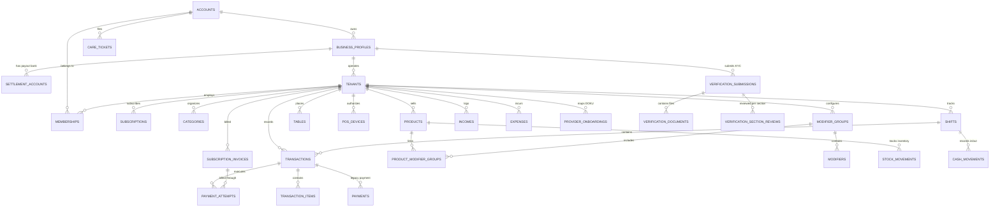
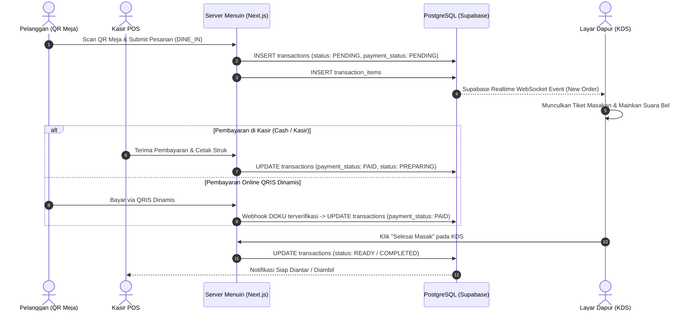

# Dokumentasi Sistem dan Arsitektur Database Menuin

> **Status:** Production Source of Truth  
> **Revisi Terakhir:** 27 Oktober 2026  
> **Dialek Database:** PostgreSQL 15+ (Supabase Managed / Self-Hosted PostgreSQL)  
> **ORM & Schema Engine:** Drizzle ORM (`drizzle-orm`, `drizzle-kit`)  
> **Payment Gateway Engine:** DOKU (Platform + Sub-Account Model, SNAP QRIS Dinamis, DOKU Checkout) & Midtrans  

---

## Daftar Isi
1. [Ikhtisar Platform Menuin](#1-ikhtisar-platform-menuin)
2. [Topologi Arsitektur Monorepo](#2-topologi-arsitektur-monorepo)
3. [Arsitektur Database & Model Data (41 Tabel)](#3-arsitektur-database--model-data-41-tabel)
   - [3.1 Konvensi & Custom Enum](#31-konvensi--custom-enum)
   - [3.2 Entity Relationship Diagram (ERD)](#32-entity-relationship-diagram-erd)
   - [3.3 Pembagian Domain 41 Tabel Database](#33-pembagian-domain-41-tabel-database)
4. [Alur Bisnis Utama (Core Lifecycles)](#4-alur-bisnis-utama-core-lifecycles)
   - [4.1 Hirarki Multi-Bisnis & Multi-Outlet (1:N:M)](#41-hirarki-multi-bisnis--multi-outlet-1nm)
   - [4.2 Verifikasi Usaha (KYC) & Provisioning Sub-Account DOKU](#42-verifikasi-usaha-kyc--provisioning-sub-account-doku)
   - [4.3 Order Lifecycle & Sinkronisasi Dapur (KDS Realtime)](#43-order-lifecycle--sinkronisasi-dapur-kds-realtime)
   - [4.4 POS Kasir, Shift, & Rekonsiliasi Laci Kas (Cash Drawer)](#44-pos-kasir-shift--rekonsiliasi-laci-kas-cash-drawer)
   - [4.5 Payment Gateway Omnichannel (SNAP QRIS, Checkout, Webhook Idempotency)](#45-payment-gateway-omnichannel-snap-qris-checkout-webhook-idempotency)
   - [4.6 Akuntansi Restoran (Incomes, Expenses, Budgets, Daily Sales)](#46-akuntansi-restoran-incomes-expenses-budgets-daily-sales)
   - [4.7 Billing Langganan SaaS (Subscription Tiers)](#47-billing-langganan-saas-subscription-tiers)
5. [Keamanan, RLS, & Supabase Realtime](#5-keamanan-rls--supabase-realtime)
6. [Panduan Operasional & Sinkronisasi Schema](#6-panduan-operasional--sinkronisasi-schema)

---

## 1. Ikhtisar Platform Menuin

**Menuin** adalah platform *Point-of-Sale* (POS) dan *Dining Experience Engine* multi-tenant berbasis cloud yang dirancang untuk industri F&B di Indonesia. Menuin menyatukan operasional restoran offline dengan kemudahan teknologi digital modern.

### Pilar Layanan Menuin:
1. **Storefront QR Dinamis (Pelanggan):** Halaman pemesanan web responsif yang diakses pengunjung via QR Code meja tanpa perlu install aplikasi. Mendukung pemesanan Dine-in (Meja), Take-Away, dan Delivery.
2. **Web & Mobile POS (Kasir / Staf):** Aplikasi kasir berbasis Web (Next.js) dan Mobile (React Native / Expo) untuk pencatatan pesanan cepat, split bill, diskon, cetak struk thermal via Bluetooth/ESC-POS, dan manajemen shift.
3. **Kitchen Display System (KDS) & Screen Dapur:** Tampilan antrean pesanan real-time untuk tim dapur/bar, terintegrasi via WebSocket Supabase Realtime.
4. **Business KYC & Settlement (Merchant Legal):** Hirarki manajemen entitas bisnis legal (PT, CV, Perorangan), rekening pencairan dana (settlement bank), dan verifikasi kepatuhan DOKU Sub-Account.
5. **Omnichannel Payment Processing:** Dukungan pembayaran Tunai, QRIS Dinamis Standar SNAP (Bank Indonesia), DOKU Checkout (Virtual Account, Kartu Kredit, E-Wallet), dan Midtrans.
6. **Financial Management & Analytics:** Pembukuan kas masuk non-penjualan, pengeluaran operasional, pembatasan anggaran per kategori, serta ringkasan penjualan harian teragregasi.

---

## 2. Topologi Arsitektur Monorepo

Menuin dibangun menggunakan arsitektur monorepo berbasis NPM Workspaces / Turborepo:

```
menuin/
├── apps/
│   ├── web/                    # Next.js 15 (App Router), React 19, Server Actions, Drizzle ORM
│   └── mobile/                 # Expo / React Native POS kasir Android & iOS
├── packages/
│   ├── types/                  # Shared TypeScript interfaces & DTOs
│   ├── permissions/            # RBAC Role Definitions (OWNER, CASHIER, SUPERADMIN, dll.)
│   ├── validation/             # Zod validation schemas bersama
│   └── utils/                  # Format mata uang (Rupiah), kalkulasi pajak, dll.
├── schema.sql                  # Source of truth schema DDL PostgreSQL (Idempotent)
├── production-schema.sql       # Schema identik untuk lingkungan deployment produksi
└── docs/                       # Dokumentasi arsitektur dan spesifikasi teknis
```

### Stack Teknologi Inti:
- **Frontend & Fullstack Web:** Next.js 15.3+, React 19, Tailwind CSS, HeroUI, Radix UI Primitives, Framer Motion, GSAP.
- **State & Data Fetching:** Zustand (client state POS / Cart), TanStack React Query.
- **Database & Query Layer:** PostgreSQL 15+ (Supabase Hosted), Drizzle ORM (`drizzle-orm`, `drizzle-kit`), `postgres` driver (direct connection pool).
- **Realtime Layer:** Supabase Realtime WebSockets (`supabase_realtime` publication).
- **Payment Integration:** DOKU (Checkout API + SNAP QRIS Dinamis) & Midtrans.

---

## 3. Arsitektur Database & Model Data (41 Tabel)

Database Menuin terdiri dari **41 tabel relasional** dalam schema `public` yang terkelola secara utuh, bersih, dan berintegritas tinggi dengan *foreign key constraints*, *composite unique indexes*, *check constraints*, dan *row level security*.

### 3.1 Konvensi & Custom Enum

#### A. Konvensi Kunci & Tipe Data:
- **Primary Key:** Selalu bertipe `UUID` dengan default `gen_random_uuid()` (standar PostgreSQL modern non-blocking).
- **Waktu & Audit:** Kolom waktu selalu menggunakan `TIMESTAMPTZ` (`timestamp with time zone`) dengan default `now()`.
- **Nilai Finansial:** Menggunakan `NUMERIC(12, 2)` atau `INTEGER` (dalam satuan Rupiah penuh untuk payment gateway).
- **Isolasi Multi-Tenant:** Kolom `tenant_id UUID` disertakan pada seluruh entitas operasional dengan `ON DELETE CASCADE`.

#### B. PostgreSQL Custom ENUMs:
```sql
-- Status tier langganan tenant
CREATE TYPE subscription_tier AS ENUM ('FREE', 'BASIC', 'PRO');

-- Status siklus billing langganan
CREATE TYPE subscription_status AS ENUM ('TRIALING', 'ACTIVE', 'PAST_DUE', 'CANCELED', 'EXPIRED');

-- Hak akses role pengguna (Tenant RBAC & Platform Roles)
CREATE TYPE tenant_role AS ENUM (
  'OWNER', 'MANAGER', 'CASHIER', 'STAFF', 
  'SYSTEM_ADMIN', 'VERIFICATION_ADMIN', 'SUPERADMIN'
);

-- Status undangan staf ke outlet
CREATE TYPE invitation_status AS ENUM ('PENDING', 'ACCEPTED', 'EXPIRED', 'REVOKED');
```

---

### 3.2 Entity Relationship Diagram (ERD)

Berikut adalah diagram relasi entitas inti Menuin:



---

### 3.3 Pembagian Domain 41 Tabel Database

Database Menuin terbagi ke dalam **11 Domain Logis**:

| No | Domain Logis | Jumlah Tabel | Tabel-tabel yang Tercakup |
|---|---|---|---|
| 1 | **Core Identity & Auth** | 1 | `accounts` |
| 2 | **Business KYC & Multi-Business** | 2 | `business_profiles`, `settlement_accounts` |
| 3 | **Outlets & Tenancy Management** | 3 | `tenants`, `subscriptions`, `subscription_invoices` |
| 4 | **Team Access & RBAC** | 2 | `memberships`, `invitations` |
| 5 | **Catalog & Inventory** | 6 | `categories`, `products`, `modifier_groups`, `modifiers`, `product_modifier_groups`, `stock_movements` |
| 6 | **POS Hardware & Cashier Infrastructure** | 5 | `pos_devices`, `pos_sessions`, `device_pairing_codes`, `shifts`, `cash_movements` |
| 7 | **Dining Experience & Storefront** | 4 | `tables`, `operating_hours`, `promotions`, `testimonials` |
| 8 | **Order Management System (OMS)** | 2 | `transactions`, `transaction_items` |
| 9 | **Omnichannel Payments (DOKU & Midtrans)** | 4 | `payments`, `payment_attempts`, `payment_webhook_events`, `provider_onboardings` |
| 10 | **Resto Finance & Accounting** | 4 | `incomes`, `expenses`, `category_budgets`, `daily_sales_summaries` |
| 11 | **Compliance, Support & Audit** | 8 | `verification_submissions`, `verification_documents`, `verification_section_reviews`, `verification_drafts`, `verification_audit_logs`, `care_tickets`, `rate_limits`, `audit_logs` |
| **Total** | | **41** | **Tabel Terverifikasi 100% di Live Database** |

---

#### Rincian Fungsi Setiap Tabel:

##### 1. Core Identity & Auth
- **`accounts` (7 kolom):** Profil identitas global pengguna Menuin. Terhubung secara relasional `1:1` ke Supabase Auth (`auth.users.id`). Menyimpan email, nama lengkap, dan `system_role` (`USER`, `SUPERADMIN`, `VERIFICATION_ADMIN`).

##### 2. Business KYC & Multi-Business Hierarchy
- **`business_profiles` (26 kolom):** Entitas bisnis legal (PT, CV, Yayasan, Koperasi, atau Perorangan) yang memayungi satu atau beberapa outlet restoran. Menyimpan Nomor Induk Berusaha (NIB), NPWP Badan, data penanggung jawab (KTP/NIK), dan status verifikasi usaha.
- **`settlement_accounts` (15 kolom):** Rekening bank pencairan dana (payout / disbursement). Mendukung verifikasi nama pemegang rekening via API inquiry dan verifikasi manual buku tabungan/rekening koran.

##### 3. Outlets & Tenancy Management
- **`tenants` (76 kolom):** Entitas sentral outlet restoran. Menyimpan nama outlet, `outlet_key` unik, slug URL storefront, konfigurasi dine-in/takeaway/delivery, tarif pajak (PB1) & service charge, komisi ojek online (GoFood, GrabFood, ShopeeFood), custom branding struk kasir, konfigurasi cetak tiket dapur, serta credential DOKU sub-account & QRIS.
- **`subscriptions` (8 kolom):** Data status paket SaaS tenant (`FREE`, `BASIC`, `PRO`), tanggal mulai/berakhir, dan siklus tagihan.
- **`subscription_invoices` (14 kolom):** Tagihan pembayaran resmi paket langganan Menuin berbasis invoice untuk aktivasi tier Pro/Basic via DOKU Checkout.

##### 4. Team Access & RBAC
- **`memberships` (9 kolom):** Hubungan many-to-many antara akun pengguna (`accounts`) dengan outlet (`tenants`), mendefinisikan role pengguna di outlet tersebut (`OWNER`, `MANAGER`, `CASHIER`, `STAFF`) serta PIN login kasir.
- **`invitations` (10 kolom):** Token dan email undangan rekrutmen staf outlet dengan tanggal kedaluwarsa dan status.

##### 5. Catalog & Inventory System
- **`categories` (8 kolom):** Kategori produk (makanan, minuman, cemilan, dll.) dengan urutan tampil (*sort order*) dan status aktif.
- **`products` (20 kolom):** Menu makanan/minuman dengan harga pokok/jual, gambar, deskripsi, SKU/barcode, pelacakan stok (*track_stock*), dan penanda koki dapur.
- **`modifier_groups` (8 kolom):** Kelompok opsi pelengkap (contoh: Level Pedas, Topping Ekstra, Pilihan Saus) beserta aturan `min_selections` dan `max_selections`.
- **`modifiers` (8 kolom):** Opsi satuan dalam kelompok modifier beserta harga tambahan dan status ketersediaan (*is_available*).
- **`product_modifier_groups` (4 kolom):** Tabel perantara (*junction*) yang menghubungkan produk dengan kelompok modifier yang berlaku padanya.
- **`stock_movements` (11 kolom):** Kartu stok otomatis (*inventory ledger*) yang mencatat mutasi penambahan/pengurangan stok beserta alasan dan aktor yang melakukan.

##### 6. POS Hardware & Cashier Infrastructure
- **`pos_devices` (7 kolom):** Data perangkat fisik tablet/smartphone kasir yang terverifikasi di outlet.
- **`pos_sessions` (7 kolom):** Sesi login aktif perangkat kasir untuk keamanan akses.
- **`device_pairing_codes` (6 kolom):** Kode OTP 6 digit berbatas waktu untuk menghubungkan aplikasi kasir mobile ke outlet.
- **`shifts` (13 kolom):** Periode kerja kasir yang mencatat modal awal kas laci (*starting_cash*), penerimaan uang tunai, uang aktual saat penutupan (*actual_cash*), uang ekspektasi (*expected_cash*), dan selisih kas (*cash_difference*).
- **`cash_movements` (7 kolom):** Mutasi uang tunai manual selama shift berjalan (Kas Masuk / Kas Keluar beserta keterangannya).

##### 7. Dining Experience & Storefront
- **`tables` (6 kolom):** Meja makan restoran dengan nama/nomor meja dan URL QR Code siap cetak.
- **`operating_hours` (6 kolom):** Jadwal hari dan jam operasional buka/tutup restoran (Senin - Minggu).
- **`promotions` (16 kolom):** Master kupon promo, diskon persentase/nominal, kuota penggunaan, dan tanggal berlaku.
- **`testimonials` (8 kolom):** Ulasan testimoni merchant untuk display marketing website.

##### 8. Order Management System (OMS)
- **`transactions` (33 kolom):** Buku besar transaksi pemesanan (POS, QR Storefront, Web Order). Menyimpan total belanja, diskon, pajak PB1, service charge, grand total, status pesanan (`PENDING`, `PREPARING`, `READY`, `COMPLETED`, `CANCELLED`), status pembayaran (`PENDING`, `PAID`, `FAILED`), data pelanggan, nomor antrean, alasan void, dan token publik.
- **`transaction_items` (11 kolom):** Baris item menu yang dibeli, harga snapshot saat transaksi, snapshot pilihan modifier dalam format JSONB, catatan khusus masakan, dan status penyelesaian koki dapur.

##### 9. Omnichannel Payments (DOKU & Midtrans)
- **`payments` (9 kolom):** Tabel log pembayaran audit Midtrans (legacy support).
- **`payment_attempts` (38 kolom):** Jantung orkestrasi pembayaran digital DOKU. Menyimpan nomor invoice unik, channel bayar (QRIS, VA, E-Wallet, Kartu Kredit), status attempt, URL payment checkout, QR string SNAP, data MDR/fee, referensi refund, dan penanda review fraud.
- **`payment_webhook_events` (11 kolom):** Log penyimpanan event webhook DOKU untuk memastikan prinsip idempotensi (mencegah pemrosesan ganda / double-spend).
- **`provider_onboardings` (13 kolom):** Mapping status integrasi sub-account merchant di payment gateway (DOKU SAC-ID).

##### 10. Resto Finance & Accounting
- **`incomes` (11 kolom):** Pencatatan pemasukan di luar penjualan makanan (contoh: penjualan kardus bekas, sewa tempat, sponsorship).
- **`expenses` (11 kolom):** Pencatatan beban pengeluaran operasional outlet (gaji staf, sewa ruko, utilitas listrik/air, pembelian bahan baku).
- **`category_budgets` (8 kolom):** Pengaturan plafon/anggaran biaya bulanan per kategori biaya untuk mengontrol kebocoran anggaran restoran.
- **`daily_sales_summaries` (17 kolom):** Tabel ringkasan agregasi penjualan per hari (total omzet, transaksi tunai vs nontunai, total diskon, HPP, laba kotor) guna mempercepat render laporan performa tanpa query agregasi berat.

##### 11. Compliance, Support & Audit
- **`verification_submissions` (21 kolom):** Berkas pengajuan verifikasi bisnis dan outlet ke tim kepatuhan (*compliance*) Menuin.
- **`verification_documents` (14 kolom):** Metadata file dokumen yang diunggah merchant (foto KTP, NPWP, NIB, buku tabungan, tampak depan toko).
- **`verification_section_reviews` (9 kolom):** Hasil review tim admin per seksi formulir verifikasi (Approved, Changes Requested, Flagged Fields).
- **`verification_drafts` (7 kolom):** Penyimpanan draf formulir pendaftaran verifikasi bertahap (*multi-step wizard*).
- **`verification_audit_logs` (13 kolom):** Jejak audit setiap perubahan status verifikasi oleh admin / reviewer.
- **`care_tickets` (13 kolom):** Sistem tiket bantuan (*support ticketing*) bagi merchant yang mengalami kendala operasional atau verifikasi.
- **`rate_limits` (7 kolom):** Proteksi keamanan sistem terhadap request abuse dan serangan brute-force berbasis IP address.
- **`audit_logs` (9 kolom):** Log riwayat tindakan krusial pengguna di outlet (perubahan harga, pembatalan/void pesanan, penutupan shift).

---

## 4. Alur Bisnis Utama (Core Lifecycles)

### 4.1 Hirarki Multi-Bisnis & Multi-Outlet (1:N:M)
Menuin menerapkan arsitektur hirarki bisnis multi-level yang fleksibel:

```
[Akun Pengguna (accounts)]
       │
       ▼
[Profil Bisnis Legal (business_profiles)]  ── (PT / CV / Perorangan)
       │
       ├──► [Rekening Pencairan (settlement_accounts)]  ── (Bank BCA, Mandiri, dll.)
       │
       └──► [Outlet Cabang Restoran 1 (tenants)]  ──► POS, Kasir, Meja QR
       └──► [Outlet Cabang Restoran 2 (tenants)]  ──► POS, Kasir, Meja QR
```

1. Satu pengguna (`accounts`) dapat mendirikan satu atau lebih profil bisnis berbadan hukum (`business_profiles`).
2. Setiap profil bisnis mendaftarkan satu atau lebih rekening bank pencairan (`settlement_accounts`).
3. Profil bisnis dapat membuka beberapa outlet cabang (`tenants`). Tiap outlet memiliki menu, kasir, meja, dan operasional mandiri, tetapi dana settlement penjualan online-nya bermuara ke rekening settlement yang ditunjuk.

---

### 4.2 Verifikasi Usaha (KYC) & Provisioning Sub-Account DOKU

Untuk memenuhi regulasi Bank Indonesia dan mengaktifkan pembayaran online/QRIS otomatis bagi merchant:

1. **Pengisian Formulir:** Pemilik outlet mengisi profil bisnis legal, data penanggung jawab, mengunggah dokumen KTP & NPWP, serta bukti rekening bank via `verification_drafts`.
2. **Pengajuan (Submission):** Data disubmit dan dicatat pada `verification_submissions` dan `verification_documents`. Status berubah menjadi `under_review`.
3. **Verifikasi Admin:** Tim verifikator (`VERIFICATION_ADMIN`) memeriksa kelengkapan melalui seksi review `verification_section_reviews`. Jika ada data buram/salah, admin memberikan catatan revisi (`action_required`).
4. **Provisioning Sub-Account:** Setelah status `verified`, sistem memicu proses provisioning DOKU Sub-Account (`provider_onboardings`). Merchant memperoleh ID Sub-Account DOKU (`doku_sub_account_id`).
5. **Aktivasi Pembayaran:** Kolom `online_payment_enabled` pada tabel `tenants` aktif, memungkinkan outlet menerima pembayaran QRIS dan e-wallet secara instan.

---

### 4.3 Order Lifecycle & Sinkronisasi Dapur (KDS Realtime)

Menuin memisahkan pesanan dari kasir fisik dan QR pelanggan:



---

### 4.4 POS Kasir, Shift, & Rekonsiliasi Laci Kas (Cash Drawer)

Menuin menerapkan kontrol keuangan kasir yang ketat untuk mencegah selisih uang kas laci:

1. **Buka Shift (`shifts`):** Kasir login, memilih perangkat (`pos_devices`), dan memasukkan modal awal kas laci (`starting_cash`). Status shift menjadi `ACTIVE`.
2. **Operasional Shift:** 
   - Transaksi tunai otomatis tercatat ke dalam transaksi shift berjalan.
   - Pemasukan/pengeluaran dadakan (misal: beli es batu, bayar kurir) dicatat via `cash_movements` bertipe `IN` atau `OUT`.
3. **Tutup Shift (End Shift):**
   - Kasir menghitung uang fisik di laci dan menginput nilai `actual_cash`.
   - Sistem otomatis menghitung `expected_cash` dengan formula:
     $$\text{Expected Cash} = \text{Starting Cash} + \sum \text{Transaksi Tunai} + \sum \text{Cash IN} - \sum \text{Cash OUT}$$
   - Selisih kas (`cash_difference = actual_cash - expected_cash`) disimpan permanen ke database untuk audit audit manager/owner.
   - Shift selesai (`status = 'ENDED'`) dan struk ringkasan shift (*Shift Report*) dicetak.

---

### 4.5 Payment Gateway Omnichannel (SNAP QRIS, Checkout, Webhook Idempotency)

Integrasi DOKU di Menuin menggunakan dua mekanisme modern:
1. **DOKU Checkout (Hosted):** Untuk pemesanan online jarak jauh dan invoice langganan Menuin SaaS.
2. **SNAP QRIS Dinamis:** Menghasilkan kode QRIS spesifik pesanan di layar POS Kasir maupun di smartphone pelanggan yang langsung terverifikasi seketika begitu dibayar.

#### Alur Webhook Idempotent:
```
[DOKU Notification Server]
       │  (HTTP POST /api/webhook/doku + Header Signature HMAC-SHA256)
       ▼
[Menuin Webhook Handler]
       │
       ├──► 1. Cek Signature: Apakah Signature Valid? (Jika tidak: Reject 401)
       │
       ├──► 2. Idempotency Gate (payment_webhook_events):
       │       Apakah (provider, request_id) sudah pernah diproses?
       │       - Jika YA: Return HTTP 200 OK langsung (No-op, cegah double processing).
       │       - Jika BELUM: Simpan raw event & lanjutkan.
       │
       ├──► 3. Cocokkan payment_attempts lewat invoice_number unik.
       │
       ├──► 4. Eksekusi Pembayaran:
       │       - Jika Purpose = 'ORDER': Update transactions -> PAID & broadcast Realtime.
       │       - Jika Purpose = 'SUBSCRIPTION': Update subscription_invoices -> PAID & naikkan tier tenant.
       │
       └──► 5. Catat result = 'SUCCESS' di payment_webhook_events & response 200 OK.
```

---

### 4.6 Akuntansi Restoran (Incomes, Expenses, Budgets, Daily Sales)

Menuin dilengkapi mini-ERP keuangan untuk pengusaha resto:

- **Pencatatan Biaya (`expenses`):** Biaya sewa, gaji, bahan baku dicatat beserta bukti foto kuitansi (`receipt_url`).
- **Plafon Anggaran (`category_budgets`):** Owner menetapkan anggaran per kategori biaya (misal: Anggaran Bahan Baku Rp 10.000.000 / bulan). Sistem menampilkan peringatan jika pengeluaran mendekati 100%.
- **Aggregated Sales Summaries (`daily_sales_summaries`):** Setiap hari, cron server menghitung total penjualan, total modal dasar (HPP), dan total laba kotor, lalu menyimpannya dalam tabel agregasi. Dashboard laporan bulanan membaca data ini secara instan ($O(1)$) tanpa perlu melakukan *full table scan* terhadap ratusan ribu baris `transactions`.

---

### 4.7 Billing Langganan SaaS (Subscription Tiers)

Menuin dimonetisasi melalui model langganan bulanan / tahunan per outlet:
- **Tier FREE:** Maksimal 50 produk, 1 perangkat kasir, tanpa integrasi KDS.
- **Tier BASIC:** Unlimited produk, 3 perangkat kasir, KDS dapur, laporan penjualan dasar.
- **Tier PRO:** Fitur penuh, unlimited perangkat kasir, SNAP QRIS Dinamis, split settlement sub-account, dan ekspor akuntansi lengkap.

Tagihan langganan dibuat dalam bentuk `subscription_invoices` yang dibayar pemilik outlet via DOKU Checkout. Begitu pembayaran terkonfirmasi, `tenants.subscription_tier` otomatis ter-upgrade.

---

## 5. Keamanan, RLS, & Supabase Realtime

### 5.1 Row Level Security (RLS) & Isolasi Server
Secara default pada arsitektur server Next.js App Router yang menggunakan direct connection pooling:
- Akses database dilakukan melalui **Server Actions** dan backend API menggunakan kredensial `DATABASE_URL` yang terproteksi (tidak terekspos ke browser client).
- Tabel sensitif seperti `payment_attempts`, `payment_webhook_events`, dan `subscription_invoices` memiliki **RLS Enabled tanpa public policy**, sehingga tertutup sepenuhnya dari akses client SDK Supabase anonim.
- Tabel `transactions` memiliki policy SELECT khusus:
  ```sql
  CREATE POLICY "Enable real-time read for everyone" 
  ON transactions FOR SELECT TO public USING (true);
  ```
  Kebijakan ini memungkinkan pelanggan dan layar KDS dapur membaca pembaruan status pesanan mereka secara real-time via Supabase Realtime WebSocket client.

### 5.2 Supabase Realtime Publication
Tabel berikut didaftarkan ke publikasi real-time Supabase:
```sql
ALTER PUBLICATION supabase_realtime ADD TABLE transactions;
ALTER PUBLICATION supabase_realtime ADD TABLE shifts;
```
Ketika kasir memperbarui status pesanan atau koki menyelesaikan masakan, event perubahan data langsung disiarkan ke seluruh client yang berlangganan channel tersebut tanpa *polling*.

---

## 6. Panduan Operasional & Sinkronisasi Schema

### 6.1 Status Sinkronisasi Skema
- File [schema.sql](file:///home/zidaneelfasya/D/Github/menuin/schema.sql) dan [production-schema.sql](file:///home/zidaneelfasya/D/Github/menuin/production-schema.sql) telah diverifikasi dan disinkronkan **100% identik** dengan katalog database PostgreSQL aktif (mencakup seluruh 41 tabel, kolom, custom enums, foreign keys, unique index, check constraints, dan RLS policies).
- File model Drizzle ORM di [apps/web/src/lib/db/schema.ts](file:///home/zidaneelfasya/D/Github/menuin/apps/web/src/lib/db/schema.ts) telah dilengkapi dengan seluruh 41 tabel (termasuk `stockMovements` dan `careTickets`).

### 6.2 Perintah Sinkronisasi Database
Menuin menyediakan mekanisme migrasi database yang aman dan aditif tanpa merusak data yang sudah ada:

```bash
# 1. Masuk ke workspace web
cd apps/web

# 2. Periksa rencana perubahan schema secara aditif (Dry Run - Tanpa Mengubah Database)
npm run db:sync

# 3. Terapkan perubahan aditif baru ke database (jika ada penambahan kolom/tabel baru)
npm run db:sync -- --apply

# 4. Generate snapshot migrasi Drizzle baru jika diperlukan
npm run db:generate
```

### 6.3 Menjalankan Proyek Secara Lokal
```bash
# Jalankan seluruh service (Next.js web & POS)
npm run dev

# Jalankan unit & integration tests
npm test --workspace=web
```

---
*Dokumentasi ini adalah representasi resmi arsitektur teknis Menuin. Setiap perubahan skema database wajib melalui proses review, penulisan migrasi aditif, dan pengujian idempotensi.*
