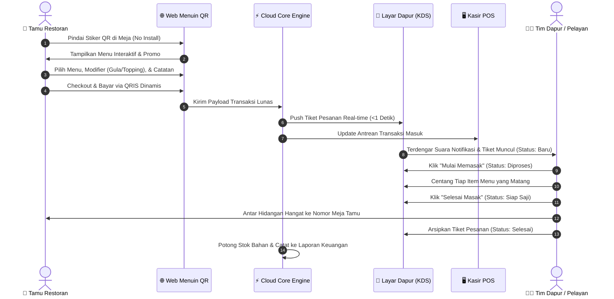
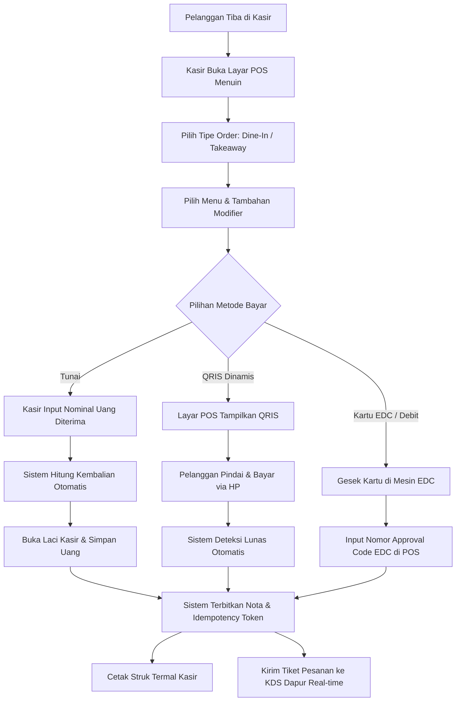
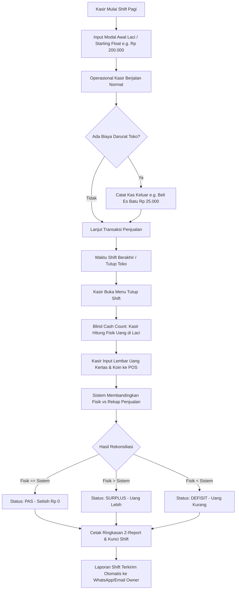
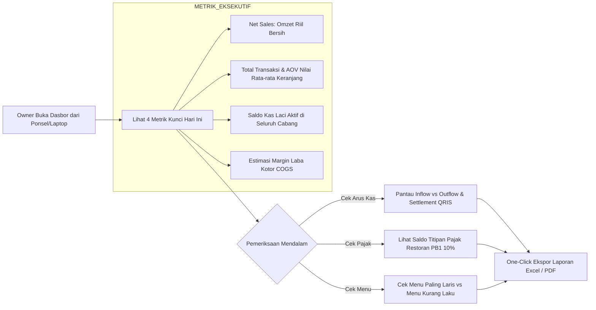

# 📘 MENUIN — Product Overview, Essential Features, & Operational Workflows
> **Klasifikasi:** Dokumentasi Resmi Produk, Filosofi Esensial, Analisis Kompetitif, dan Alur Operasional End-to-End  
> **Target Audiens:** Pemilik Bisnis F&B (Owner), Manajer Outlet, Tim Kasir & Dapur, Investor, dan Tim Pengembang  
> **Versi:** 2.4.0 (Production Blueprint)  
> **Status:** Active / Source of Truth  

---

## 📑 Daftar Isi
1. [Hakikat & Filosofi Produk Menuin](#1-hakikat--filosofi-produk-menuin)
   - [1.1 Jebakan "Feature Bloat" pada Kompetitor F&B](#11-jebakan-feature-bloat-pada-kompetitor-fb)
   - [1.2 Pendekatan Menuin: Essential-First, High Data-Ink, & Zero Latency](#12-pendekatan-menuin-essential-first-high-data-ink--zero-latency)
2. [Analisis Keunggulan & Matriks Komparatif Kompetitor](#2-analisis-keunggulan--matriks-komparatif-kompetitor)
   - [2.1 Tabel Perbandingan Menuin vs Kompetitor Utama](#21-tabel-perbandingan-menuin-vs-kompetitor-utama)
   - [2.2 Perbandingan Biaya & Total Cost of Ownership (TCO)](#22-perbandingan-biaya--total-cost-of-ownership-tco)
   - [2.3 Kurva Pembelajaran & Kecepatan Training Staf](#23-kurva-pembelajaran--kecepatan-training-staf)
3. [Daftar Fitur Esensial Menuin](#3-daftar-fitur-esensial-menuin)
   - [3.1 Smart QR Table Ordering (Self-Order Mandiri Tanpa Aplikasi)](#31-smart-qr-table-ordering-self-order-mandiri-tanpa-aplikasi)
   - [3.2 High-Speed Cloud POS Register (<150ms Transaksi)](#32-high-speed-cloud-pos-register-150ms-transaksi)
   - [3.3 Real-Time Kitchen Display System (KDS) & Order Kanban](#33-real-time-kitchen-display-system-kds--order-kanban)
   - [3.4 Audit Kas Shift & Rekonsiliasi Laci Kasir (Anti-Kebocoran Kas)](#34-audit-kas-shift--rekonsiliasi-laci-kasir-anti-kebocoran-kas)
   - [3.5 Laporan Keuangan, Arus Kas (Cash Flow), & Pajak PBJT yang Jujur](#35-laporan-keuangan-arus-kas-cash-flow--pajak-pbjt-yang-jujur)
   - [3.6 Manajemen Multi-Outlet, Katalog Menu, & Kontrol Stok Esensial](#36-manajemen-multi-outlet-katalog-menu--kontrol-stok-esensial)
4. [Alur Operasional Lengkap (End-to-End Workflows)](#4-alur-operasional-lengkap-end-to-end-workflows)
   - [4.1 Alur 1: Customer Self-Order QR Meja hingga Hidangan Selesai](#41-alur-1-customer-self-order-qr-meja-hingga-hidangan-selesai)
   - [4.2 Alur 2: Pemesanan Langsung di Kasir (POS Walk-In & Takeaway)](#42-alur-2-pemesanan-langsung-di-kasir-pos-walk-in--takeaway)
   - [4.3 Alur 3: Rekonsiliasi Kas & Tutup Shift Kasir (Shift Cash Audit)](#43-alur-3-rekonsiliasi-kas--tutup-shift-kasir-shift-cash-audit)
   - [4.4 Alur 4: Monitoring Keuangan & Arus Kas Eksekutif oleh Owner](#44-alur-4-monitoring-keuangan--arus-kas-eksekutif-oleh-owner)
5. [Pondasi Keandalan Teknis & Integritas Finansial](#5-pondasi-keandalan-teknis--integritas-finansial)
6. [Kesimpulan: Mengapa Menuin Adalah Solusi Paling Masuk Akal](#6-kesimpulan-mengapa-menuin-adalah-solusi-paling-masuk-akal)

---

## 1. Hakikat & Filosofi Produk Menuin

**Menuin** (ditulis dengan wordmark berakhiran titik: `menuin.`) adalah **Unified F&B Operating System** modern yang mengintegrasikan pemesanan mandiri oleh pelanggan (Self-Order QR), kasir kasir POS cloud berkecepatan tinggi, sistem layar dapur digital (Kitchen Display System), serta pembukuan arus kas dan rekonsiliasi shift yang ketat ke dalam satu aliran data terpadu.

### 1.1 Jebakan "Feature Bloat" pada Kompetitor F&B
Mayoritas sistem POS F&B di pasar Indonesia (seperti Moka POS, Majoo, ESB, Pawoon, Olsera) terjebak dalam perlombaan menambah sebanyak mungkin fitur (seperti akuntansi jurnal ganda palsu, modul CRM rumit, absensi wajah, marketplace bahan baku, hingga program loyalitas bertingkat). 

Di atas kertas atau brosur pemasaran, fitur yang sangat lengkap terlihat mengesankan. Namun di lapangan operasional jam sibuk (*lunch rush* dan *dinner rush*), hal tersebut menghasilkan **bencana operasional nyata**:
1. **Antarmuka Menjadi Lambat & Rumit:** Layar kasir dipenuhi ratusan tombol, tab bersarang, dan pop-up konfirmasi yang memperlambat kasir mencatat satu pesanan sederhana.
2. **Waktu Pelatihan Karyawan Sangat Lama:** Tingkat pergantian staf (*turnover*) kasir dan pelayan di industri F&B sangat tinggi. Sistem yang rumit membutuhkan training 3–7 hari setiap kali ada staf baru.
3. **Layar Macet (*Freeze*) di Jam Sibuk:** Sistem yang memuat modul-modul berat sering mengalami kelambatan respon saat koneksi internet restoran melambat.
4. **Metrik Keuangan yang Menyesatkan:** Banyak POS mencampuradukkan omzet kotor (*Gross Sales*) dengan uang titipan pajak daerah (PB1/PBJT 10%) dan *service charge*, sehingga pemilik restoran mengira bisnisnya untung besar padahal mengalami krisis arus kas (*cash flow insolvency*).
5. **Harga Langganan Selangit & Biaya Siluman:** Pengusaha dibebani biaya lisensi tahunan jutaan rupiah per outlet, biaya aktivasi awal (*setup fee*), potongan komisi transaksi menu, dan keharusan membeli perangkat keras (*hardware proprietary*) yang mahal.

### 1.2 Pendekatan Menuin: Essential-First, High Data-Ink, & Zero Latency
Menuin menolak paradigma *bloatware*. Menuin dibangun dengan filosofi:
> **"Hanya sediakan apa yang benar-benar membuat restoran berjalan lebih cepat, uang kas tercatat rapi tanpa bocor, dan tamu puas tanpa menunggu."**

* **Essential-First (Fitur Tepat Guna):** Menuin hanya memuat modul operasional yang esensial: QR Self-Order, Kasir POS Kilat, Layar Dapur Digital, Rekonsiliasi Kas Shift, dan Laporan Arus Kas. Setiap fitur dipoles hingga mencapai tingkat kecepatan dan ketahanan tertinggi.
* **Kecepatan Sub-300ms SLA:** Transaksi kasir dapat diselesaikan dalam <150ms dengan jumlah klik minimal.
* **High Data-Ink Ratio:** Mengutamakan penyajian data riil yang bersih tanpa ornamen grafis atau tombol dekoratif yang membingungkan mata.
* **Harga yang Adil & Rasional:** Tanpa biaya setup, tanpa kontrak tahunan yang mengikat, dan dapat berjalan di perangkat apa pun yang sudah dimiliki restoran (HP, tablet Android, iPad, laptop).

---

## 2. Analisis Keunggulan & Matriks Komparatif Kompetitor

### 2.1 Tabel Perbandingan Menuin vs Kompetitor Utama

| Dimensi Perbandingan | Menuin | Moka POS | Majoo | ESB POS | Pawoon |
| :--- | :--- | :--- | :--- | :--- | :--- |
| **Model Filosofi Produk** | **Essential-First & Ultra-Speed** | General POS Multi-Industri | Super-App Kompleks (All-in-One) | Enterprise Monolitik F&B | General POS Ritel/F&B |
| **QR Meja Mandiri (Self-Order)** | **Bawaan (Zero Install, Scan & Order)** | Add-on berbayar / Pihak Ketiga | Tersedia di paket mahal | Tersedia (Sistem terpisah) | Terbatas / Pihak Ketiga |
| **Kecepatan Transaksi Jam Sibuk** | **Super Cepat (<150ms, <3 klik)** | Rata-rata (300–600ms) | Lambat karena modul berat | Kuat namun UI kompleks | Rata-rata |
| **Kitchen Display System (KDS)** | **Terintegrasi Real-time (Web/Tablet)** | Opsional / Add-on terpisah | Opsional | Terintegrasi | Terbatas printer nota |
| **Audit Laci Kasir (Shift Cash)** | **Audit Uang Fisik Ketat (Target Selisih Rp 0)** | Rekap Standar | Rekap Kasir | Rekap Enterprise | Rekap Standar |
| **Struktur Laporan Keuangan** | **Pemisahan Tegas: Net Sales, Arus Kas, & PBJT** | Gross/Net campur saldo | Cenderung pseudo-accounting | Lengkap tapi butuh training | Standar penjualan |
| **Kemudahan Penggunaan (UX)** | **Sangat Intuitif (Mahir dalam 5 menit)** | Butuh waktu adaptasi | Membingungkan bagi pemula | Butuh sertifikasi khusus | Cukup mudah |
| **Fleksibilitas Perangkat (Hardware)** | **Bebas (Tablet, Laptop, HP, iPad)** | Diutamakan iPad / Android Tab | Android Tablet | Diutamakan POS Hardware | Android Tablet |
| **Biaya Langganan Bulanan** | **Sangat Terjangkau (Flat per outlet)** | Mahal (Mulai Rp 299k+/bln) | Menengah-Tinggi (Tiered) | Sangat Mahal (Enterprise) | Menengah (Rp 200k–300k) |
| **Biaya Pemasangan / Setup Awal** | **Rp 0 (Gratis)** | Sering ada paket implementasi | Sering ada biaya setup | Jutaan rupiah | Sering ada paket bundling |

### 2.2 Perbandingan Biaya & Total Cost of Ownership (TCO)

Satu kendala terbesar pemilik F&B independen (seperti coffee shop rintisan, gerai bakery, atau kafe keluarga) adalah beban biaya modal awal (*capital expenditure*) untuk sistem kasir:

```
┌────────────────────────────────────────────────────────────────────────┐
│             ESTIMASI BIAYA TAHUN PERTAMA PER OUTLET                    │
├────────────────────────────────┬───────────────────────────────────────┤
│ Sistem POS Kompetitor Rata-rata│ Rp 8.000.000 – Rp 18.000.000          │
│ (Lisensi Tahunan + Hardware    │ • Lisensi POS: Rp 3.600.000 – 6.000.000│
│  Khusus + Add-on QR + Setup)   │ • Beli Tablet Khusus: Rp 3.500.000    │
│                                │ • Setup & Training: Rp 1.000.000+     │
├────────────────────────────────┼───────────────────────────────────────┤
│ MENUIN (Sistem Esensial)       │ Rp 2.388.000 (Hemat hingga 75%)       │
│                                │ • Langganan Flat: ~Rp 199.000/bln     │
│                                │ • Hardware: Gunakan HP/Tablet lama    │
│                                │ • Setup: Rp 0 (Mandiri 5 Menit)       │
└────────────────────────────────┴───────────────────────────────────────┘
```

Menuin memberikan **akses fitur lengkap tingkat enterprise** tanpa membebani arus kas awal bisnis F&B yang sedang bertumbuh.

### 2.3 Kurva Pembelajaran & Kecepatan Training Staf
* **Kompetitor:** Karena memiliki terlalu banyak menu bersarang (*nested menus*), kasir baru membutuhkan panduan tebal dan sering salah menekan tombol saat antrean panjang, memicu kepanikan dan komplain pelanggan.
* **Menuin:** Antarmuka POS dirancang dengan tata letak visual berbasis kategori besar, pencarian instan, dan kalkulator nominal cepat. Kasir baru dapat menguasai sistem ini dalam waktu **kurang dari 5 menit** tanpa buku panduan.

---

## 3. Daftar Fitur Esensial Menuin

Menuin mengonsentrasikan seluruh kapabilitas sistemnya ke dalam 6 pilar fitur esensial:

```
┌────────────────────────────────────────────────────────────────────────┐
│                        6 PILAR ESENSIAL MENUIN                         │
│                                                                        │
│  ┌─────────────────────────┐            ┌───────────────────────────┐  │
│  │ 1. QR Table Self-Order  │◀──────────▶│ 2. High-Speed Cloud POS   │  │
│  │  (Zero App Installation)│            │   (<150ms Instant Record) │  │
│  └────────────┬────────────┘            └─────────────┬─────────────┘  │
│               │                                       │                │
│               ▼                                       ▼                │
│  ┌─────────────────────────┐            ┌───────────────────────────┐  │
│  │ 3. Real-Time KDS Dapur  │            │ 4. Shift Cash Audit       │  │
│  │   (Layar Tiket Masak)   │            │   (Target Selisih Rp 0)   │  │
│  └────────────┬────────────┘            └─────────────┬─────────────┘  │
│               │                                       │                │
│               └───────────────────┬───────────────────┘                │
│                                   ▼                                    │
│  ┌──────────────────────────────────────────────────────────────────┐  │
│  │ 5. Laporan Keuangan, Cash Flow, & Utang Pajak PBJT Terpisah      │  │
│  └────────────────────────────────┬─────────────────────────────────┘  │
│                                   ▼                                    │
│  ┌──────────────────────────────────────────────────────────────────┐  │
│  │ 6. Manajemen Multi-Outlet, Master Katalog, & Kontrol Stok        │  │
│  └──────────────────────────────────────────────────────────────────┘  │
└────────────────────────────────────────────────────────────────────────┘
```

### 3.1 Smart QR Table Ordering (Self-Order Mandiri Tanpa Aplikasi)
Fitur pemesanan mandiri langsung dari meja makan yang dirancang untuk menghilangkan antrean kasir dan mempercepat perputaran meja (*table turnover*):
* **Zero App Installation:** Pelanggan cukup mengarahkan kamera ponsel ke stiker QR meja. Menu langsung terbuka seketika di peramban web (Safari/Chrome) tanpa meminta pelanggan mengunduh aplikasi sebesar 50MB.
* **Kustomisasi Menu Lengkap (Modifiers):** Pelanggan bebas memilih tingkat kemanisan (*sugar level*), tingkat es (*ice level*), pilihan susu (oat/almond/dairy), serta tambahan topping dengan rincian harga transparan.
* **Catatan Khusus Per Item:** Tamu dapat menambahkan catatan koki (misal: *"sambal dipisah"*, *"alergi kacang"*) yang langsung dicetak ke dapur.
* **Pembayaran Digital Langsung (QRIS Dinamis):** Pelanggan dapat langsung membayar dari meja menggunakan QRIS (Gopay, OVO, Dana, ShopeePay, BCA, dll.) dengan konfirmasi status lunas otomatis seketika.
* **Opsi Bayar di Kasir:** Pelanggan juga dapat memilih opsi memesan dari meja namun membayar tunai/kartu di kasir fisik.

### 3.2 High-Speed Cloud POS Register (<150ms Transaksi)
Mesin kasir digital berbasis cloud yang dioptimasi khusus untuk menghadapi antrean panjang di jam sibuk:
* **Input Pesanan Cepat:** Tata letak grid visual yang responsif memungkinkan pemilihan produk dan varian dalam hitungan detik.
* **Multi-Tender Payment:** Menerima pembayaran Tunai (*Cash*), Kartu Debit/Kredit (EDC), QRIS Dinamis, Transfer Bank, hingga pesanan platform ojek online (GrabFood, GoFood, ShopeeFood).
* **Kalkulasi Pajak & Biaya Otomatis:** Sistem secara otomatis menghitung Pajak Restoran (PB1 10%), *Service Charge*, dan potongan komisi ojol tanpa perlu kalkulator manual.
* **Cetak Struk Termal Universal:** Mendukung pencetakan ke berbagai merek printer kasir termal (ukuran 58mm maupun 80mm) via Bluetooth nirkabel maupun kabel LAN/WiFi.
* **Proteksi Transaksi Ganda (Idempotency Key):** Kasir yang menekan tombol bayar berulang kali saat koneksi internet tersendat dijamin **tidak akan pernah menduplikasi transaksi** atau memotong stok dua kali.

### 3.3 Real-Time Kitchen Display System (KDS) & Order Kanban
Papan pesanan digital yang menggantikan nota kertas di area dapur dan bar barista:
* **Sinkronisasi Instan (<1 Detik):** Pesanan yang dibayar via QR meja atau diinput kasir seketika muncul di layar tablet dapur tanpa delay.
* **Status Kanban Dinamis:** Tiket pesanan bergerak rapi melalui tahapan:
  $$\text{Pesanan Masuk (Pending)} \longrightarrow \text{Sedang Dimasak (Processing)} \longrightarrow \text{Siap Diantar (Ready)} \longrightarrow \text{Selesai (Completed)}$$
* **Checklist Menu Per Item:** Koki dapat mencentang setiap item menu yang sudah matang satu per satu, memastikan tidak ada pesanan yang tertinggal dalam satu meja.
* **Penanda Durasi Waktu (Timer Peringatan):** Setiap tiket pesanan menampilkan durasi menit sejak pesanan masuk. Tiket berubah warna jika pesanan melampaui batas waktu standar penyajian (misal >15 menit), memberi sinyal darurat kepada koki.
* **Bebas Kertas Basah & Hilang:** Menghapus biaya kertas thermal dapur dan mencegah risiko nota pesanan basah, sobek, atau tercecer.

### 3.4 Audit Kas Shift & Rekonsiliasi Laci Kasir (Anti-Kebocoran Kas)
Modul disiplin kasir yang dirancang untuk mencegah kebocoran uang kas restoran:
* **Pencatatan Modal Awal (Starting Bank/Float):** Kasir wajib menginput jumlah uang kembalian awal saat membuka laci kasir di awal shift.
* **Pencatatan Arus Kas Laci (Petty Cash In/Out):** Kasir mencatat setiap pengeluaran kas kecil darurat (misal: beli es batu, bayar kurir, beli bumbu darurat) lengkap dengan alasan dan nominal.
* **Metode Hitung Buta Saat Tutup Kasir (Blind Cash Count):** Saat shift berakhir, kasir menghitung fisik uang kertas dan koin di laci **tanpa diperlihatkan target angka sistem**.
* **Deteksi Selisih Kas Otomatis:** Sistem membandingkan:
  $$\text{Ekspektasi Kas} = \text{Modal Awal} + \text{Penjualan Tunai} + \text{Kas Masuk} - \text{Kas Keluar}$$
  Sistem langsung menampilkan status: **Pas (Selisih Rp 0)**, **Lebih (Surplus)**, atau **Kurang (Defisit)**.
* **PIN Otorisasi Pembatalan (Void Anti-Fraud):** Setiap pembatalan nota atau item pesanan wajib memasukkan PIN Manajer, mencegah oknum staf membatalkan transaksi yang uangnya sudah diterima.

### 3.5 Laporan Keuangan, Arus Kas (Cash Flow), & Pajak PBJT yang Jujur
Berbeda dari POS lain yang menampilkan data membingungkan, Menuin menyajikan angka akuntansi yang presisi:
* **Pemisahan Tegas Gross vs Net Sales:**
  $$\text{Net Sales (Pendapatan Operasional Riil)} = \text{Gross Sales} - \text{Diskon/Promo} - \text{Void/Refund}$$
* **Isolasi Utang Pajak Daerah (PBJT / PB1):**
  Pajak restoran 10% dikelompokkan secara terpisah sebagai **titipan utang pemerintah daerah**, BUKAN sebagai pendapatan restoran. Owner terhindar dari kaget bayar pajak di akhir bulan.
* **Laporan Arus Kas Nyata (Cash Flow Inflow vs Outflow):**
  Memisahkan antara uang yang sudah cair di tangan (kas laci + transfer bank yang sudah settlement) dengan piutang yang masih tertahan di payment gateway.
* **Estimasi HPP / COGS & Laba Kotor:**
  Menghitung estimasi laba kotor berdasarkan biaya bahan baku teoritis per menu, membantu pemilik mengetahui menu mana yang paling menyumbang profit (*Stars*) dan mana yang membebani margin (*Dogs*).
* **Ekspor Laporan Bersih (One-Click CSV/Excel/PDF):**
  Data penjualan dan rekapitulasi harian siap diekspor ke Microsoft Excel atau diimpor langsung ke software akuntansi resmi (Mekari Jurnal, Accurate Online) tanpa formatting manual yang rumit.

### 3.6 Manajemen Multi-Outlet, Katalog Menu, & Kontrol Stok Esensial
* **Manajemen Multi-Cabang Terpusat:** Pemilik dapat memantau 1 hingga puluhan cabang restoran dalam satu dasbor akun induk (*HQ Dashboard*).
* **Master Menu & Kategori:** Mengatur ketersediaan menu (buka/tutup menu yang habis) seketika dari ponsel.
* **Peringatan Stok Menipis (Low-Stock Alerts):** Memberi notifikasi dini ketika bahan baku utama mencapai batas minimum stok pengaman.
* **Hak Akses Berbasis Peran (RBAC):** Pemisahan tegas hak akses antara **Owner** (akses finansial penuh), **Manajer** (akses shift, menu, dan operasional), serta **Kasir/Staff** (hanya akses layar transaksi tanpa melihat profit/laporan toko).

---

## 4. Alur Operasional Lengkap (End-to-End Workflows)

Berikut adalah visualisasi rinci dari 4 alur operasional utama pada ekosistem Menuin:

### 4.1 Alur 1: Customer Self-Order QR Meja hingga Hidangan Selesai

Alur pemesanan mandiri oleh tamu dari meja makan tanpa intervensi pelayan:



#### Rincian Langkah Operasional:
1. **Pindai Kode QR:** Tamu duduk di meja nomor 08, membuka kamera ponsel, dan memindai kode QR. Peramban otomatis membuka katalog digital khusus meja 08.
2. **Kustomisasi & Catatan:** Tamu memilih *Es Kopi Susu Gula Aren*, memilih varian *Oat Milk (+Rp 6.000)*, *Less Sugar (50%)*, dan memberi catatan *"Jangan pakai sedotan plastik"*.
3. **Pembayaran Instan:** Tamu menekan tombol bayar, barcode QRIS muncul di layar, tamu melakukan screenshot/scan bayar dari aplikasi bank/e-wallet. Pembayaran terverifikasi lunas dalam 2 detik.
4. **Masuk ke Dapur:** Tiket digital meja 08 seketika muncul di layar KDS dapur makanan dan bar minuman secara paralel.
5. **Proses Memasak:** Barista menyiapkan kopi, koki menyiapkan makanan. Setiap hidangan yang matang dicentang di layar tablet dapur.
6. **Penyajian:** Pelayan melihat pesanan meja 08 berstatus "Siap Saji" (*Ready*), mengambil hidangan, dan mengantarkannya langsung ke meja tamu.
7. **Pencatatan Otomatis:** Setelah disajikan, koki mengetuk "Selesai". Sistem otomatis mencatat omzet bersih ke dashboard dan memotong saldo bahan baku terkait.

---

### 4.2 Alur 2: Pemesanan Langsung di Kasir (POS Walk-In & Takeaway)

Alur pemesanan konvensional saat pelanggan memesan langsung di meja kasir:



#### Rincian Langkah Operasional:
1. **Pilihan Kategori Kilat:** Kasir memilih kategori pesanan (*Dine In* atau *Bungkus/Takeaway*).
2. **Input Menu Cepat:** Kasir menekan gambar produk, memilih ukuran atau topping pada pop-up satu lapis yang responsif.
3. **Kalkulasi Kembalian Presisi:** Pada pembayaran tunai, kasir menekan tombol cepat pecahan uang (misal tombol Rp 50.000 atau Rp 100.000). Sistem seketika menampilkan nominal kembalian dengan angka besar anti-salah hitung.
4. **Pencetakan Struk Seketika:** Printer termal mencetak struk belanja untuk pelanggan, sementara data pesanan langsung mengalir ke KDS dapur tanpa kasir perlu berteriak atau mengantar nota kertas.

---

### 4.3 Alur 3: Rekonsiliasi Kas & Tutup Shift Kasir (Shift Cash Audit)

Alur disiplin uang kas laci saat pergantian shift kasir (pagi ke sore) atau tutup toko malam hari:



#### Nilai Disiplin Bisnis:
* Kasir tidak bisa memanipulasi angka karena tidak mengetahui berapa target kas yang seharusnya ada sebelum mereka selesai menghitung fisik uangnya.
* Jika ada uang selisih (misal kurang Rp 15.000), sistem langsung menandai nama kasir yang bertugas, jam shift, dan nominal selisihnya di audit log pemilik. Kebocoran kas laci berhasil ditekan hingga 0%.

---

### 4.4 Alur 4: Monitoring Keuangan & Arus Kas Eksekutif oleh Owner

Alur kontrol pemilik bisnis F&B dalam memantau kesehatan finansial seluruh cabangnya:



#### Nilai Bisnis bagi Owner:
* **Bebas Was-was:** Owner tidak perlu lagi menelepon kasir tiap malam hanya untuk bertanya: *"Hari ini dapet omzet berapa dan uang di laci ada berapa?"*. Semua data tersaji live di layar ponsel.
* **Kejelasan Arus Kas:** Owner mengetahui persis berapa uang yang sudah masuk ke rekening bank, berapa yang masih di laci kasir, dan berapa uang kas yang harus disisihkan untuk bayar pajak restoran ke Pemda.

---

## 5. Pondasi Keandalan Teknis & Integritas Finansial

Menuin dibangun di atas arsitektur komputasi modern yang mengedepankan kestabilan setingkat sistem perbankan (*Bank-Grade Architecture*):

1. **Jaminan Idempotensi Transaksi (Zero Double Charge):**
   Setiap transaksi kasir dan QR disematkan *Unique Idempotency Key* (`UUIDv4`). Apabila terjadi gangguan jaringan atau tombol ditekan berkali-kali oleh kasir yang panik, sistem database PostgreSQL menolak duplikasi dan hanya mengembalikan hasil transaksi yang valid.
2. **Kinerja P99 Sub-150ms dengan B-Tree Compound Indexing:**
   Seluruh tabel transaksi dipartisi secara logis per outlet (`tenant_id`) dengan indeks gabungan `(tenant_id, created_at DESC)`. Paginasi dan pencarian ribuan riwayat transaksi merespon di bawah 50 milidetik.
3. **Pemisahan Beban Transaksi & Laporan (CQRS Architecture):**
   Aktivitas kasir di jam sibuk menulis data secara cepat ke tabel transaksi utama, sementara ringkasan laporan keuangan diakumulasikan ke tabel agregat terpisah (`daily_sales_summaries`). Kueri laporan bulanan yang berat tidak akan pernah memperlambat kasir yang sedang melayani antrean.
4. **Row-Level Locking pada Pembatalan Nota (Anti-Fraud Void):**
   Operasi pembatalan transaksi (*void*) menggunakan mekanisme kunci baris atomik (`SELECT ... FOR UPDATE`), mencegah pengembalian saldo atau pengembalian stok berulang akibat klik ganda staf.
5. **Universal Fluid Transition (Zero Blank Screen):**
   Perpindahan antar halaman menggunakan transisi halus *liquid curtain* dengan *streaming skeleton* berbasis React Suspense. Tidak pernah ada layar putih kosong (*blank screen*) yang membuat kasir bingung apakah aplikasi sedang merespon atau membeku.

---

## 6. Kesimpulan: Mengapa Menuin Adalah Solusi Paling Masuk Akal

Bagi pengusaha kuliner modern, **kecepatan operasional, kejujuran angka keuangan, dan efisiensi biaya adalah kunci bertahan hidup dan berkembang**. 

Kompetitor yang menawarkan fitur terlalu banyak dan rumit sering kali menjadi bumerang: biaya langganan mahal, staf kesulitan mengoperasikan aplikasi di jam sibuk, dan laporan keuangannya tidak memisahkan antara uang restoran dan utang pajak.

**Menuin hadir sebagai antitesis yang segar dan masuk akal:**
* ✅ **Fitur Esensial yang Tepat Sasaran:** Fokus pada apa yang benar-benar dibutuhkan restoran di jam sibuk.
* ✅ **Antrean Hilang Berkat QR Meja:** Tamu pesan dan bayar sendiri dari meja tanpa perlu unduh aplikasi.
* ✅ **Dapur Tenang & Terkendali:** Pesanan mengalir otomatis ke layar KDS tanpa nota kertas yang tercecer.
* ✅ **Uang Kas Aman & Transparan:** Rekonsiliasi shift ketat menjamin selisih kas Rp 0 dan pembukuan arus kas jujur.
* ✅ **Biaya Jauh Lebih Murah:** Hemat hingga 75% dibanding kompetitor, tanpa biaya instalasi, dan fleksibel memakai perangkat apa pun yang sudah Anda miliki.

---
*Dokumentasi ini disusun sebagai acuan resmi representasi produk, strategi pemasaran, dan panduan operasional Menuin.*
