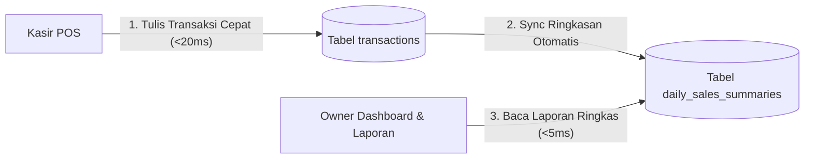

# 📋 PRODUCT REQUIREMENTS DOCUMENT (PRD)
# MENUIN: PRODUCTION-READY MULTI-TENANT POS & FINTECH F&B SAAS
> **Status:** Approved / Source of Truth  
> **Version:** 1.0.0  
> **Target Audience:** Core Engineering, Product, DevOps, QA  
> **Classification:** High-Reliability F&B Point of Sale (POS) & Merchant Payment Platform

---

## 1. 🎯 Executive Summary & Vision

Menuin adalah platform SaaS F&B *all-in-one* yang melayani operasional harian restoran, kafe, dan waralaba (*franchise*) yang mencakup:
1. **Point of Sale (POS) Kasir** untuk operasional cepat di outlet.
2. **Self-Order QR / Storefront** untuk pemesanan mandiri oleh pelanggan.
3. **Kitchen Display System (KDS)** & Manajemen Antrean Pesanan.
4. **Payment Gateway Integration** (DOKU / QRIS Dinamis / Virtual Account).
5. **Dashboard Analytics & Manajemen Multi-Outlet** untuk pemilik bisnis (*Owner/Manager*).

### Problem Statement
Operasional F&B memiliki beban transaksi ekstrem yang terkonsentrasi pada jam-jam puncak (**Lunch Rush: 11.30 – 14.00** dan **Dinner Rush: 18.30 – 21.00**). Keterlambatan respon sistem di atas 1 detik, layar membeku (*freeze*), transaksi terduplikasi (*double charge*), atau selisih stok bahan baku akibat ketidakstabilan koneksi internet akan langsung menghentikan operasional kasir dan merugikan bisnis mitra.

### Core Philosophy
> **"Reliability First, Sub-300ms SLA, Zero Double Charge, Zero Blank Screens."**  
> Kasir harus selalu dapat menyelesaikan transaksi dan mencetak struk secara instan dalam kondisi jaringan apa pun.

---

## 2. ⚡ Service Level Agreements (SLAs) & Non-Functional Requirements (NFR)

| Kategori Metrik | Target SLA Produksi | Toleransi Maksimal | Metode Pengukuran |
| :--- | :--- | :--- | :--- |
| **Pencatatan Transaksi POS (Checkout)** | **< 150 ms** | < 400 ms | P99 TTFB pada `insertPosTransaction` |
| **Perpindahan Halaman Dashboard** | **< 300 ms** | < 500 ms | P95 Server-Side Rendering / Action TTFB |
| **Respon Visual Interaksi Pengguna** | **< 50 ms** | < 100 ms | Layout shift & transition feedback |
| **Kueri Riwayat Transaksi (Paginasi)** | **< 50 ms** | < 100 ms | B-Tree Index Scan pada 25 data |
| **Kueri Agregasi Laporan Penjualan** | **< 200 ms** | < 500 ms | SQL Aggregation / `daily_sales_summaries` |
| **Tingkat Ketersediaan Sistem (*Uptime*)** | **99.9%** | Max 43 menit downtime/bulan | Uptime monitoring (Synthetic ping) |
| **Integritas Finansial (*Idempotency*)** | **100% (Zero Duplication)** | 0% Toleransi Transaksi Ganda | Database Unique Constraint per tenant |

---

## 3. 🏢 Arsitektur Multi-Tenant & Isolasi Data

Menuin mengadopsi model **Shared Database, Shared Schema** dengan isolasi data berbasis partisi logika (*Logical Tenant Partitioning*).

```mermaid
flowchart TD
    subgraph INGRESS
        U1[Kasir Outlet A] --> API[Next.js Server Actions / API]
        U2[Pelanggan QR Storefront Outlet B] --> API
        U3[Owner Dashboard Outlet A] --> API
    end

    subgraph SECURITY LAYER
        API --> AUTH[Auth Context & Session Validation]
        AUTH --> TENANT_GUARD[Tenant Isolation Guard]
    end

    subgraph DATABASE ENGINE (PostgreSQL)
        TENANT_GUARD --> IDX[B-Tree Compound Indexes (tenant_id, created_at)]
        IDX --> T_A[(Outlet A Data Partition)]
        IDX --> T_B[(Outlet B Data Partition)]
    end
```

### Standar Wajib Isolasi Multi-Tenant:
1. **Mandatory Tenant Filtering:**
   Setiap kueri `SELECT`, `UPDATE`, `DELETE`, dan `INSERT` **wajib** menyertakan klausul `WHERE tenant_id = :tenantId`.
2. **Foreign Key Integrity:**
   Relasi antar entitas (contoh: `transaction_items` ke `transactions`) wajib memvalidasi kecocokan `tenant_id` ganda untuk mencegah kebocoran data lintas-outlet.
3. **Compound B-Tree Indexing:**
   Setiap tabel transaksi dan operasional wajib memiliki indeks gabungan dengan kolom pertama `tenant_id`:
   - `transactions`: `(tenant_id, created_at DESC)`
   - `transactions`: `(tenant_id, payment_status, created_at DESC)`
   - `transaction_items`: `(tenant_id, transaction_id)`
   - `shifts`: `(tenant_id, status)`

---

## 4. 💳 Standar Idempotency & Integritas Transaksi Finansial

### A. Idempotency pada POS Checkout
* **Problem:** Kasir menekan tombol "Bayar" berkali-kali karena koneksi internet lambat (*rage click*).
* **Solusi Wajib:**
  1. Frontend POS men-generate `idempotencyKey = crypto.randomUUID()` saat modal pembayaran dibuka.
  2. Tabel `transactions` menyimpan kolom `idempotency_key` dengan constraint `UNIQUE(tenant_id, idempotency_key)`.
  3. Jika request kedua dengan token yang sama masuk:
     - Database menolak insert baru via *Unique Violation*.
     - Server secara elegan mengembalikan transaksi yang sudah berhasil dibuat sebelumnya tanpa memotong stok produk dua kali.

### B. Idempotency pada Pembatalan Transaksi (*Void Anti-Fraud*)
* **Problem:** Double-click pada modal konfirmasi pembatalan pesanan berisiko memicu pengembalian stok barang (*restock*) dua kali.
* **Solusi Wajib:**
  1. Operasi pembatalan di `voidTransaction` wajib menggunakan **Row-Level Locking** di dalam transaksi database:
     ```sql
     SELECT * FROM transactions WHERE id = :id AND tenant_id = :tenantId FOR UPDATE;
     ```
  2. Verifikasi status atomik: Jika transaksi sudah berstatus `CANCELLED`, transaksi segera dibatalkan tanpa eksekusi mutasi stok.

### C. Idempotency pada Payment Gateway Webhook
* **Solusi Wajib:**
  Setiap notifikasi webhook dari DOKU/Midtrans wajib dicatat dalam tabel `payment_webhook_events` dengan `request_id` unik. Pemrosesan status pesanan hanya dieksekusi 1 kali (*exactly-once processing*).

---

## 5. 🗄️ Strategi Pemisahan Beban Transaksional vs Analitikal (CQRS)

Untuk memastikan kasir POS tidak terganggu oleh kueri laporan keuangan bulanan yang berat, Menuin menerapkan pemisahan baca (*Read/Write Segregation*):



### Tabel Agregasi: `daily_sales_summaries`
1. **Granularitas:** 1 baris per outlet per tanggal (`tenant_id`, `date`).
2. **Kandungan Data:** Total order, penjualan kotor (*gross*), diskon, penjualan bersih (*net*), pajak, *service charge*, HPP (*COGS*), laba kotor, breakdown tunai/non-tunai, dan breakdown POS/Storefront.
3. **Mekanisme Sinkronisasi:**
   - **Realtime Hook:** Diupdate secara atomik saat pesanan POS berstatus lunas via PostgreSQL UPSERT:
     ```sql
     INSERT INTO daily_sales_summaries (tenant_id, date, total_orders, net_sales, ...)
     VALUES ($1, $2, 1, $3, ...)
     ON CONFLICT (tenant_id, date) DO UPDATE SET
       total_orders = daily_sales_summaries.total_orders + 1,
       net_sales = daily_sales_summaries.net_sales + EXCLUDED.net_sales,
       updated_at = NOW();
     ```
   - **Reconciliation Job:** Diverifikasi ulang saat kasir melakukan Tutup Shift (*End Shift*).

---

## 6. 🚀 Resiliensi Kueri & Arsitektur Asinkron (*Fault Isolation*)

### A. Larangan Keras Bare `Promise.all`
* **Prinsip:** Kueri data tabel utama (kritikal) tidak boleh digagalkan oleh kueri statistik/grafik sekunder.
* **Standar Implementasi:**
  Gunakan **`Promise.allSettled()`** dan satukan kalkulasi metrik menjadi **2 kueri terkonsolidasi**:
  1. *Query 1 (Paginasi):* Mengambil 25 baris transaksi untuk tabel.
  2. *Query 2 (Agregasi):* Mengambil 1 baris agregat angka statistik menggunakan PostgreSQL `FILTER (WHERE ...)`.
  3. Jika *Query 2* gagal atau timeout, sistem **TIDAK CRASH**, melainkan menggunakan nilai default, sementara 25 baris transaksi tetap ditampilkan secara normal.

### B. Background Execution via Next.js `after()` API
Operasi non-kritikal yang tidak berhubungan langsung dengan struk kasir dialihkan ke eksekusi latar belakang (*background job*):
- Pengiriman notifikasi WhatsApp / Email nota pesanan.
- Sinkronisasi rekonsiliasi ke tabel `daily_sales_summaries`.
- Pencatatan log audit aktivitas pengguna.

---

## 7. ⚡ Strategi Caching Multi-Tenant (4-Tier)

1. **Lapis 1 — Request Memoization (`React.cache`):**
   Mencegah duplikasi pemanggilan auth remote dan profil outlet dalam satu siklus render HTTP.
2. **Lapis 2 — Tagged Data Cache (`unstable_cache` / `revalidateTag`):**
   - Katalog menu dan kategori di-cache dengan tag tenant: `catalog-${tenantId}`.
   - Panggilan publik QR menu merespon dalam waktu **< 10ms**.
   - Mutasi produk langsung memicu invalidasi instan hanya untuk tenant bersangkutan.
3. **Lapis 3 — Distributed Cache & Rate Limiting (Redis / Upstash):**
   Proteksi dari serangan bot pada endpoint publik dan manajemen sesi perangkat POS.
4. **Lapis 4 — Client-Side SWR (Stale-While-Revalidate):**
   Penyajian data seketika dari cache browser dengan pembaruan latar belakang halus tanpa mengganggu kasir.

---

## 8. 🎨 Pengalaman Navigasi & UI/UX (Zero Visual Disruption & Design Standard)

1. **Tirai Transisi Halaman (Page Transition):**
   - Animasi liquid fill Menuin tetap dipertahankan sebagai elemen estetika premium.
   - Durasi disetel ke **0.35s** (responsif & *snappy*).
   - Eksekusi `router.push()` dijalankan secara paralel saat animasi dimulai.
   - Animasi keluar disinkronkan dengan pergantian `pathname` (mencegah tirai turun memperlihatkan halaman lama).
   - *Safety timer* ditetapkan ke **15.000 ms** (hanya aktif saat putus koneksi total).

2. **Standardisasi UI: Komponen Paginasi Lingkaran (Circular Pagination Design Standard):**
   - **Bentuk Geometri:** Seluruh tombol navigasi paginasi (nomor halaman, tanda panah sebelumnya `<` dan selanjutnya `>`, serta kontainer hover) **wajib berbentuk bulat penuh (`rounded-full`) dengan rasio aspek persegi (`aspect-square`)**.
   - **Dimensi Token:** Ukuran standar `h-8 w-8` (desktop) atau `h-9 w-9` (touch tablet/POS).
   - **State Token:**
     - **Nomor Halaman Aktif:** `bg-[#0e59f9] text-white font-semibold rounded-full shadow-xs hover:bg-[#0e59f9]/90`.
     - **Nomor Halaman Inaktif:** `text-slate-600 dark:text-slate-400 rounded-full hover:bg-slate-100 dark:hover:bg-slate-800 hover:text-slate-900 dark:hover:text-white transition-all`.
     - **Tombol Panah (`<` dan `>`):** `rounded-full border border-slate-200 dark:border-slate-800 text-slate-500 hover:text-blue-600 hover:border-blue-300 hover:bg-blue-50/50 dark:hover:text-blue-400 disabled:opacity-30`.
     - **Ellipsis (`...`):** `w-6 text-center text-xs text-slate-400 select-none`.
   - **Tujuan Standar:** Menjamin konsistensi visual di seluruh modul Menuin (Riwayat Transaksi, Tim & Karyawan, Promosi & Diskon, Laporan Keuangan, Shift Kasir, serta shared `app-table` & `data-table`).

3. **Arsitektur Pemisahan Scope Metrik KPI & Filter Pencarian (Decoupled Executive KPI Architecture):**
   - **Aturan Scope Metrik:**
     - 4 Kartu KPI Ringkasan Eksekutif (*Net Sales*, *Total Transaksi*, *AOV*, *Total Menu Terjual*) dan badge status tab **hanya dan secara eksklusif dipengaruhi oleh Filter Periode Waktu** (Default: **"Bulan Ini" / `this_month`**).
     - Filter pencarian teks (*Global Search* via `ILIKE`), filter tipe order, dan filter sumber **TIDAK mengubah** angka kartu KPI.
   - **Efisiensi Beban Server:**
     - Mencegah *re-aggregation scan* yang berat di database setiap kali pengguna mengetik satu karakter pencarian atau mengklik tab status tabel.
     - Kueri ringkasan periode dieksekusi secara instan via compound index `(tenant_id, created_at)`.
     - Kueri baris tabel dan kueri hitung paginasi (`totalFiltered`) berjalan terpisah sehingga paginasi tabel selalu akurat sesuai hasil filter/pencarian tanpa merusak data ringkasan bulanan.
   - **Stabilitas Pengalaman Pengguna (UX Stability):**
     - Angka KPI dan grafik *sparkline* tren tidak berkedip, tidak melompat menjadi Rp 0, dan tidak mereduksi kurva hanya karena kasir sedang mencari nota pelanggan tertentu.

4. **Paginasi Transaksi:**
   - Default: **25 transaksi per halaman**.
   - Input pencarian dilengkapi **Debounce 300ms** dan mencari ke **seluruh database** via SQL `ILIKE`.
   - Angka badge pada tab status mencerminkan **total seluruh transaksi pada periode waktu aktif**, bukan hanya data di layar.

6. **Standar Navigasi Instan & Streaming Skeleton Universal (Instant Route Transition & Skeleton Streaming Architecture):**
   - **Prinsip Utama:** Setiap klik perpindahan menu/halaman harus langsung memicu komit navigasi tanpa tertahan oleh kueri database server.
   - **Tirai Transisi Cepat (Snappy Liquid Curtain):** Durasi tirai transisi dibatasi maksimal 450ms. Begitu animasi *liquid fill logo* selesai (0.35s), tirai langsung terangkat/turun (`y: "-100%"`), membawa pengguna seketika ke halaman tujuan.
   - **Streaming Skeleton Terisolasi via React Suspense:**
     - Dilarang keras menggunakan `export default async function Page()` yang melakukan `await dataFetch()` di tingkat atas tanpa pembungkus `<Suspense>`.
     - Setiap halaman menggunakan pola:
       ```tsx
       export default function Page() {
         return (
           <Suspense fallback={<PageSkeleton />}>
             <PageDataWrapper />
           </Suspense>
         );
       }
       ```
     - Setiap modul wajib memiliki `loading.tsx` khusus yang mencerminkan geometri visual halaman asli (Header, Kartu KPI, Grafik/Heatmap, dan Baris Tabel/Kanban).
   - **Cakupan Universal:** Diterapkan di seluruh modul outlet (`/dashboard`, `/transactions`, `/reports`, `/reports/sales`, `/reports/operations`, `/reports/finance`, `/orders`, `/pos`, `/katalog`, `/items`, `/categories`, `/modifiers`, `/shifts`, `/promotions`, `/team`, `/devices`, `/settings`, `/verification`, serta fallback root `/outlet/[outletKey]/loading.tsx`).

---

## 9. 🔒 Kesiapan Produksi (*Production Readiness Checklist*)

Sebelum deployment publik, sistem wajib memenuhi kriteria berikut:
- [x] Seluruh compound index B-Tree pada `transactions` dan `transaction_items` terpasang di database Supabase.
- [x] Kolom `idempotency_key` dan unique constraint terpasang pada `transactions`.
- [x] Seluruh pemanggilan fungsi auth terbungkus `React.cache()`.
- [x] Kueri riwayat transaksi menggunakan paginasi limit 25 dan `Promise.allSettled()`.
- [x] Kartu KPI dan tab status terisolasi ke scope filter waktu (default: Bulan Ini / `this_month`).
- [x] Standardisasi paginasi lingkaran penuh (`rounded-full`) diterapkan di seluruh modul tabel Menuin.
- [x] Universal Instant Route Transition & Dedicated Skeleton Streaming terpasang di seluruh rute dashboard outlet.
- [x] Kueri laporan omzet dipindahkan ke SQL Aggregation & `daily_sales_summaries`.
- [x] Verifikasi pengujian transisi navigasi bebas dari glitch layar turun prematur atau layar membeku.
- [x] Verifikasi cetak struk kasir dan void transaksi anti-fraud berfungsi 100%.

