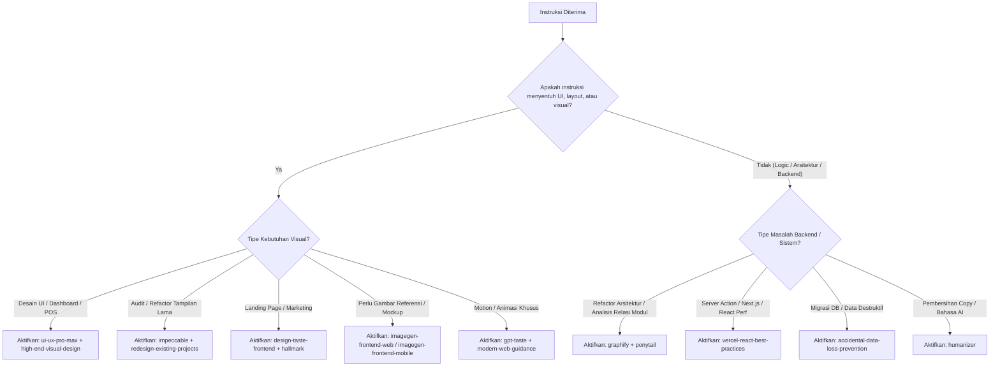

# Source of Truth: Katalog & Panduan Pemilihan Skill Agent MENUIN

Dokumen ini adalah **Master Source of Truth** untuk seluruh *skills* yang terinstal di repositori MENUIN dan lingkungan Antigravity/Gemini. Setiap agent yang menangani tugas di repositori ini **wajib** merujuk ke dokumen ini untuk memilih dan mengaktifkan skill yang relevan sebelum melakukan implementasi.

---

## 1. Aturan Inti Pemanggilan Skill (*Superpowers Rule*)

1. **Invoke Before Action**: Selalu panggil (*view*) file `SKILL.md` dari skill yang relevan **sebelum** mulai menulis kode, merancang arsitektur, atau menjawab tugas kompleks.
2. **Process First, Implementation Second**:
   - Jika tugas menyangkut investigasi arsitektur atau refactoring besar: Gunakan skill proses/analisis terlebih dahulu (`graphify`, `vercel-react-best-practices`, `ponytail`).
   - Setelah pendekatan disepakati: Gunakan skill implementasi UI/UX atau styling (`ui-ux-pro-max`, `high-end-visual-design`, `modern-web-guidance`).
3. **Safety First**: Untuk setiap perubahan skema basis data, migration, atau query destruktif, terapkan prinsip `accidental-data-loss-prevention`.

---

## 2. Matriks Pemilihan Skill Berdasarkan Kasus Penggunaan

| Kategori | Nama Skill | Lokasi File | Kapan Wajib Digunakan (Triggers & Use Cases) |
| :--- | :--- | :--- | :--- |
| **Arsitektur & Refactoring** | `graphify` | `.agents/skills/graphify/SKILL.md` | - Menganalisis relasi antar file dan modul kompleks di repositori. - Investigasi *codebase flow*, *god nodes*, ketergantungan paket. - Menjawab pertanyaan arsitektural yang melibatkan banyak file. |
| **Arsitektur & Refactoring** | `ponytail` | `.agents/skills/ponytail/SKILL.md` | - Tugas perbaikan bug, refactoring ringkas, atau optimasi. - Menghindari over-engineering (*YAGNI*). - Menghasilkan solusi dengan baris kode paling minimal, presisi, dan aman. |
| **Keamanan Data** | `accidental-data-loss-prevention` | `~/.gemini/config/skills/accidental-data-loss-prevention/SKILL.md` | - Melakukan migrasi database (ALTER TABLE, DROP, TRUNCATE, UPDATE massal). - Membersihkan bucket penyimpanan Cloud Storage. - Menghapus resource infrastruktur penting. |
| **Next.js & React Performance** | `vercel-react-best-practices` | `.agents/skills/vercel-react-best-practices/SKILL.md` | - Menulis atau me-review Server Actions (`server-auth-actions`). - Optimasi bundle dan import (`bundle-barrel-imports`). - Mencegah waterfall async (`async-parallel`). - Optimasi re-render pada halaman POS, checkout, atau dashboard outlet. |
| **Standar Web & API Modern** | `modern-web-guidance` | `~/.gemini/config/plugins/modern-web-guidance-plugin/skills/modern-web-guidance/SKILL.md` | - Implementasi CSS modern (`:has()`, container queries, dialog/popover native). - View Transitions API dan scroll-driven animations. - Standar input HTML5 (autofill, form validation). |
| **Mobile & React Native** | `vercel-react-native-skills` | `.agents/skills/vercel-react-native-skills/SKILL.md` | - Pengembangan atau optimasi komponen mobile React Native/Expo. - Pengelolaan modul native dan performa list mobile. |
| **Desain UI/UX Komprehensif** | `ui-ux-pro-max` | `.agents/skills/ui-ux-pro-max/SKILL.md` | - Merancang atau memperbaiki antarmuka web, POS, dan dashboard. - Memilih palet warna berstandar industri, rasio kontras WCAG, dan tipografi harmonis. - Merancang komponen navigasi, form, tabel data, modal, dan empty states. |
| **Visual Desain Kelas Atas** | `high-end-visual-design` | `.agents/skills/high-end-visual-design/SKILL.md` | - Membangun antarmuka landing page, pricing, atau portal login. - Menghindari tampilan default AI yang murah/generik. - Mengatur ritme spasi, border radius halus, bayangan berlapis (*layered shadows*), dan aksen mikro. |
| **Audit & Peningkatan Desain** | `impeccable` | `.agents/skills/impeccable/SKILL.md` | - Mengkritisi, mengaudit, dan memoles UI yang terasa kaku atau berantakan. - Memperbaiki hirarki informasi, cognitive load, dan konsistensi visual sistem. |
| **Redesain Proyek Eksisting** | `redesign-existing-projects` | `.agents/skills/redesign-existing-projects/SKILL.md` | - Merombak halaman atau komponen yang sudah ada tanpa merusak fungsionalitas logika yang berjalan. - Mengubah UI generik menjadi desain premium. |
| **Desain Minimalis & Editorial** | `minimalist-ui` | `.agents/skills/minimalist-ui/SKILL.md` | - Antarmuka bersih, monokrom hangat, flat bento grid, tanpa gradient mencolok atau bayangan berat. - Cocok untuk halaman invoice, resi cetak, laporan finansial, dan dokumentasi. |
| **Desain Industrial Brutalis** | `industrial-brutalist-ui` | `.agents/skills/industrial-brutalist-ui/SKILL.md` | - Tampilan terminal monospaced, cetak Swiss, blueprint mekanikal. - Cocok untuk log audit, debugging console, atau developer terminal. |
| **Animasi & Motion Interaktif** | `gpt-taste` | `.agents/skills/gpt-taste/SKILL.md` | - Implementasi animasi GSAP kompleks, pinning scroll, scrubbing, parallax. - Layout bento grid dinamis tanpa celah kosong. |
| **Frontend Taste (Landing/Porto)** | `design-taste-frontend` | `.agents/skills/design-taste-frontend/SKILL.md` | - Halaman marketing, portofolio, dan beranda. - Mencegah template repetitif dan memastikan *taste* desain yang unik. |
| **Anti-AI-Slop Landing** | `hallmark` | `.agents/skills/hallmark/SKILL.md` | - Membangun landing page baru dari nol dengan diferensiasi visual tinggi. |
| **Design Tokens & Systems** | `stitch-design-taste` | `.agents/skills/stitch-design-taste/SKILL.md` | - Pembuatan atau standardisasi token desain, variabel CSS, dan panduan tema terpadu. |
| **Generasi Konsep Gambar Web** | `imagegen-frontend-web` | `.agents/skills/imagegen-frontend-web/SKILL.md` | - Membuat referensi visual landing page per seksi sebelum dikoding. - Wajib 1 gambar horizontal terpisah untuk tiap seksi. |
| **Generasi Konsep Gambar Mobile**| `imagegen-frontend-mobile`| `.agents/skills/imagegen-frontend-mobile/SKILL.md` | - Membuat mockup aplikasi mobile di dalam frame subtle smartphone. |
| **Brand Identity & Guidelines** | `brandkit` | `.agents/skills/brandkit/SKILL.md` | - Pembuatan aset branding, logo guidelines, mockup identitas visual MENUIN. |
| **Implementasi Image-ke-Kode** | `image-to-code` | `.agents/skills/image-to-code/SKILL.md` | - Mengonversi gambar desain atau referensi visual menjadi kode komponen siap pakai. |
| **Penulisan Copy & Konten** | `humanizer` | `.agents/skills/humanizer/SKILL.md` | - Menulis ulang teks copy, notifikasi, label form, atau PRD agar terdengar alami, ramah, manusiawi, dan bebas dari gaya bahasa klise AI. |
| **Aksesibilitas (A11y)** | `a11y-debugging` | `~/.gemini/config/plugins/chrome-devtools-plugin/skills/a11y-debugging/SKILL.md` | - Menguji kontras warna, ARIA labels, navigasi keyboard (focus states), dan ukuran tap target (WCAG 2.1). |
| **Performa LCP Web Vitals** | `debug-optimize-lcp` | `~/.gemini/config/plugins/chrome-devtools-plugin/skills/debug-optimize-lcp/SKILL.md` | - Mengoptimalkan Core Web Vitals, Largest Contentful Paint (LCP), loading gambar hero dan font. |
| **Memory & Resource Leak** | `memory-leak-debugging` | `~/.gemini/config/plugins/chrome-devtools-plugin/skills/memory-leak-debugging/SKILL.md` | - Mengatasi lonjakan memori, kebocoran listener event di React, atau OOM pada build server. |
| **Penemuan Skill Baru** | `find-skills` | `.agents/skills/find-skills/SKILL.md` | - Membantu pengguna mencari dan menginstal kemampuan baru ketika ada fitur khusus yang belum tercakup. |

---

## 3. Decision Tree: Cara Agent Memilih Skill

---

## 4. Standar Eksekusi Saat Memulai Tugas

Setiap agent yang menerima instruksi di repositori ini harus:
1. Membaca `SKILL.md` dari skill terpilih menggunakan tool `view_file`.
2. Menyatakan di pesan chat:  
   `"Menggunakan skill [<nama-skill>] untuk [<tujuan-tugas>]..."`
3. Menjalankan panduan teknis yang ada di dalam skill tersebut secara konsisten.
