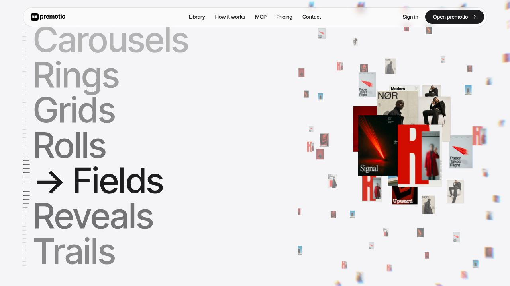
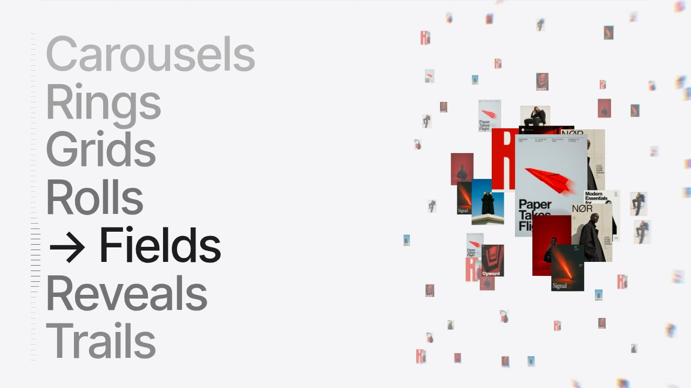
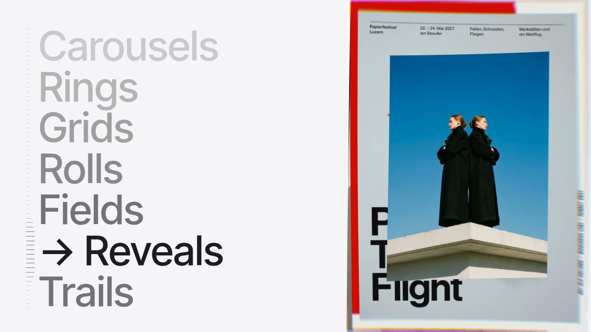
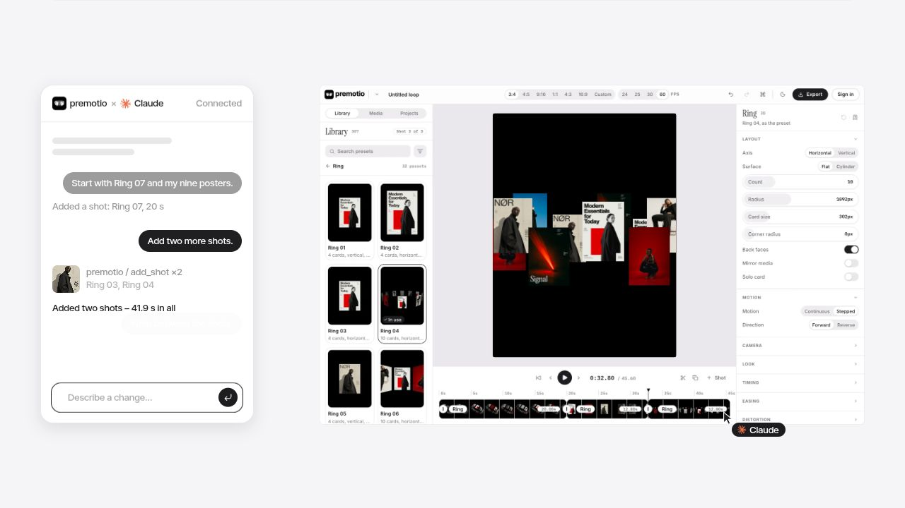
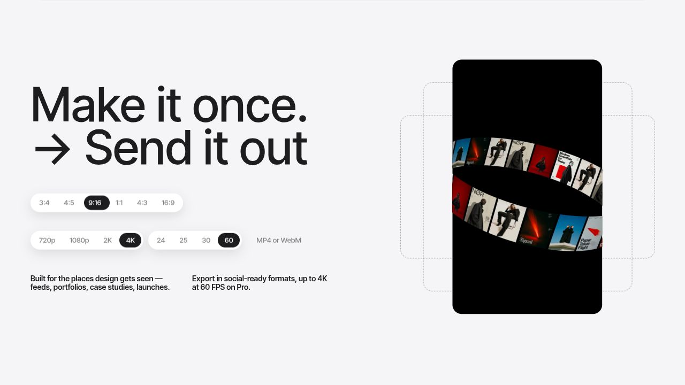
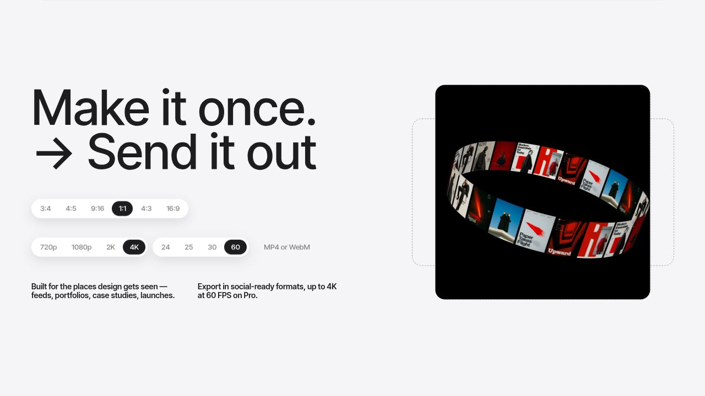
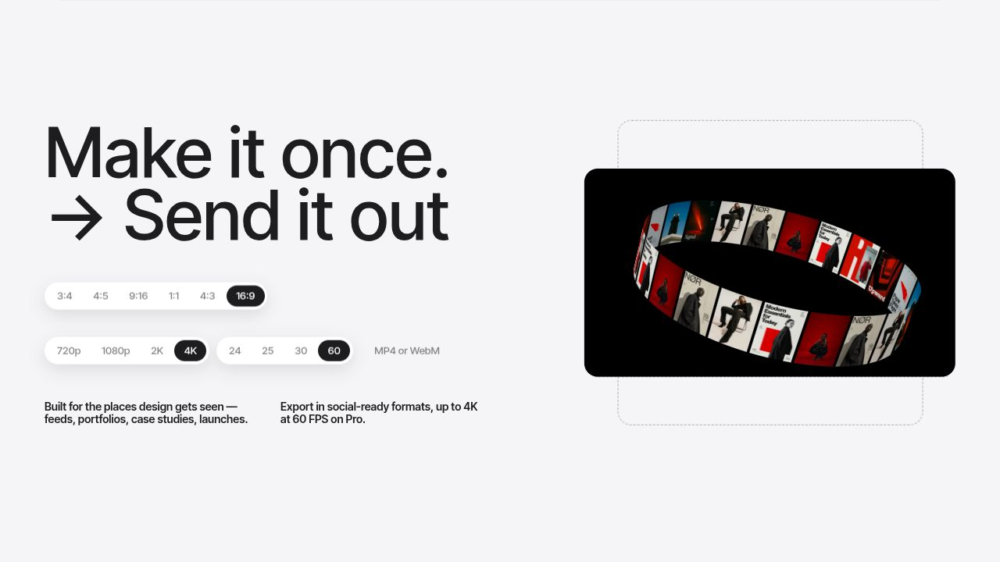

# Premotio: reverse engineering galeri dan transisi preview

Tanggal inspeksi: 2 November 2026. Status: laporan analisis, bukan implementasi baru.

> **Pembaruan arahan pengguna:** galeri pembuka untuk Phone sekarang menggunakan susunan wall/grid pada screenshot terbaru, menggantikan Fields dan Reveals. Kedua analisis lama dipertahankan sebagai bukti historis, bukan instruksi implementasi pembuka. Analisis wall dan alur terbaru: [Premotio Wall Grid](PREMOTIO_WALL_GRID_REVERSE_ENGINEERING_2026-11-02.md).

## 1. Kesimpulan utama

Implementasi sebelumnya berangkat dari model gerak yang tidak tepat. Tiga contoh yang ingin digabungkan untuk Menuin tidak berasal dari satu sistem orbit yang cukup diberi variasi sudut. Masing-masing mempunyai aturan posisi, orientasi, ukuran, pengurutan, dan waktu yang berbeda.

| Referensi | Mekanik yang terverifikasi | Yang tidak tepat dari pemahaman sebelumnya |
| --- | --- | --- |
| Fields, video galeri pertama | Bidang kartu datar; pusat pengamatan melintasi jalur; ukuran dan kabut berubah menurut jarak ke pusat | Menganggapnya kamera yang terbang di antara lapisan kartu 3D |
| Reveals, bagian lanjutan video pertama | Kartu baru tumbuh berlapis dari pusat yang sama | Menganggap seluruh video adalah satu galeri Fields yang terus di-zoom |
| Carousel dalam demo MCP, video kedua | Posisi kartu mempunyai kedalaman, tetapi orientasi akhirnya tetap menghadap penonton | Memutar permukaan setiap kartu mengikuti lingkaran seperti orbit export |
| Orbit export | Posisi DAN orientasi mengikuti lingkaran; permukaan kartu dibengkokkan | Menganggapnya carousel kartu datar yang hanya berbeda kemiringan |

Alur memilih satu screenshot hingga memenuhi layar preview Phone/Tab/Laptop merupakan adaptasi Menuin yang diminta pengguna. Itu bukan perilaku picker yang ditemukan langsung pada ketiga bagian Premotio. Adaptasi ini harus dirancang sebagai penghubung tersendiri, bukan dianggap sudah otomatis tersedia pada preset referensi.

## 2. Metode, sumber, dan batas kepastian

Inspeksi menggunakan browser MCP: menavigasi situs live, memilih kategori, melakukan scroll, mengambil screenshot, membaca DOM/layout, serta membaca JavaScript publik yang benar-benar dimuat browser melalui debugger. Tidak memakai akses backend atau source repository Premotio.

Referensi visual:

- [Premotio live](https://premotio.com/).
- [Jam galeri pertama: Fields lalu Reveals](https://jam.dev/c/bb6a2f28-4e95-4206-a4dd-80e5c8c63e0f), durasi sekitar 12,31 detik.
- [Jam galeri kedua: carousel dalam demo MCP](https://jam.dev/c/8bb7bc7a-4e2b-4fcc-898e-7f710f087dea), durasi sekitar 5,3 detik.

Sumber teknis publik yang diperiksa:

- [Bundle render dan komponen landing](https://premotio.com/_nuxt/Xc5JkAqg.js).
- [Bundle konfigurasi, matematika, timeline, dan layout](https://premotio.com/_nuxt/CGu4ElgJ.js).
- [Entry aplikasi](https://premotio.com/_nuxt/DJQUG5s7.js).

Kategori kepastian dalam laporan:

- **Teramati:** terlihat di video atau browser live.
- **Terverifikasi kode:** terdapat dalam bundle yang dimuat saat inspeksi.
- **Usulan adaptasi:** cara menerapkannya untuk kebutuhan Menuin; bukan klaim tentang situs asli.

Bundle ter-minifikasi dan tidak menyediakan source map. Nama fungsi di bawah adalah simbol build tersebut, bukan nama asli di repository pembuatnya. Angka waktu seperti `16`, `4`, atau `0.4` dalam preset adalah waktu internal animasi; pada landing, waktu itu dipetakan dari progress scroll. Jangan langsung mengartikannya sebagai durasi menunggu dalam detik nyata.

Pemeriksaan live dilakukan pada viewport 1280 × 720 desktop. Angka piksel screenshot bukan spesifikasi universal untuk semua viewport. Mobile dan semua variasi prefers-reduced-motion belum diuji secara visual end-to-end.

## 3. Arsitektur yang membuat animasinya menyatu

### Satu panggung utama

Situs memakai Vue/Nuxt, GSAP untuk ticker dan animasi DOM, Lenis untuk penghalusan/navigasi scroll, serta renderer berbasis Three.js/WebGL2.

Pada rangkaian story terdapat satu canvas visual utama berukuran viewport. Section hero, kategori, demo editor/MCP, perangkat, dan export dikoordinasikan pada panggung `.story__stage` yang sticky. Canvas kecil lain dipakai untuk ruler dan elemen footer; jadi bukan berarti seluruh situs hanya mempunyai satu canvas.

DOM menyediakan teks dan penanda layout, misalnya `data-story="agents-picture"`, `devices-phone`, dan `export-room`. Renderer membaca rectangle penanda tersebut untuk menempatkan visual. Screenshot editor pada MCP juga dipadukan dengan kartu yang dirender hidup; bukan sebuah video editor yang benar-benar sedang dijalankan di dalam landing.

### Dua jenis jam animasi

1. **Jam narasi berbasis scroll:** mengatur preset aktif, perpindahan layout, kartu, chat simulasi, format preview, dan masuk/keluar teks.
2. **Jam real-time:** dipakai untuk settling fisika tertentu, pointer follow, post-processing, dan gerak hidup iPhone.

Keduanya perlu dipisahkan. Menjadikan seluruh gerakan sebagai sinus waktu yang terus berputar akan menghilangkan hubungan yang terarah dengan scroll. Sebaliknya, memaksa semua efek berhenti tanpa settling juga tidak sama dengan referensi.

### Scroll bukan sekadar persentase satu section

Unit dasar narasi adalah `1.4 × tinggi viewport`. Beberapa rentang kemudian diperpanjang lagi. Rangkaian kategori, misalnya, diberi faktor panjang scroll `1.8`; kategori masing-masing mempunyai rentang internal `0.5` unit.

Dalam pergantian kategori, setengah awal rentang kategori digunakan untuk transisi antarpreset; setengah berikutnya memberi ruang bagi gerakan preset tujuan. Karena itu waktu gerak Fields tidak bisa disamakan dengan satu `rotation = progress × 2π` untuk seluruh section.

## 4. Galeri pertama: Fields

### Apa yang terlihat

Pada awal Jam pertama, beberapa poster besar bertumpuk di area fokus, dikelilingi banyak poster yang lebih kecil dan lebih pucat. Saat scroll bergerak, pusat perhatian berpindah. Poster yang mendekati pusat membesar, sementara poster yang menjauh mengecil. Kartu tidak berputar memperlihatkan samping atau belakang.





### Susunan dan aset

Terverifikasi pada preset `cg`, konfigurasi `ng`:

- Ada **500 kandidat kartu** dalam data field; bukan 500 elemen HTML dan bukan berarti semuanya digambar sekaligus.
- Posisi dasar memakai grid dengan jitter deterministik. Jadi tampak organik tetapi tidak berubah acak setiap render.
- Pemilihan gambar menyeimbangkan pemakaian aset dan menghindari gambar sama pada tetangga dekat yang telah ditempatkan.
- Kolam aset dasar landing berisi sembilan poster, dimuat dari `/pictures/1.webp` sampai `/pictures/9.webp`.
- Rasio asli masing-masing aset dipertahankan dengan perhitungan contain dalam kotak dasar; tidak semua dipaksa ke crop potret identik.

### Jalur pusat pengamatan

Pusat virtual mengikuti delapan titik pada jalur Catmull–Rom tertutup. Setiap segmen memakai 64 sampel panjang lintasan untuk meratakan kemajuan di dalam segmen. Amplitudo pan adalah `1.45`.

Ini adalah perpindahan pusat pengamatan pada bidang, bukan kamera perspektif yang mendolly menembus banyak lapisan Z. Setelah transformasi koordinat renderer, kartu Fields berada pada **Z yang sama, yaitu 0**, dengan quaternion identitas. Kesan kedalamannya dibangun terutama melalui ukuran, tumpukan, dan atmosphere.

### Rumus fokus

Untuk kartu dengan jarak terhadap pusat `distance`:

```text
d = clamp(distance / (0.41 × 1080), 0, 1)
scale = mix(0.63, 0.08, d) × variasiUkuranKartu
```

Variasi ukuran deterministik berkisar sekitar ±25% dari nilai interpolasi tersebut. Ukuran akhir juga mengikuti unit layout dan rasio aset.

- Dekat pusat: kartu lebih besar.
- Jauh dari pusat: kartu lebih kecil.
- Urutan gambar mengikuti nilai layer yang berasal dari skala; kartu yang lebih besar dapat menutupi kartu yang lebih kecil.
- Atmosphere baru bertambah pada setengah luar radius fokus, memakai smoothstep dan kekuatan maksimum `0.5`.
- Atmosphere ini bukan bukti adanya depth-of-field optik atau CSS blur pada setiap kartu. Efek tepi/prism pada renderer merupakan lapisan visual lain.

Preset mempunyai loop internal 16 unit waktu dengan delapan bagian, dan `step = 2`. Di landing, progress scroll menggerakkan jam preset itu dengan easing dan jeda transisi yang diatur mesin kategori. Angka 16 tidak berarti field otomatis harus berkeliling selama 16 detik setelah pengguna berhenti scroll.

### Implikasi untuk Menuin

Jika ingin sama karakternya, yang harus ditiru adalah kepadatan field, distribusi ukuran, pergeseran pusat, urutan overlap, dan peredupan perifer. Memberi Z acak, rotasi acak, serta kamera yang terlalu aktif menghasilkan bentuk gerak berbeda walaupun screenshot sesaat tampak mirip.

## 5. Bagian berikutnya video pertama: Reveals

Sekitar pertengahan Jam pertama, indikator kategori berganti dari Fields ke Reveals. Bagian ini bukan lagi field yang sama.



Terverifikasi pada preset `jg`, konfigurasi `Dg`:

- Siklus internal `4`, dengan `10` urutan kartu.
- Jarak kelahiran kartu `0.4` unit waktu internal.
- Satu kartu mempunyai jendela pembesaran `2` unit, sehingga beberapa generasi kartu tumpang-tindih.
- Semua kartu berpusat pada posisi yang sama dan tetap menghadap depan.
- Skala memakai ease-out quint: `1 - (1 - u)^5`, setelah `u` dibatasi ke 0–1.
- Kartu generasi baru dirender di atas generasi sebelumnya.
- Mesin mempertahankan jendela sekitar delapan kandidat generasi, termasuk kandidat yang belum membesar; bukan sepuluh kartu selalu terlihat dengan ukuran penuh.
- Bentuk kartu di preset ini memakai rasio rata-rata kolam aset, berbeda dari Fields yang mempertahankan rasio masing-masing aset.

Kesan poster “maju” terutama berasal dari pertumbuhan skala kartu baru di pusat yang sama. Tidak ditemukan kebutuhan menggerakkan kamera 3D untuk menghasilkan efek ini.

### Transisi Fields → Reveals juga mempunyai mekanik sendiri

Mesin tidak sekadar menukar scene dengan fade. Ia:

1. Mengambil kandidat kartu yang relevan/terlihat dari kedua preset.
2. Menghitung posisi proyeksi dan area keterlihatannya.
3. Memasangkan kartu asal ke tujuan dengan mempertimbangkan jarak, pengulangan gambar, dan hubungan overlap.
4. Menginterpolasi posisi, ukuran, orientasi, bentuk, serta haze.
5. Mempertahankan urutan depan-belakang agar kartu tidak mendadak melompat layer.

Konfigurasi transisi kategori menggunakan `over = 0.5`, rentang relatif penerbangan `0.7–1`, lift `0.15`, dan 200 sampel urutan transisi. Ini angka internal sistem, bukan durasi CSS 0,5 detik. Ada pula simulasi lentur kertas yang diprakomputasi, sehingga transisi bisa mempunyai sedikit respons material tanpa menjadikan seluruh viewport memantul.

Karena itu pemilihan gambar hardcoded untuk Phone sebaiknya mengikuti prinsip kontinuitas kartu ini, bukan hanya menaruh gambar besar baru di atas galeri lalu melakukan crossfade.

## 6. Galeri kedua: carousel datar pada demo MCP

Jam kedua memperlihatkan bagian demo MCP dengan screenshot antarmuka editor dan percakapan yang disimulasikan. Ini bukan section export dan bukan kelanjutan langsung dari kategori Fields pada situs aslinya.



### Geometri yang tepat

Konfigurasi carousel pada bundle shared:

| Parameter | Nilai |
| --- | --- |
| Jumlah kartu carousel | 10 |
| Radius | 0.32 × tinggi stage internal |
| Tinggi kartu | 0.22 × tinggi stage internal |
| Kemiringan lintasan | 8° |
| Offset vertikal berselang-seling | ±0.05 × tinggi stage |
| Laju putaran | 1.2 putaran per progress penuh narasi MCP |

Secara konseptual:

```text
theta = sudutSlot + 2π × 1.2 × progressMCP
x = pusatX + radius × sin(theta)
z = radius × cos(theta)
y = pusatY + koreksiKemiringanDanOffsetBerselang
orientasiKartu = identitas
```

Inilah pembeda terpenting: **kartunya bergerak dalam ruang berkedalaman, tetapi permukaannya tetap sejajar bidang layar** setelah morph ke carousel selesai. Bukan kartu yang menempel menghadap radial pada dinding silinder.

Akibatnya:

- Kartu depan tampak lebih besar karena perspektif dari kamera tetap.
- Kartu belakang lebih kecil dan tertutup kartu depan.
- Kartu tidak terus menipis hingga edge-on ketika mengitari sisi.
- Konten poster tetap mudah dikenali.
- Kedalaman diurutkan sebelum rendering; pertemuan kartu harus memperhatikan occlusion, bukan sekadar opacity silang.

Kartu carousel datar ini memakai `bend = 0`. Jangan mewariskan nilai bend milik orbit terakhir.

### Konteks sebelum dan sesudahnya

Demo MCP sebelumnya membentuk ring dengan 16 kartu, tilt sekitar 50° dan roll −28°. Saat progress MCP `0.64–0.70`, susunan itu dimorph menjadi carousel datar 10 kartu. Posisi diinterpolasi dan orientasi dikembalikan ke depan menggunakan interpolasi quaternion.

Ketika chat menampilkan permintaan Whip, pada progress `0.80–0.86`, kode melakukan perpindahan horizontal: kelompok lama bergeser ke kiri hingga sekitar `1.8 × lebar stage`, sementara kelompok berikutnya masuk dari kanan. Penggeraknya smootherstep terhadap scroll.

Tulisan “Whip transition, 0.6 s” adalah bagian isi demo antarmuka. Label tersebut tidak boleh dijadikan bukti bahwa gerakan landing selalu memakan 0,6 detik nyata; renderer landing mempunyai pemetaan progress-nya sendiri.

### Implikasi untuk transisi Phone → Tab

Untuk adaptasi Menuin, gambar storefront yang sedang memenuhi preview harus mundur ke salah satu slot yang tetap menghadap depan. Galeri kemudian bergerak dengan mekanik carousel datar ini. Screenshot POS yang telah ditentukan diangkat dari slot yang masuk akal menuju pusat, lalu diperbesar memenuhi preview Tab. Tahap pemilihan POS ini adalah tambahan Menuin, bukan Whip asli Premotio.

## 7. Galeri ketiga: orbit melengkung pada export

Orbit ini berbeda lagi dari preset ring generik di kategori dan dari carousel MCP.







Konfigurasi yang terverifikasi pada export:

| Parameter | Nilai |
| --- | --- |
| Jumlah slot kartu | 22 |
| Gambar | Sembilan aset dasar diulang menurut slot |
| Radius orbit | 0.35 × tinggi ruang export |
| Fill sepanjang lingkaran | 0.96 |
| Pitch/tilt bidang ring | 26° |
| Roll | −8° |
| Laju sudut | 1 putaran per kenaikan 1 progress export |

Posisi dan orientasi disusun dengan transformasi quaternion yang sama untuk pusat kartu dan normal permukaannya. Selain itu, lebar kartu diturunkan dari keliling ring:

```text
lebarKartu = 0.96 × kelilingRing / 22
bend = -lebarKartu / radiusRing
```

Karena kartu mengikuti arah keliling dan ikut dibengkokkan, kumpulan gambar tampak sebagai pita kontinu. Pada sisi lingkaran, kartu dapat menipis; pada bagian depan/belakang, arah permukaan berbeda. Ini perilaku yang justru tidak digunakan pada carousel datar MCP.

### Yang berubah saat rasio berganti

Referensi export tidak menunjukkan pergantian gambar terpilih untuk setiap rasio. Galeri tetap berjalan di belakang jendela preview. Perubahan utamanya adalah **bentuk mask/cut preview**, bukan kamera mengatur ulang orbit agar semua gambar selalu muat pada rasio baru.

Tiga bentuk jangkar dihitung relatif terhadap tinggi ruang layout:

- Portrait: sekitar `0.5624 × H` lebar, `1 × H` tinggi.
- Square: sekitar `0.8084 × H` pada kedua sisi.
- Landscape: sekitar `0.9842 × H` lebar, `0.5536 × H` tinggi.

Pusat preview tetap sama. Bentuk di antaranya diinterpolasi; indikator switch mengikuti progress bentuk tersebut. Rentang morph ke square adalah progress `0.355–0.535`, dan ke landscape `0.685–0.865`.

Ukuran/jalur ring tidak dihitung ulang berdasarkan rasio aktif; selama fase normal, ia menggunakan tinggi ruang export yang stabil. Karena itulah portrait memperlihatkan potongan ring dan landscape membuka area lebih luas tanpa seluruh scene terasa berganti skala mendadak.

Garis panduan DOM hanya membentuk square dan wide, bukan outline 9:16 tambahan. Garis dipotong di sekitar lubang mask aktif; bukan border luar yang diberi margin seragam dari gambar.

### Bounce memang ada, tetapi tempatnya spesifik

Kode asli memakai spring untuk nilai morph format `f` dan nilai exit `out`: frekuensi alami `2π/0.6`, damping ratio `0.3`, integrasi substep maksimum `1/240` detik. Jadi tidak tepat juga menyatakan Premotio sama sekali tidak mempunyai bounce.

Namun spring tersebut berada pada morph format/exit. Itu bukan alasan membuat posisi semua gambar, kamera, atau screenshot yang sedang dipilih ikut meloncat. Kebutuhan Menuin yang menghendaki gambar tenang boleh menghapus respons spring pada morph tersebut, sambil mempertahankan susunan dan urutan geraknya.

### Exit asli

Pada akhir export, ring menyusut sedikit lalu kartu bergerak radial ke luar, hingga menembus batas mask/keluar tampilan. Ini berbeda dari pilihan desain Menuin sebelumnya yang ingin fade tanpa orbit meledak keluar. Bagian exit itu tidak perlu disalin apabila keputusan fade tetap dipertahankan.

## 8. Teks dan gerak hidup perangkat

Temuan pendukung untuk menjaga kesatuan dengan section yang sudah ada:

- Font live adalah **Inter Tight variable**.
- Heading export yang terlihat, pada viewport 1280 × 720: ukuran sekitar **88.89 px**, weight **500**, line-height sekitar **80 px**. Elemen heading aksesibilitas berukuran 1 px adalah duplikat sr-only; jangan mengukur elemen itu sebagai heading visual.
- Heading dipecah menjadi baris, kata, dan karakter. Karakter masuk dari `yPercent: 50`, dengan pemanjangan vertikal awal `scaleY: 1.4` dan stagger `0.025` dalam timeline internal.
- Paragraf dipecah per baris dan dimask; baris bergerak dari `yPercent: 120` ke posisi akhirnya. Jadi bukan seluruh teks muncul melalui opacity dari posisi tengah yang sudah selesai.
- Opacity tetap digunakan sebagai pendamping reveal, bukan satu-satunya gerakan.
- Sistem teks mempunyai lag/settling dan penanganan arah scroll balik; bukan pemicu masuk sekali lalu tidak bisa dibalik.
- iPhone tengah mempunyai gerak real-time kecil: amplitudo vertikal `0.015` pada model setinggi `1.466`, periode `5` detik. Rotasi juga mengikuti pointer secara teredam. Gerak ini tidak sama dengan menggoyangkan seluruh preview atau bezel export.

Angka timeline karakter dan paragraf tetap perlu diterjemahkan ke rentang progress ketika digunakan sebagai scroll animation; tidak semuanya merupakan delay detik literal.

## 9. Kenapa hasil sebelumnya berbeda

Perbedaan mendasar yang sekarang bisa dijelaskan dengan bukti:

1. Fields direkonstruksi sebagai lapisan Z 3D dengan jumlah kartu kecil, padahal kedalaman dominannya adalah ilusi ukuran pada bidang kartu datar yang jauh lebih padat.
2. Fields dan Reveals diperlakukan sebagai satu efek yang sama; padahal video pertama melintasi preset berbeda beserta transisi khususnya.
3. Carousel MCP dan orbit export disatukan terlalu jauh. Orientasi kartu depan, rotasi radial, dan curvature seharusnya berbeda.
4. Penambahan selector hardcoded dilakukan sebelum jalur kontinuitas kartu dan fase diamnya benar-benar dipisahkan.
5. Morph ukuran, rotasi galeri, pembesaran selected image, dan respons bounce terjadi berbarengan. Referensi mempunyai pembagian fase dan pengelolaan layer yang lebih ketat.
6. Perubahan mask dianggap harus selalu mengubah skala seluruh isi, padahal pada export asli mask dan world galeri relatif independen.

Ini bukan masalah yang cukup diselesaikan dengan mengganti angka easing atau menambah jarak scroll saja. Model pose dan pembagian tanggung jawab perlu dikoreksi dahulu.

## 10. Pemahaman kebutuhan Menuin setelah koreksi

Bagian berikut adalah kontrak adaptasi berdasarkan klarifikasi pengguna, bukan perilaku bawaan Premotio:

```text
WALL / GRID dari kolam gambar bersama
  → pilih storefront hardcoded
  → kartu itu memenuhi layar preview PHONE
  → hold yang jelas
  → gambar mundur, masuk CAROUSEL DATAR dari kolam yang sama
  → pilih POS hardcoded
  → kartu itu memenuhi layar preview TAB
  → hold yang jelas
  → gambar mundur, masuk ORBIT MELENGKUNG dari kolam yang sama
  → pilih dashboard hardcoded
  → kartu itu memenuhi layar preview LAPTOP
```

“Memenuhi layar” selalu berarti aperture di preview sebelah kanan, bukan fullscreen halaman browser. Semua galeri memakai kolam aset yang sama; tidak boleh ada galeri yang hanya berisi storefront, galeri lain hanya POS, dan galeri lain hanya dashboard.

### Prinsip penerapan yang masuk akal

1. **Tiga model pose terpisah:** wall 2D dengan kolom bergerak bergantian, carousel 3D front-facing, dan ring 3D melengkung.
2. **Identitas kartu tetap:** sebuah aset/slot mempunyai key yang stabil agar kartu yang keluar dari galeri memang terasa menjadi screenshot terpilih yang sama.
3. **Satu kartu penghubung:** saat dipilih, satu kartu mewarisi pose awal galeri; posisi, orientasi, ukuran, bentuk, dan curvature-nya diselesaikan ke pose layar penuh. Jangan menambahkan gambar lain yang tiba-tiba menggantikan target.
4. **Pisahkan aperture dan isi:** bezel mengikuti morph Phone → Tab → Laptop; isi mempunyai timeline sendiri tetapi satu progress narasi yang sama.
5. **Fase yang terbaca:** galeri bergerak → target tersorot/merapat ke pusat → kartu memenuhi aperture → hold. Saat mundur, lakukan kontinuitas kebalikannya sebelum galeri berikutnya mengambil alih.
6. **Tidak ada bounce pada screenshot terpilih:** pilih kurva monotonic untuk langkah pick/unpick dan morph utama sesuai permintaan pengguna.
7. **Reversible dan deterministik:** scroll balik mengembalikan kartu ke slot yang sama, bukan merandomisasi susunan baru.
8. **Ukuran aman navbar:** layout preview dan heading ditentukan dari rectangle responsif; jangan menyalin piksel screenshot desktop begitu saja.

Pemetaan persentase scroll baru tidak dikunci dalam laporan ini. Angka tersebut perlu dikalibrasi setelah mekanik masing-masing direproduksi secara terpisah. Ini menghindari janji durasi atau detail target yang belum diuji.

### Hal yang perlu divalidasi sebelum implementasi berikutnya dianggap selesai

- Wall/grid tampak sama pada beberapa posisi scroll, dengan kolom berlawanan arah dan clipping yang rapi.
- Kartu carousel datar tetap menghadap penonton setelah transisinya selesai.
- Ring export benar-benar melengkung dan berputar dengan orientasi radial.
- Target hardcoded hadir dalam kolam dan pemilihannya tidak teleport.
- Pada hold, screenshot memenuhi aperture tanpa seam, crop keliru, atau bergerak sendiri.
- Phone, Tab, Laptop mempunyai proporsi dan tinggi yang sengaja dibedakan.
- Scroll balik, scroll cepat, resize, dan reduced motion diuji.
- React state tidak perlu diperbarui per kartu per frame; texture dan geometri dasar harus dipakai ulang.

Pembaruan analisis wall/grid pada laporan terpisah merupakan acuan pembuka terbaru.

## 11. Catatan performa dan batas reproduksi

Kode Premotio menunjukkan penggunaan ulang sembilan texture dasar, culling kandidat field, worker untuk perhitungan passage/pieces, cache urutan/pose, pengurangan ukuran texture tertentu pada perangkat touch, serta batas DPR 2 desktop dan 1.5 coarse pointer. Model iPhone dimuat sebagai GLB dengan Meshopt; bukan gambar statis yang diputar dengan CSS.

Angka 500 kartu tidak boleh diterjemahkan menjadi 500 gambar DOM besar dengan filter blur masing-masing. Pendekatan ringan perlu memisahkan jumlah kandidat dalam data dari jumlah kartu yang benar-benar terlihat/digambar.

Laporan ini tidak mengklaim sudah mengaudit seluruh shader, semua preset di aplikasi berbayar, atau seluruh halaman Premotio. Mekanik galeri yang relevan dan penghubung story telah ditelusuri pada build publik saat inspeksi. Asset dan kode milik Premotio tidak disalin ke implementasi produk Menuin; rekonstruksi berikutnya perlu memakai aset Menuin dan implementasi sendiri.

## 12. Jejak bukti teknis

Offset berikut adalah indeks karakter pada teks bundle JavaScript yang dibaca melalui browser, bukan nomor baris sumber asli. Build situs dapat berubah.

| Bukti | Bundle / area |
| --- | --- |
| Konfigurasi dan generator Fields | `Xc5JkAqg.js`, sekitar 615–619 ribu karakter; `ng`, `sg`, `cg` |
| Reveals | `Xc5JkAqg.js`, sekitar 624–625 ribu; `Dg`, `jg` |
| Mesin transisi kategori dan ordering | `Xc5JkAqg.js`, sekitar 631–660 ribu; `k_`, `le`, `K`, `he` |
| Timeline, carousel MCP, orbit export | `CGu4ElgJ.js`, sekitar 21–42 ribu; `ar.agents`, `zr`, `Vr`, `Qr`, `ei`, `mi` |
| Renderer, GLB, worker, DPR, spring format | `Xc5JkAqg.js`, sekitar 733–749 ribu; `qy`, `Qy`, `nb`, StoryScene |
| Text reveal | `Xc5JkAqg.js`, sekitar 749–755 ribu; `ob`, `ub` |
| DOM demo MCP dan export | `Xc5JkAqg.js`, sekitar 806–819 ribu; Agents, Devices, Export |

SHA-256 teks sumber yang diinspeksi:

```text
Xc5JkAqg.js
d11ffaaca7934fe3e65091cbdc4340db0b54c4627dfd78824436dd50658240e3

CGu4ElgJ.js
f59b02541661e67575327cddd5e7e29a44e0f24c86c508b7f60e71c7e02bb6b6

DJQUG5s7.js
d596ffb65eb5ef9cb18712caa67880020200dc2ace23126813b2207dfa32ba27
```

Screenshot live tersimpan di folder `docs/design/evidence/premotio-gallery-runtime-2026-11-02/`. Screenshot Fields, carousel MCP, serta orbit portrait/square/landscape memperlihatkan perbedaan yang dibahas, bukan hasil implementasi Menuin.
