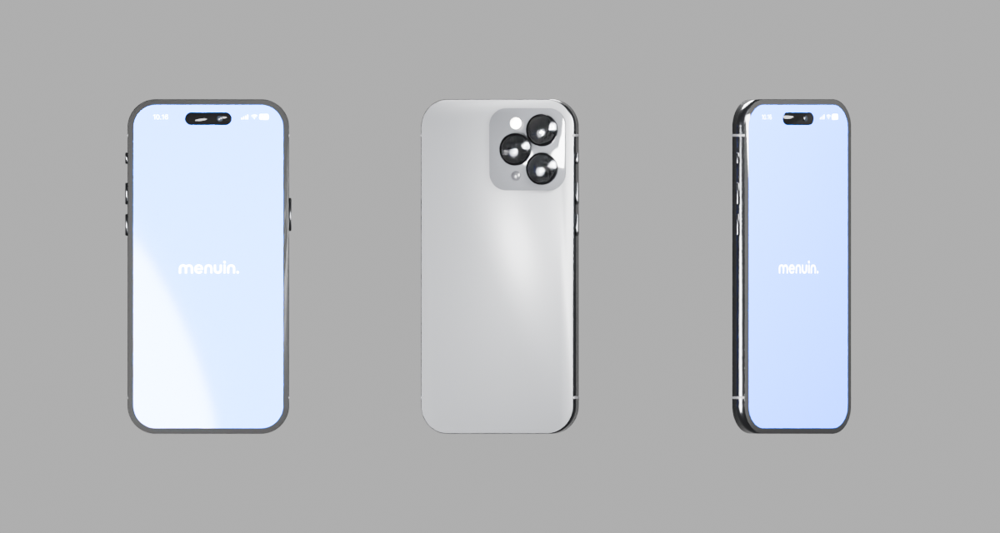

# Status implementasi perangkat dan ekspor

Tanggal: 1 November 2026. Lokasi terbaru: `/landing-experiment`, setelah FeatureGridMinimal, mengikuti pemindahan oleh pengguna.

Pembaruan model 2 November 2026: section kini memakai model iPhone 17 Pro Max Silver yang dibuat sendiri di Blender, menggantikan iPhone 14. Model memiliki 18.638 segitiga, 12 mesh/material, normal map metal yang tertanam dan kompresi Meshopt sekitar 332 KB. Material lensa, UV layar, lighting studio dan tone mapping bodi juga diperbaiki. [Laporan model, sumber Blender, GLB dan preview](PREMOTIO_IPHONE_17_MODEL.md) memuat hasil dan batas pemeriksaannya. Model lama di bagian audit berikut merupakan riwayat prototipe.

Pembaruan 2 November 2026: sumber pembuka tunnel diganti dari dua foto lokal menjadi satu logo Menuin biru transparan, memakai aset yang sudah ada `/img/landing/hero/menuin-wordmark.png` (1.271 × 258 px). Shader mengambil RGBA logo, mempertahankan alpha saat sampling dispersi dan blending, lalu mengomposisikannya di atas stage putih. Logo dipusatkan dengan ukuran contain: lebar maksimal 64% viewport, tinggi maksimal 50% viewport, tanpa crop atau peregangan. Tekstur ini mengikuti pemuatan paralel dan cleanup renderer yang sudah ada. Kompilasi delapan varian shader dan pemeriksaan alpha/warna/proporsi aset lulus; hasil visual browser untuk pembaruan ini belum diperiksa karena akses origin lokal masih ditolak.

**Revisi terbaru sudah dipasang dalam kode**, mengikuti [analisis entrance dan snap rasio](PREMOTIO_REVIEW_ENTRANCE_DAN_RATIO_SNAP.md). Entrance diawali stage putih, compositor memakai radial warp dan sampling warna spektral, serta pergantian format memiliki keputusan gesture commit/revert dan spring. Pemeriksaan logika, lint, tipe, dan kompilasi shader telah dilakukan; kemiripan visual belum dinyatakan lolos karena browser lokal masih ditolak oleh gerbang izin.

## Aset dan keputusan model

Pada prototipe awal, model lokal `iphone_14_pro_max_space_black.glb` dipakai kembali. Audit GLB menemukan 4.490 segitiga, 28 mesh primitive, material terpisah, serta bidang `OLED_Display` dengan UV. Model berhasil diimpor dan dirender melalui Blender 5.2 dalam proses background terpisah; scene Blender pengguna tidak diubah. Setelah tinjauan Jam terbaru, model ini diganti untuk meningkatkan kualitas visual section; keputusan awal bahwa model lama cukup hanya berlaku untuk prototipe gerak.

Gambar ini adalah audit model lama dengan material asal, bukan screenshot section atau model iPhone 17 terbaru. Renderer sekarang mempertahankan material PBR model baru dan mengganti material layar dengan shader komposisi.

Seluruh gambar berasal dari aset lokal. Delapan gambar dipakai ulang pada 22 kartu ring. Gambar layar menggunakan screenshot yang tersedia sebagai konten sementara; state dasar dan panel belum merupakan pasangan screenshot UI yang disiapkan khusus seperti pada referensi.

## Implementasi yang dipasang

- Wrapper scroll dengan satu sticky stage dan progress yang dapat dibalik.
- Awal stage putih `#fff`; model/fallback disembunyikan sampai envelope entrance dimulai setelah stage menempel.
- Tunnel compositor dengan pemetaan radial, plate dari logo Menuin biru transparan, blending menuju handset, sampling spektral, dan grain. Jejak panjang diproses pada render target setengah resolusi saat warp aktif; jalur normal memakai sampling ringan.
- Tiga instance handset; dua handset samping berputar keluar dan satu handset menjadi fokus.
- Rotasi entrance handset tengah dari orientasi awal sekitar −520° menuju frontal, disinkronkan dengan pelepasan warp. Handset samping memiliki orientasi dan foto layar berbeda.
- Shader layar menggabungkan dua gambar dan panel dengan tepi membulat; footer dikomposisikan kembali pada posisi tetap.
- Handoff berotasi menuju preview kanan.
- Ring WebGL dengan plane melengkung, delapan kelompok instanced, crop gambar yang mempertahankan proporsi, dan phase berbasis scroll.
- Preview berklip melalui shader: portrait, square dan landscape. Preview, tiga outline, lubang mask, dan fallback memakai fungsi geometri endpoint yang sama, dengan ruang overshoot.
- Input rasio hanya diambil alih pada rentang pergantian format. Tarikan pendek kembali ke asal; tarikan cukup jauh atau flick dengan perjalanan minimum memilih frame tetangga. Ekor momentum tidak memajukan pilihan kedua dalam gesture yang sama.
- Spring menjaga posisi dan velocity saat arah dibalik, membolehkan overshoot pendek, lalu menetap persis ke indeks 0/1/2. Frame terakhir tetap digambar ketika solver menyelesaikan gerak.
- Snap scroll memakai instance Lenis yang sudah ada; `virtualScroll` pada smooth-scroll menghormati event yang telah dikonsumsi section. Keyboard, touch, seek scrollbar, dan keluar dari batas rasio ditangani; transaksi/listener dibersihkan saat unmount.
- Fade scene ekspor dan entrance konten nyata “Satu alur. Semua terhubung.” dari bawah, tanpa scatter kartu.
- Gambar fallback, alur statis reduced motion, penghentian render di luar viewport/tab tersembunyi, dan cleanup resource.
- Loop hero lama dijeda saat hero keluar viewport agar tidak terus bekerja bersama renderer section baru.
- Tekstur foto ring memakai `getImageProps()` Next.js untuk URL optimasi berlebar 640 px, kualitas 75. Empat foto asal berjumlah sekitar 3,45 MB; ukuran respons optimasi aktual belum diukur. Logo entrance memakai PNG transparan yang sudah tersedia, sekitar 113 KB, tanpa mengubah aset asal.

## Parameter revisi

| Bagian | Nilai dalam kode |
| --- | --- |
| Awal kosong | Alpha perangkat 0 sampai progress 0,055. |
| Warp | Build-up 0,04–0,10; release sampai 0,20; peak `k=22`. |
| Triptych dan fokus | Triptych sebelum 0,24; fokus 0,24–0,33. |
| Panel dalam layar | 0,39–0,51. |
| Handoff | 0,52–0,61; preview frontal pada 0,66. |
| Anchor rasio | 0,69 / 0,78 / 0,87 untuk 9:16 / 1:1 / 16:9. |
| Keputusan gesture | Commit pada tarikan 42%; pembatalan balik di bawah 24%. Flick memerlukan perjalanan minimal 12% dan kecepatan normalisasi >1,8 per detik. |
| Gesture selesai | Jeda input 160 ms atau touchend. |
| Spring | Periode natural 0,52 detik; damping ratio 0,55; substep maksimal 1/240 detik. |
| Snap scroll | Durasi 0,34 detik, dapat diinterupsi. |
| Fade dan konten berikut | Fade ekspor 0,92–0,965; judul berikut mulai 0,94. |

Parameter ini adalah hasil implementasi awal revisi; rasa gesture, pose, intensitas dispersi, dan timing perlu dikalibrasi pada browser/perangkat nyata.

## Pemeriksaan

- 18 tes lulus: koreografi, endpoint bersama, rasio/ruang overshoot, commit/revert, flick minimum, hysteresis, momentum, interupsi spring, refresh rate, keyboard, touch, seek keluar, dan cleanup.
- ESLint untuk tujuh file TypeScript/TSX yang terkait revisi lulus.
- Pemeriksaan TypeScript proyek lulus.
- Build produksi lulus; hasil konfirmasi terakhir dicatat dalam [manifest verifikasi revisi](premotio-evidence/entrance-revision-2026-11-01/verification.json).
- Delapan varian shader berhasil dikompilasi pada driver native OpenGL ES 3.2/Mesa, memakai sumber GLSL yang diekstrak dari renderer dan chunk colorspace Three.js. Hasilnya tersimpan pada [shader-validation.json](premotio-evidence/entrance-revision-2026-11-01/shader-validation.json). Ini pemeriksaan kompilasi, bukan pengujian integrasi atau tampilan browser.
- Seluruh path aset lokal yang dirujuk sudah diperiksa keberadaannya.
- `getImageProps()` diperiksa menghasilkan URL texture dengan `w=640&q=75` pada konfigurasi proyek.

**Batas yang masih terbuka:** setelah pengguna menyatakan izin sudah diubah, pembukaan browser lokal dicoba kembali dan tetap ditolak otomatis: izin tersimpan atau kebijakan terkelola memblokir origin `http://127.0.0.1:3000`. Karena itu rendering shader di browser, layout desktop/mobile, rasa input nyata, kemiripan visual, pergantian sticky, respons route optimasi gambar, dan performa GPU belum diverifikasi langsung. Tidak ada jalur browser alternatif yang dipakai untuk melewati penolakan. Status ini tidak mengklaim visual QA selesai.

Rujukan desain dan temuan sumber: [laporan gabungan](PREMOTIO_LAPORAN_GABUNGAN_DAN_IMPLEMENTATION_PLAN.md).
