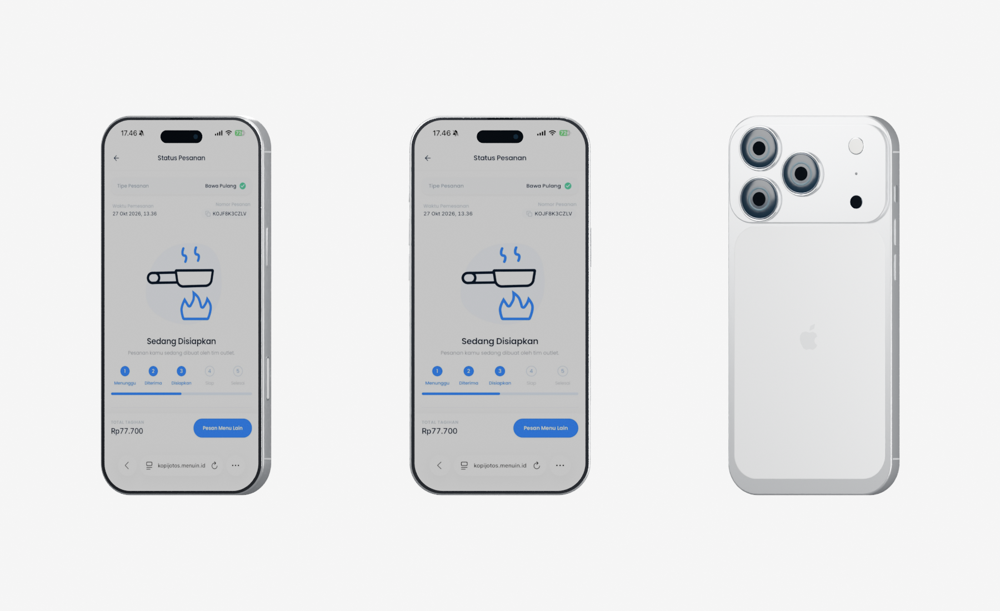

# Model iPhone 17 Pro Max Silver untuk Device Story

Tanggal: 2 November 2026. Dipasang pada `/landing-experiment`, di section setelah feature grid.

Model ini dibuat sendiri secara prosedural di Blender 5.2.3 untuk menggantikan model iPhone 14 pada section Device Story. Model Premotio tidak disalin. Bentuknya merupakan rekonstruksi visual, bukan CAD manufaktur atau aset resmi Apple.

## Temuan dari rekaman

Rekaman [Jam implementasi](https://jam.dev/c/da217e1a-2900-41ce-b795-4ae99ef58630) ditinjau melalui MCP Jam: overview serta frame 6.853 dan 23.299 ms. Bagian belakang menunjukkan lensa yang menyerupai logam, highlight yang menutupi detail, dan bentuk kamera generasi sebelumnya. Temuan ini menggantikan keputusan audit awal bahwa model lama cukup untuk hasil akhir; model lama hanya memadai untuk prototipe gerak.

Ada masalah renderer yang ikut memengaruhi kualitas: Three.js melewati tone mapping material standar ketika tujuan render berupa render target biasa. Compositor lama kemudian langsung mengonversi hasil ke sRGB. Renderer baru menerapkan ACES pada material bodi sebelum komposisi, dengan konten layar tetap melalui shader terpisah.

Proporsi dasar mengacu pada [spesifikasi Apple](https://support.apple.com/en-us/125091): lebar 78 mm, tinggi 163,4 mm, tebal bodi 8,75 mm dan pilihan Silver. Detail unibody aluminium serta plateau kamera mengacu pada [deskripsi desain Apple](https://www.apple.com/newsroom/2025/09/apple-unveils-iphone-17-pro-and-iphone-17-pro-max/). Detail kecil diperkirakan secara visual, termasuk chamfer, ring optik dan posisi komponen. Ukuran total geometri termasuk tombol dan tonjolan kamera lebih besar daripada ukuran bodi.

## Hasil dan berkas

| Berkas | Fungsi |
| --- | --- |
| [GLB untuk web](../../apps/web/public/hero/3d/iphone_17_pro_max_silver.glb) | Model yang dimuat renderer, sekitar 332 KB. |
| [Sumber Blender](../../assets/3d/iphone-17-pro-max-silver.blend) | Satu handset, material dan gambar packed, kamera serta studio preview. |
| [Generator](../../scripts/assets/build-iphone-17-pro-max.py) | Membangun ulang model, ekspor GLB dan render tinjauan. |
| [Pemeriksa model](../../scripts/assets/verify-device-story-model.mjs) | Menguji hasil decode melalui GLTFLoader dan MeshoptDecoder yang sama dengan website. |
| [Statistik build](premotio-evidence/iphone-17-pro-max/model-build.json) | Identitas model, jumlah geometri, ukuran dan orientasi. |



Ini render tinjauan Blender, bukan screenshot browser. Pratinjau [depan](premotio-evidence/iphone-17-pro-max/front-three-quarter.png) dan [belakang](premotio-evidence/iphone-17-pro-max/rear-three-quarter.png) juga tersedia.

## Bentuk dan material

- Bodi aluminium silver dengan profil fillet beberapa lapis dan sudut melengkung; permukaan depan/belakang memakai normal planar terpisah.
- Panel belakang Ceramic Shield putih dan plateau kamera lebar.
- Tiga kamera dengan rim silver, barrel graphite, lapisan kaca berwarna gelap, elemen optik dan aperture. Kaca memakai metalness rendah agar tidak terlihat seperti chrome.
- Flash, LiDAR, mikrofon belakang, Dynamic Island dan kamera depan.
- Tombol Action, volume, power, Camera Control, garis antena, speaker bawah, sekrup dan detail USB-C.
- Satu normal map mikrobrushing 256 × 256 px yang tertanam dalam GLB. Material PBR memakai parameter roughness, metalness, clearcoat dan specular. Tidak membutuhkan tekstur 4K atau pass transmission tambahan.

## Kontrak renderer dan biaya

18.638 segitiga dan 12 kelompok material/mesh per handset. Ketiga handset berbagi geometry, texture dan material bodi; masing-masing layar dapat diganti. Angka ini bukan benchmark FPS.

GLB memakai `EXT_meshopt_compression`, `KHR_materials_clearcoat` dan `KHR_materials_specular`, yang dibaca GLTFLoader proyek. Decoder Meshopt diimpor dari Three.js yang sudah terpasang, tanpa layanan decoder eksternal.

Sumbu model: X ke kanan, Y ke atas, Z ke depan. Mesh `OLED_Display` wajib tersedia dengan UV standar glTF, V=0 pada tepi atas. Renderer menggunakan UV tersebut dan mengambil rasio layar dari geometri, menggantikan rekonstruksi UV dan koreksi rotasi khusus model lama.

Kompresi default Blender menggunakan filter eksponensial 12 bit, yang pada pengujian menghasilkan bidang OLED tidak rata sekitar 0,18 mm. Generator menaikkan presisi menjadi 20 bit hanya pada proses ekspor terisolasi. Ukuran bertambah dari sekitar 279 KB menjadi 332 KB, dengan bidang layar dan fillet tetap terjaga.

Lighting website memakai environment studio yang dibuat dari empat softbox, PMREM, key/fill dan ambient terbatas. Material bodi menjalankan ACES sebelum masuk render target; shader UI tidak menerima tone mapping bodi. PMREM dan softbox dibuat sekali, lalu resource sementara dibersihkan.

## Reproduksi dan pemeriksaan

Dari root repository:

```bash
blender --background --factory-startup --threads 8 --python scripts/assets/build-iphone-17-pro-max.py
node scripts/assets/verify-device-story-model.mjs
```

Tambahkan `-- --no-render` pada perintah Blender untuk ekspor tanpa membuat ulang preview. Jalankan di proses background terpisah; file Blender pengguna yang sedang terbuka tidak disentuh. Source `.blend` menyimpan satu handset; tiga salinan preview dibuat setelah penyimpanan dan ekspor.

Pemeriksaan yang lulus:

- Decode GLB aktual melalui GLTFLoader/MeshoptDecoder, termasuk embedded normal map.
- Kontrak layar, orientasi UV, rasio, dimensi, nilai posisi/normal, jumlah draw, dan kaca dengan metalness rendah tanpa transmission.
- 18 tes koreografi/spring/gesture yang sudah ada.
- ESLint, TypeScript dan build produksi Next.js.
- Kompilasi native GLES untuk delapan varian shader section dan fungsi ACES bodi. Ini pemeriksaan sintaks shader, bukan link seluruh material PBR di browser.
- Tinjauan render Blender dari depan, belakang dan tiga handset.

Yang belum terverifikasi adalah kesetaraan visual dengan Premotio di browser, shader PBR yang sudah dilink di WebGL browser, seluruh sudut saat scroll, serta FPS dan penggunaan GPU di desktop/mobile. Origin lokal masih ditolak oleh gerbang izin browser; pemeriksaan offline di atas tidak mengklaim menggantikan QA browser.
