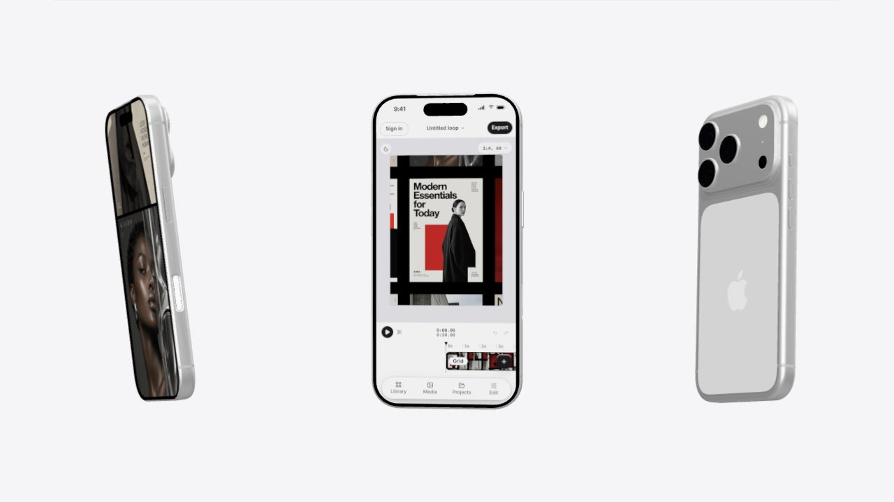
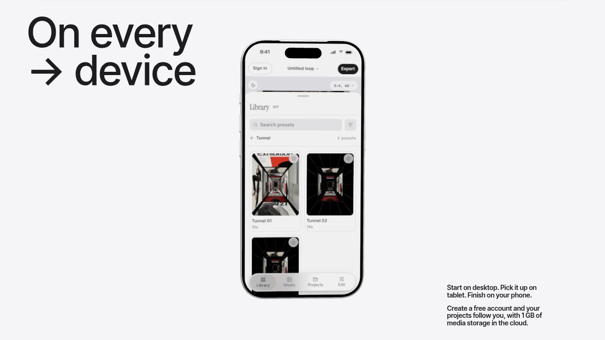
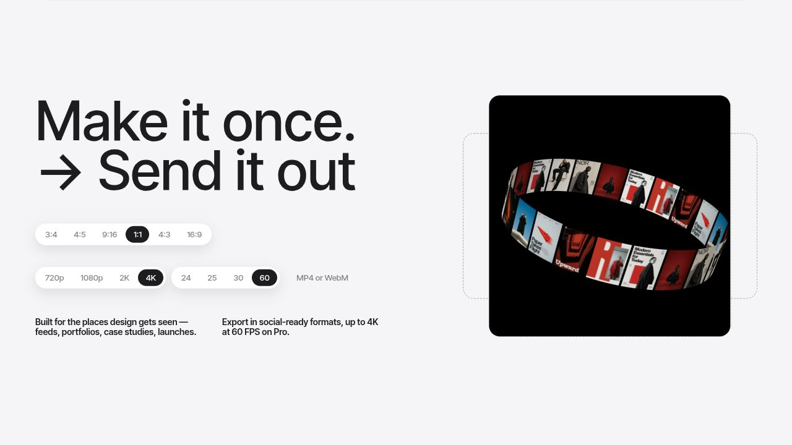
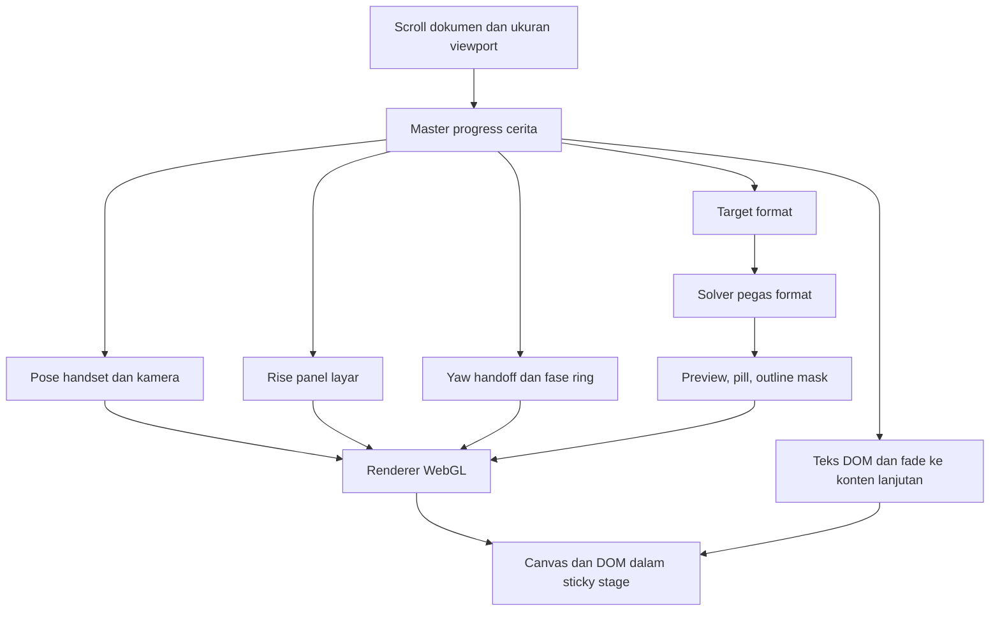

# Premotio — laporan gabungan reverse engineering dan implementation plan

**Tanggal:** 1 November 2026. **Target:** `/landing-experiment`.  
**Status:** investigasi dan spesifikasi implementasi; bukan pernyataan bahwa animasi Menuin telah selesai atau telah lulus pengujian performa.  
**Sumber utama:** [rekaman Jam, 43,69 detik](https://jam.dev/c/8a360bcb-b640-465c-9a3f-711d8bc7f710), [situs langsung](https://premotio.com/), bundle publik yang dikirim situs, serta aset yang dirujuk bundle tersebut.

Dokumen ini menyatukan analisis sebelumnya dengan pemeriksaan baru pada kode yang dikirim ke browser, struktur GLB, file gambar, dan runtime. Jika ada perbedaan dengan dua laporan sebelumnya, **gunakan laporan ini**. Rancangan lama berbasis perkiraan visual tidak menjadi spesifikasi final.

**Addendum setelah rekaman implementasi:** [review entrance dan snap rasio](PREMOTIO_REVIEW_ENTRANCE_DAN_RATIO_SNAP.md) memperinci shader tunnel, awal section putih, keputusan gesture commit/revert, dan geometri frame. Untuk dua perilaku tersebut, gunakan spesifikasi addendum. Section kini berada setelah FeatureGridMinimal; temuan aset dan teknologi dalam laporan ini tetap menjadi dasar.

## 1. Jawaban utama: teknologi apa yang sebenarnya dipakai?

**Scene yang diteliti memakai real-time WebGL2 melalui Three.js r186, model iPhone GLB, tekstur gambar statis, shader GLSL khusus, serta lapisan HTML/CSS untuk teks dan kontrol.** GSAP membantu sinkronisasi dan animasi DOM. Situs aslinya menggunakan Vue/Nuxt; Menuin dapat mencapai mekanisme visual yang sama dengan Next.js/React dan Three.js yang sudah tersedia.

Ini bukan kesimpulan dari tampilan saja:

| Pertanyaan | Temuan dan tingkat kepastian |
| --- | --- |
| Apakah ada model iPhone 3D? | **Ya.** Loader scene memuat `/devices/iphone.glb` menggunakan GLTFLoader dengan MeshoptDecoder. Berkasnya berhasil diperiksa. |
| Apakah tiga ponsel membutuhkan tiga model berbeda? | **Tidak.** Scene membuat tiga salinan dari satu model; tampilan layar, pose, dan orientasinya yang dibedakan. |
| Apakah geraknya berasal dari animasi bawaan GLB? | **Tidak pada aset yang diperiksa.** GLB memiliki nol animation clips; posisi, rotasi, kamera, dan perpindahan scene dihitung di JavaScript. |
| Apakah ini video atau image sequence? | **Bukan sebagai mekanisme scene ini.** Empat gambar layar dan sembilan gambar ring adalah WebP satu frame. Jalur render yang ditelusuri menggunakan model/geometri dan shader, bukan video seek atau pergantian ratusan file gambar. |
| Mengapa ada angka `frames: 360`? | Itu rentang numerik untuk mengevaluasi pose. Progress diubah menjadi bilangan dari 1 hingga 360, lalu rumus menghitung posisi/rotasi. Bukan bukti keberadaan 360 PNG/WebP. |
| Apakah memakai CSS 3D? | Teks, kontrol, outline, dan layout memakai DOM/CSS. Handset dan kartu ring dalam jalur yang diperiksa dirender WebGL; CSS 3D bukan renderer utama scene ini. |
| Apakah ada teknologi lain yang menentukan hasilnya? | **Ya:** render-to-texture, shader komposisi layar, mask shader, instanced geometry kartu, pembengkokan vertex, environment lighting, tone/color handling, dan compositing/postprocessing. |

Bukti langsung: [bundle scene](https://premotio.com/_nuxt/Xc5JkAqg.js), [bundle parameter dan perhitungan pose](https://premotio.com/_nuxt/CGu4ElgJ.js), [model iPhone](https://premotio.com/devices/iphone.glb). Nama bundle ber-hash dapat berubah setelah deployment situs; identitas berkas saat pemeriksaan disimpan dalam [manifest bukti](premotio-evidence/manifest.json).

### Koreksi penting terhadap laporan awal

1. **Putaran ring mengikuti scroll, bukan loop waktu yang terbukti terus berjalan.** Dalam kode yang diperiksa, sudut ring dihitung dari indeks kartu dan progress lokal scene ekspor. Dua screenshot runtime pada `scrollY = 35280`, berselang sekitar **31,82 detik**, identik piksel demi piksel. Efek pegas pada perubahan format dan inertia scroll dapat memberi kesan masih bergerak setelah input berhenti. Target paling mirip adalah ring yang bergerak ketika scroll maju/balik; loop otomatis akan menjadi variasi tambahan.
2. **Gerak layar terutama panel yang naik, bukan satu halaman panjang yang seluruhnya digeser.** Dua tekstur—editor dan Library—digabung dengan mask sudut membulat. Shader memiliki perlakuan khusus agar tab bar tetap di tempat. Ini mengoreksi usulan awal memakai repeat/offset satu screenshot.
3. **Handoff bukan sekadar crossfade perangkat menjadi kotak baru.** Handset utama diputar menuju profil; preview berikut masuk dari sudut sekitar −90° menuju frontal. Kesinambungan orientasi ini penting walaupun kedua objek tidak harus mesh yang sama.
4. **Rasio, resolusi, dan FPS adalah hal berbeda.** Rasio bergerak di antara 9:16, 1:1, 16:9; kontrol resolusi dan FPS pada komponen referensi dipasok dengan seleksi tetap di indeks terakhir, yaitu 4K dan 60. Scene tidak sedang mengekspor ulang file video.
5. **Model yang sudah ada di Menuin tidak otomatis setara dengan model referensi.** Perbandingan geometri menunjukkan perbedaan besar; perlu uji kualitas dalam pencahayaan dan ukuran layar yang sama sebelum memilihnya.

## 2. Cara investigasi dan batas hasil

### Bukti yang digunakan

- Jam MCP: metadata serta frame pada sekitar 10,0; 11,5; 16,0; 18,5; 19,75; 20,25; 20,75; 24; 28; dan 32 detik, ditambah frame dari analisis terdahulu.
- Browser langsung: canvas `data-engine="three.js r186"`, stage sticky, canvas fixed, DOM teks/kontrol, perubahan scene dengan scroll, dan pengujian berhenti scroll.
- Analisis statis: dua bundle utama diformat untuk pembacaan; impor, loader, sumber shader, formula pose, state rasio, dan pengaturan renderer ditelusuri.
- Aset: ukuran byte, dimensi gambar, jumlah frame, ekstensi GLB, jumlah primitive/segitiga, material dan animation clips diperiksa langsung.
- REA CLI digunakan untuk analisis statis tambahan pada dua bundle terpilih. Ringkasannya tersimpan di [rea-summary.json](premotio-evidence/rea-summary.json).

**Batas:** graph REA bersifat parsial dan mencapai batas retensi semantik; sembilan berkas inventaris tidak dipilih untuk analisis semantik. Klaim spesifik dalam laporan ini didukung pembacaan langsung bagian kode relevan, pemeriksaan aset, dan bukti runtime; tidak bergantung pada anggapan bahwa graph otomatis memulihkan seluruh program. Tidak ada pengukuran GPU-time, draw-call runtime, suhu, konsumsi baterai, atau FPS perangkat fisik pada tahap ini. Tidak ada klaim bahwa semua bagian situs bebas video.

Bukti berhenti scroll: [tangkapan A](premotio-evidence/export-hold-a.png) dan [tangkapan B](premotio-evidence/export-hold-b.png). Batasan: pengujian tersebut hanya satu titik scene pada browser yang digunakan, bukan pengukuran semua posisi atau perangkat.

## 3. Inventaris aset asli yang terkonfirmasi

Ukuran di bawah adalah **ukuran berkas/body respons yang diperiksa**, bukan seluruh transfer halaman dan bukan alokasi memori GPU.

| Aset | Ukuran byte | Dimensi / isi | Peran |
| --- | ---: | --- | --- |
| [`iphone.glb`](https://premotio.com/devices/iphone.glb) | 440.984 | 16 mesh primitive; 65.708 segitiga; 75.130 vertex berdasarkan accessor | Satu handset untuk tiga instance. |
| [`screen-editor.webp`](https://premotio.com/devices/screen-editor.webp) | 53.884 | 804 × 1748, satu frame | State editor ponsel utama. |
| [`screen-library.webp`](https://premotio.com/devices/screen-library.webp) | 68.956 | 804 × 1748, satu frame | Panel Library yang naik di atas editor. |
| [`screen-loop-a.webp`](https://premotio.com/devices/screen-loop-a.webp) | 52.794 | 604 × 1312, satu frame | Layar ponsel samping. |
| [`screen-loop-b.webp`](https://premotio.com/devices/screen-loop-b.webp) | 22.532 | 604 × 1312, satu frame | Layar ponsel samping lainnya. |
| [`pictures/1.webp`](https://premotio.com/pictures/1.webp) sampai `pictures/9.webp` | Total 234.176 | Masing-masing 720 × 1019, satu frame | Sembilan desain diulang pada 22 kartu ring. |

**Total model + empat layar: 639.150 byte ≈ 624 KiB.** Dengan sembilan gambar ring: **873.326 byte ≈ 853 KiB**. Ini tidak termasuk JS, decoder, font, render target, atau aset section lain. Angka ini membuktikan bahwa kebutuhan aset visual tidak harus puluhan MB.

GLB menggunakan `EXT_meshopt_compression` dan `KHR_mesh_quantization`; model tidak membawa gambar embedded dan tidak membawa animation clips. Material perangkat dipisahkan, termasuk layar, frame, kaca, lensa, dan bagian kamera. Kompresi memperkecil berkas yang dikirim; GPU tetap harus memproses geometri setelah decode.

Nama `screen-loop-a/b` **tidak berarti** animated WebP: kedua file yang diperiksa hanya memiliki satu frame.

## 4. Rekonstruksi cara setiap komponen bekerja

### 4.1 Panggung, scroll, dan hubungan DOM dengan WebGL

Struktur HTML memisahkan `.devices` dan `.export`, tetapi keduanya berada dalam `.story__stage` yang sticky. Canvas `.story-scene` fixed memenuhi viewport. Ini menghasilkan kesan background tetap sementara cerita berganti.

Scene membaca bounding box anchor HTML `data-story="devices-phone"` dan `data-story="export-room"`. Koordinat pixel anchor diterjemahkan ke posisi/kamera render. Karena itu handset bisa tepat berada di antara teks, dan preview bisa tepat berada di kolom kanan saat ukuran viewport berubah. Ini lebih stabil daripada memakai koordinat dunia tetap untuk semua breakpoint.

Loop frame berada pada ticker GSAP. Posisi scroll yang sudah dihaluskan, ukuran viewport, posisi anchor, pointer, dan state format dibaca untuk menyusun frame. Teks/control DOM mengikuti state yang sama. **Ada scroll dokumen sungguhan; yang tertahan adalah panggungnya.**

### 4.2 Tiga iPhone: geometri, pose, dan kamera

Satu model dimuat, ukurannya dinormalisasi, material tertentu diklon untuk penyesuaian, lalu dibuat tiga grup perangkat. Model tidak dianimasikan dengan tulang/skeleton. Yang berubah adalah transform grup dan kamera.

- Tengah: rotasi besar berakhir menjadi frontal. Kode memiliki parameter gerak awal sekitar −520° menuju 0° dengan easing; angka ini adalah orientasi pada rentang shot, bukan instruksi agar pengunjung melihat satu putaran penuh tanpa transisi.
- Samping: rotasi, lean, dan kedalaman berbeda dari tengah. Posisi akhirnya bergerak menjauh ke kiri/kanan; perspektif serta yaw membuatnya tetap terasa sebagai benda berketebalan nyata.
- Kamera: jarak berubah untuk mendekati handset, kemudian disesuaikan terhadap ukuran anchor device. Bagian akhir mengunci komposisi handset, bukan terus menggesernya bersama halaman.
- Setelah fokus, ada gerak kecil berbasis waktu dan pointer pada handset utama. Ini terpisah dari ring ekspor yang sudut utamanya mengikuti progress scroll.

Untuk fidelity, jangan mengganti semua material handset menjadi satu warna logam. Kamera, lensa, kaca belakang, bezel, layar, dan frame membutuhkan respons cahaya berbeda. Sudut membulat, bevel, normals, roughness, dan refleksi lebih menentukan hasil daripada menambah efek blur.

### 4.3 Mengapa material tampak berkualitas

Jalur perangkat membentuk environment dari `RoomEnvironment` melalui PMREM. Material mendapat perlakuan tone/color khusus. Kaca depan memiliki alpha rendah dan penyesuaian shader untuk membuka area layar berdasarkan geometri layar yang sebenarnya.

Implikasinya: kualitas yang terlihat tidak datang hanya dari “GLB yang bagus”. Model, refleksi lingkungan, exposure/tone mapping, color space, orientasi layar, dan sampling texture harus cocok. Model yang baik bisa terlihat seperti plastik bila pencahayaan atau roughness salah; model berat tidak otomatis lebih indah.

### 4.4 Konten dalam layar: dua gambar dan shader komposisi

Renderer menyiapkan UV layar dari bidang geometri sehingga gambar berada pada orientasi yang sesuai. Tekstur mempunyai `flipY` dan anisotropic filtering yang diatur secara eksplisit.

Shader ponsel utama melakukan pekerjaan berikut:

1. Menampilkan tekstur editor sebagai lapisan dasar.
2. Menghitung posisi tepi atas panel Library dari nilai `rise` yang mengikuti progress.
3. Membaca tekstur Library pada koordinat bergeser, dengan mask sudut atas membulat dan tepi yang diperhalus menggunakan turunan pixel shader.
4. Menghilangkan salinan tab bar yang ikut terbawa di gambar Library saat panel bergerak.
5. Mengomposisikan kembali tab bar pada posisi tetap.
6. Mempertahankan bentuk Dynamic Island dan mengeluarkan warna yang selaras dengan pipeline render.

Jadi gerak “halaman di dalam iPhone” bisa dibuat sangat ringan dengan **dua gambar diam yang sejajar**, tanpa menjalankan aplikasi penuh dalam iframe dan tanpa mengunggah ulang CanvasTexture setiap frame. Untuk bagian yang diminta, pendekatan ini paling dekat dengan mekanisme referensi.

### 4.5 Warp dan fringe warna saat pergantian shot

Di sekitar pergantian menuju shot ponsel terdapat deformasi pandangan, pembesaran pusat, warna terpisah di tepi, dan smear/rays. Bundle mengandung compositor GLSL dengan parameter warp, prism, dan pemrosesan mask. Ini lebih dari CSS `blur()` pada handset.

Renderer dapat menggambar scene ke render target, kemudian menjalankan pass komposisi ke canvas akhir. Sebagian efek rays dihitung pada setengah ukuran frame; jalur tanpa efek dapat melewati pekerjaan mahal tertentu. Ini menjelaskan detail visual sekaligus upaya penghematan.

Untuk Menuin: pertahankan focal transition yang singkat dengan shader ringan dan terukur. Jangan mengaktifkan postprocessing penuh selama seluruh section atau memakai blur besar di seluruh halaman. Keputusan mengurangi efek dibuat sesudah profiling, bukan dengan mengganti seluruh scene menjadi CSS 3D.

### 4.6 Handoff iPhone ke preview kanan

Pada Jam sekitar 19,5 detik, perangkat menghadap samping. Sekitar 19,75–20,75 detik, preview ekspor muncul dari orientasi miring menuju frontal di kanan. Bundle memang memiliki track terpisah: yaw keluar ponsel dari 0 menuju +90°, dan yaw masuk preview dari sekitar −90° menuju 0.

Ini adalah **dua objek yang geraknya diselaraskan**. Tidak perlu memaksa model iPhone benar-benar berubah topologi menjadi panel. Kesamaan arah rotasi, urutan visibility, posisi layar, serta momentum cukup untuk menghubungkannya; crossfade sederhana tanpa rotasi akan kehilangan ciri tersebut.

### 4.7 Ring: 22 kartu melengkung, sembilan gambar

Ring tidak membutuhkan model GLB tersendiri. Pose 22 kartu dibuat secara prosedural pada lintasan lingkaran dengan:

- radius relatif terhadap tinggi ruang preview;
- kemiringan grup sekitar 26° dan roll sekitar −8° dalam parameter referensi;
- setiap kartu punya posisi dan quaternion mengikuti arah lingkaran;
- sudut bertambah bersama progress lokal scene;
- sembilan gambar diulang pada 22 posisi;
- kartu diberi pembengkokan agar membentuk pita, bukan kumpulan papan datar yang berjarak kasar.

Renderer kartu memakai **instanced buffer geometry** dan shader. Plane dasar dibagi 28 × 28 segmen dalam implementasi yang diperiksa, sehingga vertex dapat dibengkokkan. Fragment shader menangani crop gambar, pencahayaan sederhana, tepi kartu, mask, dan alpha. Ada dukungan texture array/layer dan pengelompokan render; instancing tidak berarti seluruh scene selalu tepat satu draw call.

Ini alasan usulan ring DOM/CSS datar tidak menjadi jalur utama untuk target “semirip mungkin”. CSS 3D sendiri dapat menghasilkan karya bagus, tetapi implementasi sederhana dengan plane datar tidak mewakili pembengkokan geometri, shader clipping, dan shading yang ditemukan di sini.

### 4.8 Perubahan rasio dan efek pegas

State format bergerak dari portrait ke square lalu wide. Bentuk dibaca dari koordinat kunci width/height, bukan dari stretching gambar ring. Nilai pembentuk format yang sama dipakai untuk preview, pill switch, serta lubang mask outline di belakang.

Bundle memuat solver pegas dengan redaman rendah untuk state format. Respons ini memberi sedikit kelenturan saat perubahan bentuk. Pada keadaan bergerak, pill dan preview tidak harus melompat antarindeks: posisi active pill diinterpolasi dari pilihan 9:16 ke 1:1, lalu ke 16:9.

Ring tetap memiliki geometri/proporsi sendiri dan di-crop oleh viewport. Dalam implementasi Menuin, jangan mengalikan `scaleX`/`scaleY` pada semua kartu hanya agar mengikuti bentuk kotak. Ukur ruang preview, hitung width/height yang benar, lalu ubah area tampilan dan proyeksi secara konsisten.

Kontrol rasio referensi memiliki enam label, tetapi tiga state yang dianimasikan adalah indeks `2 → 3 → 5`. Seleksi resolusi/FPS bersifat tetap pada jalur komponen yang diperiksa. Default Menuin tetap demonstrasi presentasional; jangan menambahkan tombol seolah interaktif tanpa perilaku yang jelas.

### 4.9 Teks dan outline

Heading dan paragraf tetap HTML. Heading visual dipecah per karakter/word/line untuk entrance, sementara teks semantik tetap tersedia untuk aksesibilitas. Copy naik dari line mask; urutan huruf dan baris memberi detail yang tidak diperoleh dengan memudarkan seluruh section sekaligus.

Outline rasio berupa elemen DOM tipis dan dashed. Mereka dibagi ke band di sekeliling area preview; ukuran lubang mengikuti bentuk preview agar garis tidak menyeberang area aktif. Teks, pill, outline, dan render harus mengikuti anchor/layout yang sama.

### 4.10 Exit sesuai kebutuhan Anda

Exit asli menggerakkan kartu keluar dari ring menuju luar viewport. Bagian ini **dikeluarkan dari scope target**.

Target yang dipertahankan dari brief Anda:

1. Setelah landscape selesai terbaca, semua elemen ekspor memudar: ring, bidang hitam, outline, kontrol, heading dan copy.
2. Background tidak berganti posisi atau warna selama overlap.
3. Heading dan komponen lanjutan masuk dari bawah di panggung yang sama, dengan offset dan urutan yang terukur.
4. Konten lanjutan adalah section nyata yang sama ketika sticky dilepas. Tidak ada teaser duplikat yang kemudian meloncat menjadi section lain.
5. Scroll balik membalik urutan tersebut dengan mulus.

Konten sementara yang saya tentukan sesuai izin Anda: **“Satu alur. Semua terhubung.”** dengan urutan tamu memesan → tim menyiapkan → pemilik memantau. Copy ini dapat diganti kemudian tanpa mengubah arsitektur animasi.

## 5. Perbandingan pilihan teknologi

| Pendekatan | Potensi visual | Biaya/risiko utama | Keputusan untuk target ini |
| --- | --- | --- | --- |
| WebGL + GLB + shader + DOM | Perspektif, material, mask dan pembengkokan dapat mengikuti mekanisme asli; responsif dan dapat di-scrub | Memerlukan kalibrasi material/kamera, manajemen resource dan profiling | **Pilihan utama.** |
| Video prerender | Sangat baik pada sudut dan komposisi tetap | Seek saat scroll, keyframe decode, konten/rasio terkunci, sulit mempertahankan teks/hand-off responsif | Tidak dipilih sebagai renderer utama. |
| Image sequence | Kualitas frame offline dapat tinggi; indeks mudah dipetakan ke scroll | Jumlah file, decode, RAM, bandwidth, varian responsif dan penggantian konten | Tidak diperlukan; referensi tidak memakai jalur ini untuk scene yang diteliti. |
| CSS 3D + gambar | Ringan untuk geometri sederhana, UI DOM mudah | Handset/material realistis, kartu melengkung, shading dan clipping jauh dari prototipe sederhana | Cocok sebagai fallback/penyederhanaan, bukan hasil desktop utama. |
| WebGPU atau engine lain | Bisa berkualitas tinggi | Menambah jalur kompatibilitas dan migrasi tanpa bukti kebutuhan | Tidak perlu; referensi telah terbukti menggunakan WebGL2. |

“Paling ringan” dinilai bersama fidelity, perangkat, waktu muat, dan memori. Tidak ada alasan teknis untuk memakai file video besar hanya karena hasilnya terlihat realistis. Sebaliknya, jangan menjanjikan WebGL selalu lebih ringan pada semua GPU tanpa pengukuran.

## 6. Audit aset iPhone Menuin saat ini

| Ukuran struktural | Model lokal Menuin | Model referensi |
| --- | ---: | ---: |
| Byte | 109.160 | 440.984 |
| Segitiga dari accessor | 4.490 | 65.708 |
| Mesh primitive | 28 | 16 |
| Animation clips | 0 | 0 |
| Gambar embedded | 1 | 0 |

Model lokal: [`iphone_14_pro_max_space_black.glb`](../../apps/web/public/hero/3d/iphone_14_pro_max_space_black.glb).

Jumlah segitiga **bukan skor mutu**, tetapi perbedaan ini berarti kita tidak boleh menganggap kedua handset identik. Model lokal mungkin cukup pada ukuran kecil; close-up bezel, kamera, siluet, dan refleksi perlu dibandingkan. Warna space black juga berbeda dengan handset terang pada referensi.

Rencana pemilihan: buat satu shot frontal, tiga-perempat, samping, dan belakang dengan model lokal dalam lighting yang benar. Jika bevel/siluet/detail tetap kurang pada ukuran final, gunakan model pengganti dengan material terpisah, UV layar rapi, dan lisensi sesuai. Hindari memperbaiki siluet yang salah dengan bloom, blur, atau menaikkan resolusi texture.

## 7. Paket aset yang dibutuhkan untuk hasil akhir

### Wajib

**A. Satu model iPhone GLB**

- Siluet, ketebalan, bevel, kamera dan bezel rapi pada sudut frontal/samping/belakang.
- Mesh/material layar dapat dipilih terpisah; UV layar 0–1 tidak overlap dan orientasinya terdokumentasi.
- Normals bersih, skala/pivot/orientasi konsisten, tidak ada objek tersembunyi yang tak terpakai.
- Material kaca, logam, bezel dan lensa terpisah; jangan menyatukannya menjadi satu material generik.
- Target awal berkas terkompres sekitar 200–700 KiB bila kualitas memungkinkan; ini anggaran kerja, bukan batas wajib. Bandingkan meshopt dengan hasil aslinya. Jangan menurunkan detail yang tampak demi angka.
- Tidak perlu animation clips, rig, video, atau tiga file handset berbeda.

**B. Dua gambar layar utama yang sejajar**

- State dasar dan state panel terbuka, dengan ukuran dan skala UI sama.
- Titik acuan: batas layar, header, status bar, tab bar bawah dan posisi panel.
- Baseline yang sudah terbukti pada referensi: 804 × 1748. Ekspor sumber resolusi lebih tinggi boleh, lalu turunkan berdasarkan ukuran tampil dan DPR; 4K portrait tidak otomatis diperlukan.
- Gambar sebaiknya konten layar saja, tanpa bezel iPhone, mockup perspective, address bar browser, atau pantulan yang sudah dibakar ke gambar.
- Sediakan koordinat panel/tab bar bila ada file desain. Jika hanya ada screenshot, saya dapat mengukur dan menyiapkannya.

**C. Dua gambar layar samping**

- Sekitar 604 × 1312 sebagai titik awal; resolusi disesuaikan framing akhir.
- Bisa menggunakan konten Menuin berbeda untuk memberi variasi, tetapi proporsi UI harus konsisten.

**D. Sembilan gambar ring**

- Baseline referensi: 720 × 1019; crop yang konsisten dan komposisi yang tetap terbaca saat diputar.
- Untuk versi Menuin, saya dapat menata screenshot/visual yang sudah ada menjadi sembilan panel gambar.
- Tidak perlu 22 file: geometri mengulang sembilan gambar pada 22 kartu.

**E. Poster fallback**

- Satu gambar handset dan satu gambar preview untuk kondisi WebGL tidak tersedia/reduced motion.
- Dapat diekspor dari scene yang sudah jadi sehingga arah visual tetap konsisten.

### Tidak wajib

- Video MP4/WebM, sequence ratusan gambar, lisensi aplikasi animasi tambahan, atau animasi Blender prerender.
- HDRI besar: environment studio sederhana dapat dibuat secara prosedural dan dikonversi PMREM seperti mekanisme referensi. HDRI berlisensi dapat dipakai jika hasilnya lebih baik dalam anggaran.
- Model ring GLB: geometri kartu dan lintasan dibangun di runtime.

## 8. Arsitektur implementasi Menuin

Stack yang dipilih: **Next.js/React + Three.js/R3F yang sudah terpasang + GLSL ShaderMaterial + GSAP/ScrollTrigger + DOM/CSS**. Versi Three yang ada di package Menuin berada pada keluarga r186, sama dengan renderer yang teramati; tetap cek API lokal ketika implementasi.

### Modul yang diperlukan

| Modul | Tanggung jawab |
| --- | --- |
| `DeviceExportStory` | Scroll wrapper, anchor, layout, content, lifecycle dan fallback. |
| `storyTracks` | Progress lokal, pose kamera/objek, rasio dan opacity; dapat diuji tanpa browser. |
| `DeviceScene` | Memuat GLB sekali, membuat tiga instance, mengatur material dan screen shader. |
| `ScreenCompositeMaterial` | Menggabungkan dua tekstur, panel rise, fixed tab bar, island dan edge smoothing. |
| `ExportRing` | Geometri kartu melengkung, texture layers, rotasi berbasis scroll, crop dan clip preview. |
| `SceneCompositor` | Render target serta warp singkat; bypass ketika efek tidak aktif. |
| DOM overlay | Heading, copy, pill, outline, dan konten lanjutan yang aksesibel. |

Pembagian ini adalah kepemilikan pekerjaan; tidak semua nama harus menjadi file atau abstraksi baru. Gunakan struktur sekecil yang tetap jelas dan dapat diuji.

### Aturan sinkronisasi

1. Satu progress scroll utama; pecah ke local progress per fase. Jangan mencampur persentase halaman, persentase scene, detik video Jam, dan pseudo-frame 360.
2. Phase ring berasal dari scroll. Jam waktu hanya dipakai untuk idle handset/pointer dan solver pegas; jangan reset orientasi ketika rasio berubah.
3. Ukur anchor ketika resize/font siap/refresh, bukan membuat DOM layout read untuk semua elemen pada setiap frame.
4. Simpan nilai visual per frame pada ref/uniform/typed array. React mengurus lifecycle dan perubahan mode; jangan `setState` pada setiap scroll tick.
5. Lenis dan GSAP mengikuti loop landing yang sudah ada. Hindari ticker kedua atau `preventDefault` wheel global.
6. Satu renderer aktif untuk rangkaian perangkat dan ekspor. Koordinasikan dengan canvas hero yang sudah ada agar tidak terus merender dua scene berat sekaligus. Tidak perlu merombak seluruh hero hanya untuk menyatukan nama file.
7. Jaga DOM text tajam, dan beri heading semantik tunggal ketika teks visual dipecah menjadi karakter.

### Formula konseptual yang dipertahankan

- Sudut kartu = sudut awal berdasarkan indeks + kelipatan progress ekspor. Scroll balik memutar kembali ke pose sebelumnya.
- Bentuk preview = interpolasi width/height keyframe dengan rasio yang dipertahankan; gambar di dalamnya di-crop, bukan diregangkan.
- Panel = gabungan texture dasar dan texture panel dengan mask tepi bergerak; fixed chrome dikomposisikan kembali setelah panel.
- Handoff = yaw keluar handset + yaw masuk preview + pergantian visibility/alpha yang memiliki overlap terkendali.
- Exit pengganti = fade semua layer scene lama, sementara heading dan komponen scene berikut masuk dari bawah pada background yang sama.

## 9. Rencana fase dan urutan implementasi

### Fase 1 — kalibrasi visual sebelum memperluas animasi

Buat shot pembanding handset frontal dan tiga-perempat, satu ring square, serta satu panel rise. Tujuannya membuktikan tiga bahan utama dengan kualitas yang layak: material handset, komposisi layar, dan ring melengkung. Jika salah satu belum cocok, selesaikan di sini sebelum menggabungkan rangkaian panjang.

**Hasil yang ditinjau:** silhouette dan bahan ponsel, tepi layar, UV, ketajaman teks dalam layar, perspektif ring, dan clipping. Jangan menilai dari screenshot canvas kosong atau kode yang berhasil compile.

### Fase 2 — rangkaian lengkap di `/landing-experiment`

| Fase visual | Yang bergerak | Yang perlu tetap terkunci |
| --- | --- | --- |
| Masuk triptych | Tiga grup handset + kamera; warp singkat bila aktif | Background dan sistem anchor. |
| Fokus satu handset | Samping keluar + rotasi, tengah mendekati frontal | Teks tidak bertabrakan dengan handset. |
| Device copy dan panel | Heading/copy masuk, panel dalam layar naik | Frame handset, header/tab bar sesuai desain. |
| Handoff | Ponsel yaw ke profil; preview yaw masuk dari kanan | Arah gerak dan overlap tanpa frame kosong. |
| Portrait → square → wide | Bentuk, pill, outline mask dan phase ring | Proporsi kartu/gambar; tidak restart. |
| Fade → konten lanjutan | Alpha scene lama turun; teks dan komponen berikut naik | Background; titik pelepasan sticky. |

Gunakan named ranges, lalu kalibrasi scroll distance dengan rekaman. Baseline awal dapat sekitar 6–8 tinggi viewport untuk jarak scroll seluruh rangkaian; itu **usulan**, bukan pengukuran universal. Tidak perlu mengunci angka progress lama yang dibuat sebelum source tersedia.

### Fase 3 — akhir animasi dan kontinuitas dokumen

Konten lanjutan berada sebagai node nyata dalam stage/wrapper yang dirancang bersama handoff. Stage baru dilepas ketika posisi akhir konten menyambung ke alur dokumen tanpa loncatan. Bandingkan frame sebelum/sesudah batas sticky, termasuk saat scroll balik. Background tetap bukan berarti seluruh konten harus `position: fixed` selamanya.

### Fase 4 — responsif, fallback, dan optimasi

Sesuaikan komposisi berdasarkan ruang yang tersedia, bukan hanya mengecilkan semuanya. Desktop menampilkan komposisi penuh. Tablet/ponsel tetap mempertahankan narasi dengan framing dan jarak yang layak; penyederhanaan model/effect dilakukan berdasarkan hasil profil. Reduced motion menampilkan state yang tetap lengkap dan dapat dibaca tanpa rangkaian gerak besar.

### Fase 5 — validasi akhir

- Compare key poses dengan Jam dan screenshot situs: triptych, single phone, panel tengah, panel terbuka, handoff profile, portrait, square, landscape, dan exit target.
- Uji scroll lambat/cepat/bolak-balik, refresh di tengah, resize/orientasi, deep link, tab hidden/visible, serta context loss.
- Uji desktop 1920 × 993, 1440 × 900, 1280 × 720; tablet 768 × 1024; ponsel 390 × 844. Tambahkan Safari/iOS dan perangkat fisik yang tersedia.
- Jalankan pemeriksaan TypeScript/lint/build yang relevan, lalu profil frame/GPU/memori. Kelulusan statis tidak menggantikan visual QA.

## 10. Rencana agar visual baik dan tetap ringan

### Optimasi yang sudah terlihat pada referensi

- Satu model dimuat untuk tiga instance; texture layar statis.
- GLB dikompresi meshopt dan dikuantisasi.
- Pixel ratio dibatasi: jalur pointer kasar memakai cap 1,5 dan jalur lain cap 2 dalam kode yang diperiksa.
- Shader/texture dipersiapkan sebelum diperlukan; pekerjaan persiapan dibagi ke langkah-langkah agar tidak menumpuk dalam satu frame.
- Render target perangkat memakai MSAA hingga empat sample bila didukung.
- Render handset dihitung ulang ketika signature pose/ukuran berubah; ada bounding-box/scissor untuk membatasi area kerja tertentu.
- Kartu memakai geometry instanced, texture layer, crop dan mask shader.
- Sebagian pass efek menggunakan ukuran frame yang lebih kecil; resource dibersihkan ketika scene dibuang.

Ini adalah temuan source, bukan jaminan bahwa kita harus menyalin seluruh pipeline kompleks untuk satu section Menuin.

### Anggaran kerja Menuin yang diusulkan

| Aspek | Target awal untuk divalidasi |
| --- | --- |
| Aset visual section | Upayakan sekitar 1–1,5 MB atau kurang untuk model, layar, gambar ring dan poster; sesuaikan bila kualitas nyata membutuhkannya. JS diukur terpisah. |
| Pixel ratio | Mulai 1–1,5 untuk perangkat lebih terbatas; naikkan sampai 2 hanya pada profil yang mampu. |
| Layar perangkat | Texture immutable + shader uniform; tidak redraw/upload canvas layar setiap frame. |
| Ring | 22 kartu sebagai baseline visual; share geometry/material dan gunakan layers/atlas bila memberi manfaat nyata. |
| Efek | Warp/compositor hanya ketika transisi; hindari bloom, blur global, SSR/refraction mahal tanpa kebutuhan yang terbukti. |
| Render offscreen | Jeda loop di luar viewport/tab tersembunyi; render-on-demand untuk pose yang sudah menetap bila tidak ada idle yang terlihat. |
| Waktu frame | Sasaran 60 fps pada laptop target yang disepakati, lalu ukur p95 frame time; angka ini target QA, bukan hasil yang sudah tercapai. |

Biaya pixel bertambah kira-kira sebanding kuadrat DPR: DPR 2 memproses sekitar empat kali jumlah pixel DPR 1 untuk ukuran CSS yang sama. Berkas WebP kecil juga tetap memakai memori setelah decode: dua gambar utama 804 × 1748 saja sekitar 10,7 MiB pada penyimpanan RGBA8, sebelum mipmap/duplikasi. Ukur GPU memory/render target secara terpisah dari ukuran download.

Jangan menjalankan seluruh sistem fisika kartu dari section lain Premotio hanya untuk menampilkan satu ring. Jalur ring yang kita butuhkan dapat direkonstruksi lebih sempit sambil mempertahankan bentuk, shading, crop dan geraknya.

## 11. Kriteria selesai yang dapat dinilai

1. Handset terlihat sebagai perangkat 3D dari depan, samping, dan belakang; tidak terasa sebagai gambar datar yang diputar.
2. Kiri/kanan keluar dengan pose kontinu, sementara subjek tengah tetap jelas; rotasi tidak melompat ketika scroll dibalik.
3. Panel di dalam layar naik dengan mask membulat; chrome yang seharusnya tetap tidak ikut mengambang, berulang, terbalik, atau meregang.
4. Handoff memperlihatkan rotasi profil perangkat dan masuknya preview dengan arah gerak konsisten.
5. Ring punya kartu yang melengkung, perspektif dan depth yang benar; batas preview benar-benar memotong kontennya.
6. Portrait/square/landscape, pill dan outline mengikuti satu state format. Tidak ada distorsi gambar akibat `scaleX`/`scaleY` pada isi.
7. Phase ring mengikuti scroll secara kontinu; jika pengunjung berhenti, hasil dapat menetap sesuai referensi. Loop otomatis hanya ditambahkan bila kelak diminta.
8. Exit akhir berupa fade dan entrance konten berikut dari bawah; tidak ada kartu terbang atau orbit yang membesar.
9. Background tetap dan tidak ada loncatan saat sticky dilepas; mobile, reduced motion, kegagalan aset dan WebGL tetap menyajikan konten berguna.
10. Kualitas dan performa ditunjukkan dengan screenshot/rekaman dan hasil profil pada perangkat target, bukan dinyatakan dari pilihan library saja.

## 12. Bantuan Anda yang paling berguna

Anda sudah memilih `/landing-experiment` dan menyerahkan konten transisi lanjutan kepada saya. Dua keputusan itu **tidak perlu dikonfirmasi ulang**.

| Yang bisa Anda bantu | Mengapa membantu | Bila belum tersedia |
| --- | --- | --- |
| Model iPhone berkualitas dengan hak pakai yang jelas, bila Anda memilikinya | Mengurangi waktu mencari atau memperbaiki silhouette/material | Saya audit model lokal dahulu dan menentukan apakah layak. Tidak perlu membeli model sebelum hasil audit visual. |
| Dua screenshot UI Menuin dengan state awal dan state panel terbuka pada ukuran sama | Membuat screen shader akurat dan isi produk konsisten | Saya dapat menyiapkan aset demonstrasi dari UI/gambar yang tersedia. |
| Gambar produk/brand yang boleh digunakan pada ring | Sangat memengaruhi kualitas pita visual | Saya pilih dan tata sembilan visual dari aset lokal sebagai versi pertama. |
| Laptop/ponsel utama yang Anda gunakan beserta browsernya | Menentukan target performa yang berarti | Mulai dari viewport laptop umum dan mode kualitas adaptif; validasi perangkat nyata tetap diperlukan. |
| Umpan balik pada shot frontal, profile, panel, dan ring versi pertama | Membantu menilai kemiripan sebelum animasi panjang dipoles | Saya memakai frame Jam sebagai acuan awal dan menyiapkan pose pembanding. |

Anda **tidak perlu** membuat sequence 360 gambar, merekam video 3D, membuat rig animasi, atau mempelajari Three.js. Hambatan utama bukan kurangnya file animasi, melainkan kecocokan aset, render material, shader layar/ring dan koreografi.

## 13. Catatan implementasi saat ini dan batas pekerjaan laporan

> Pembaruan setelah laporan: implementasi menggunakan aset lokal sudah ditambahkan. Lihat [status implementasi dan hasil audit model](PREMOTIO_IMPLEMENTATION_STATUS.md) untuk keadaan terbaru, pemeriksaan yang lulus, dan batas visual QA.

Pada pemeriksaan workspace terbaru, berkas komponen perangkat/ekspor yang sempat dikerjakan pada giliran sebelumnya tidak ada lagi. Karena itu status prototipe pada laporan awal bersifat historis, bukan gambaran kode saat ini. Laporan ini tidak mengembalikan atau memodifikasi implementasi animasi.

Pekerjaan pada tahap ini menghasilkan laporan gabungan, inventaris bukti, screenshot runtime dan rencana teknis yang diperbarui. Source situs dianalisis sebagai referensi; aset Premotio tidak dipasang ke folder produksi Menuin. Penggantian dengan aset yang boleh digunakan menjadi bagian implementasi berikutnya.

## 14. Lampiran sumber dan jejak pemeriksaan

| Sumber | Bagian yang mendukung temuan |
| --- | --- |
| [Jam](https://jam.dev/c/8a360bcb-b640-465c-9a3f-711d8bc7f710) | Urutan visual dan komposisi pada waktu tertentu. |
| [Bundle scene](https://premotio.com/_nuxt/Xc5JkAqg.js) | `qy`/`Hy`: load handset dan screen shader; `Qy`: renderer WebGL2 dan compositor; `Dm`: geometry kartu instanced; `StoryScene.client`: ticker, anchor dan DPR. Nama minified hanya berlaku untuk build ini. |
| [Bundle gerak](https://premotio.com/_nuxt/CGu4ElgJ.js) | `Vr`/`Qr`: parameter dan evaluasi pose handset; `ei`/`pi`/`mi`: format preview, ring dan exit. |
| [Model GLB](https://premotio.com/devices/iphone.glb) | Geometri, pemisahan material, meshopt/quantization, nol animation clips. |
| [Manifest lokal](premotio-evidence/manifest.json) | SHA-256 bundle/aset, ukuran dan dimensi, pengukuran runtime. |
| [Ringkasan REA](premotio-evidence/rea-summary.json) | Identitas analisis statis serta batas coverage yang dinyatakan alat. |
| [Dokumentasi GLTFLoader](https://threejs.org/docs/pages/GLTFLoader.html) | Dukungan format/ekstensi dan pemuatan model. |
| [Dokumentasi WebGLRenderTarget](https://threejs.org/docs/pages/WebGLRenderTarget.html) | Fasilitas render target untuk pipeline WebGL. |
| [glTF Transform](https://gltf-transform.dev/cli) | Tooling optimasi, meshopt, quantization dan pengolahan aset. |
| [ScrollTrigger](https://gsap.com/docs/v3/Plugins/ScrollTrigger/) | Driver progress scroll yang tersedia untuk implementasi Menuin. |

Laporan terdahulu disimpan untuk jejak perkembangan: [analisis awal](PREMOTIO_ANALISIS_JAM_RENCANA_IMPLEMENTASI.md) dan [rencana sebelumnya](PREMOTIO_DEVICES_EXPORT_REVERSE_ENGINEERING_PLAN.md). Gunakan koreksi pada §1 dan rancangan pada §8–§11 sebagai acuan kerja selanjutnya.
