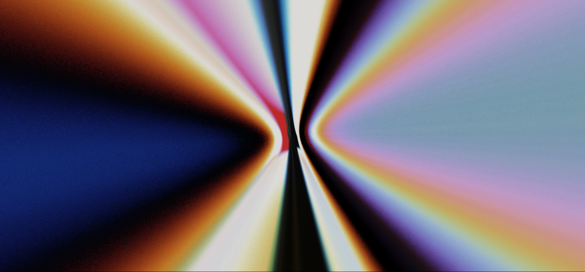
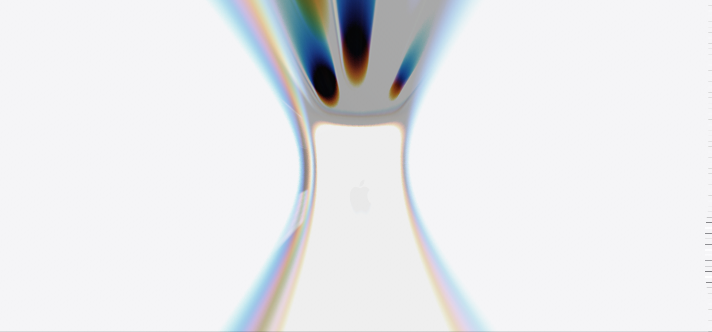
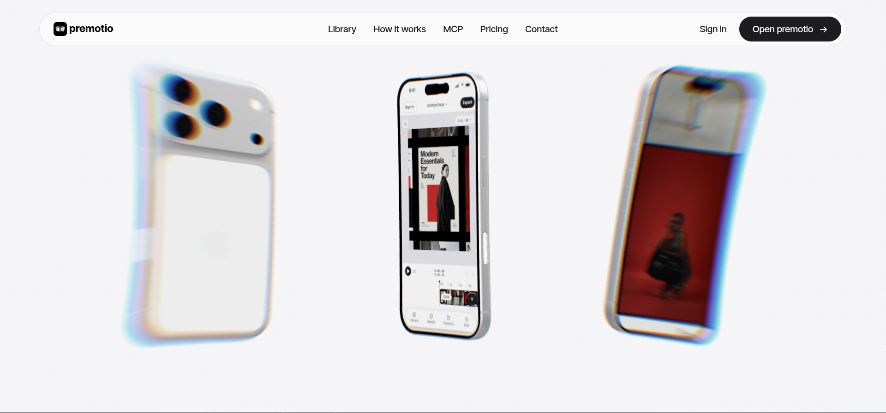
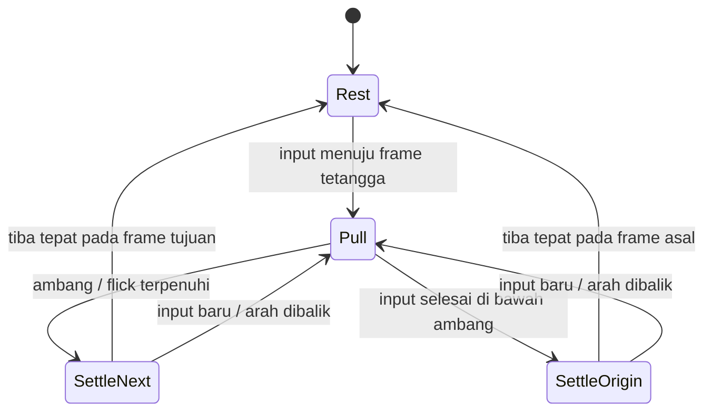

# Premotio — review entrance dan snap rasio setelah rekaman implementasi

Tanggal: 1 November 2026. Target: `/landing-experiment`, **setelah FeatureGridMinimal**, mengikuti penempatan terbaru pengguna.

Dokumen ini melengkapi [laporan gabungan](PREMOTIO_LAPORAN_GABUNGAN_DAN_IMPLEMENTATION_PLAN.md). Untuk entrance dan perilaku pergantian rasio, gunakan spesifikasi di sini. Temuan aset, model, komposisi layar, handoff, dan ring pada laporan gabungan tetap menjadi dasar.

**Status pekerjaan ini: analisis dan rencana revisi. Kode animasi belum diubah dalam review ini.** Rekaman terbaru memperlihatkan hasil implementasi awal; keberadaan shader dan spring dalam kode belum berarti kualitas visual atau perilakunya sudah sesuai referensi.

**Pembaruan setelah persetujuan implementasi:** revisi kini sudah diterapkan dalam kode. Lihat [status implementasi dan hasil verifikasi](PREMOTIO_IMPLEMENTATION_STATUS.md). Isi review berikut tetap menjadi catatan kondisi sebelum revisi dan alasan perubahan; hasil visual revisi belum lolos QA browser karena gerbang izin lokal masih menolak akses.

## 1. Kesimpulan yang memengaruhi implementasi

Ada dua kekurangan utama yang terkonfirmasi, serta satu masalah geometri yang berkaitan langsung dengan permintaan agar preview menutup tepat ke garis.

| Bagian | Kondisi sekarang | Revisi yang diperlukan |
| --- | --- | --- |
| Awal section | Handset sudah terlihat ketika stage masih naik memasuki viewport. | Stage kosong berwarna putih terlebih dahulu. Entrance baru mulai setelah stage menempel di atas dan pengguna melanjutkan scroll. |
| Efek masuk | Distorsi UV dan pemisahan RGB sangat ringan, dengan rotasi kecil pada handset tengah. | **Radial warp/tunnel reveal dengan chromatic dispersion**, jejak warna radial, grain halus, dan koreografi rotasi/perspektif handset. |
| Pergantian rasio | Spring mengikuti target kontinu dari posisi scroll. Target bisa pecahan. | Keputusan gesture untuk **lanjut atau kembali**, kemudian spring menyelesaikan gerak ke salah satu dari tiga state sah. |
| Pantulan | Redaman relatif tinggi; nilai format juga di-clamp pada batas 0 dan 2. | Spring yang terlihat lentur dengan overshoot terkendali; overshoot tidak terpotong di endpoint. |
| Ketepatan garis | Perhitungan outline terpisah dari perhitungan ukuran preview. | Outline, preview, mask, fallback, dan switch membaca geometri/state yang sama. |

Efek masuk tersebut adalah pengolahan hasil render WebGL. Membuat model baru di Blender tidak menyelesaikan kekurangan ini. Model lokal dan gambar yang sudah tersedia cukup untuk mengerjakan revisi mekanismenya.

## 2. Bukti yang ditinjau dan batas kesimpulan

### Rekaman implementasi terbaru

[Jam implementasi, 19,46 detik](https://jam.dev/c/3b4489c1-0e99-46b5-91a6-b21ed3dfbe86). Frame berikut diperiksa melalui Jam MCP, selain overview rekaman.

| Waktu rekaman | Yang terlihat |
| --- | --- |
| 0 dan 1,20 detik | Feature grid; stage perangkat mulai masuk di bawahnya. |
| 2,10 detik | Tiga handset langsung terlihat, tengah menghadap depan dan samping hampir profil. Tidak terlihat fase tunnel penuh sebelum pose ini. |
| 2,80 detik | Tiga handset berukuran biasa, dua samping memperlihatkan belakang. |
| 3,50 dan 4,20 detik | Fokus satu handset, kemudian judul dan copy muncul. |
| 6,60 detik | Preview portrait dan switch 9:16. |
| 7,40 detik | Preview square dan switch 1:1. |
| 8,50 detik | Preview landscape dan switch 16:9. |
| 10,00 dan 11,50 detik | Frame konten berikut dan frame ekspor kembali terlihat pada waktu berbeda; rekaman juga berguna untuk memeriksa perjalanan balik. |

Waktu tersebut adalah penunjuk bukti, **bukan durasi animasi yang harus di-hardcode**. Scene mengikuti scroll; kecepatan rekaman tidak memberikan jarak atau kecepatan gesture secara pasti.

Jam ini hanya menyimpan satu event keyboard; tidak ada rangkaian event scroll yang dapat dipakai mengukur gesture. Karena itu, kesimpulan bahwa ukuran dapat berhenti di tengah didukung jalur kode dan reproduksi numerik, bukan klaim bahwa rekaman mengukur seluruh variasi berhenti scroll.

### Referensi

- [Jam Premotio sebelumnya](https://jam.dev/c/8a360bcb-b640-465c-9a3f-711d8bc7f710): entrance diperiksa lagi pada 7,50; 8; 8,50; 9; 9,50; 10; 10,50; dan 11 detik.
- Lima gambar pengguna disimpan tanpa pengubahan dalam [folder bukti](premotio-evidence/entrance-review-2026-11-01/manifest.json), beserta hash dan daftar timestamp pemeriksaan.
- Bundle publik yang telah diperoleh dari [Premotio](https://premotio.com/) ditelusuri kembali. [Bundle scene](https://premotio.com/_nuxt/Xc5JkAqg.js) memuat shader/compositor dan solver spring. [Bundle parameter](https://premotio.com/_nuxt/CGu4ElgJ.js) memuat envelope warp dan perhitungan pose/format. Nama bundle dapat berubah saat situs di-deploy ulang.

Tidak dilakukan pengujian browser lokal baru dalam review ini. Tidak ada klaim FPS, GPU time, atau bahwa revisi yang direncanakan sudah lolos pemeriksaan visual.

## 3. Nama dan cara kerja efek masuk

Istilah yang paling tepat adalah **radial warp/tunnel reveal dengan chromatic dispersion**. Sebutan seperti lens warp, optical tunnel, atau pinch/zoom transition bisa menggambarkan tampilannya, tetapi tidak ada satu nama preset yang otomatis menghasilkan semua detail ini.

Efek tersebut tersusun dari beberapa lapisan yang sinkron:

1. **Render scene ke tekstur.** Tiga handset, material, layar, pencahayaan, dan perspektif digambar dahulu ke render target.
2. **Distorsi radial pada gambar hasil render.** Shader menentukan dari posisi mana setiap pixel layar mengambil warna. Area kecil dekat pusat dapat terentang sampai memenuhi viewport. Siluet handset tampak terjepit dan tertarik karena pemetaan pandangan berubah; mesh GLB tidak perlu di-remesh atau diberi skeleton.
3. **Jejak radial dengan dispersi warna.** Beberapa sampel sepanjang arah radial diberi bobot spektrum berbeda. Ini menghasilkan pita cyan, biru, merah, dan kuning pada bentangan gambar, lebih kaya daripada tiga sampel RGB yang sedikit digeser.
4. **Grain pada sampling dan dithering.** Titik mulai sampel bervariasi per pixel untuk menghindari garis/banding teratur. Grain yang terlihat bukan seluruhnya tekstur noise tambahan.
5. **Rotasi handset dan perubahan komposisi.** Di balik distorsi, handset tetap berputar sebagai benda 3D. Distorsi berkurang sambil pose dan kamera mendekati susunan tiga handset.







### Formula yang benar-benar ditemukan

Pada shader compositor, koordinat UV dikoreksi terhadap aspect ratio viewport. Untuk radius output `r`, radius sumber yang disampel adalah:

```text
sourceRadius = r / sqrt(1 + (k*r)^2) / zoom
rayAmount    = (k*r)^2 / (1 + (k*r)^2)
```

`k` mengatur kuat distorsi. `zoom` mengatur pembesaran tambahan. Arah radial tetap dipakai saat mengembalikan koordinat sumber menjadi UV.

Parameter envelope asli mencakup `k = 22` dan tambahan zoom `1.3`. Sebelum titik pergantian scene, kekuatan tumbuh dengan pangkat 4 dan zoom dengan pangkat 2,6; setelahnya, kekuatan mereda dengan pangkat 4,2. Zoom juga memakai cabang berbeda setelah titik pergantian. Dengan demikian, efeknya memiliki build-up tajam dan pelepasan yang berbeda; bukan pulsa sinus simetris.

Sebagai ilustrasi matematis, pada `r = 0.5`, `k = 22`, dan `zoom = 2.3`, radius sumber hanya sekitar **0,01968**. Rentang kecil sumber itu dipetakan ke bagian besar layar. Ini menjelaskan bentangan yang sangat besar pada gambar pengguna.

Shader asli mempunyai sampling spektral adaptif: sampai 16 tap pada jalur utama dan sampai 32 tap pada jalur rays setengah resolusi. Jalur setengah resolusi membantu membatasi biaya bentangan panjang; detail akhirnya dikomposisikan kembali. Mask untuk melewati area kosong juga tersedia. Angka tersebut adalah temuan sumber, bukan kewajiban menyalin seluruh compositor situs yang juga melayani section lain.

### Mengapa implementasi sekarang jauh lebih halus?

Pada `device-story-renderer.ts`, shader saat ini memakai:

```text
sourceUV = 0.5 + d * (1 - warp * 0.14 * dot(d,d))
RGBshift = d * warp * 0.008
```

Nilai `warp` maksimalnya 0,65. Pada tengah tepi horizontal, faktor radius sumber masih sekitar **0,97725**: hanya perubahan sekitar 2,28%. Itu berbeda jauh dari kompresi sumber pada rumus referensi. Saat ini juga belum ada integrasi sampel spektral sepanjang jejak radial.

Handset tengah sekarang berputar dari sekitar −0,4 radian menuju frontal pada entrance. Jalur pose referensi memiliki orientasi awal sekitar −520° menuju frontal dengan easing. Rotasi tersebut bekerja bersama warp, sehingga hanya menambah kekuatan RGB split tidak cukup untuk menyamakan hasilnya.

Kesimpulannya, shader dan koreografi entrance perlu direvisi sebagai satu rangkaian. Menaikkan blur atau memperbesar angka `warp` pada rumus lama saja tidak memberikan pemetaan optik yang sama.

### Hubungan dengan layar putih pada awal section

Permintaan untuk Menuin adalah jelas: section masuk sebagai bidang putih, lalu scroll berikutnya memulai reveal. Ini menjadi ketentuan implementasi.

Ada detail teknis yang perlu dijaga: **gambar putih seragam tetap putih ketika didistorsi**. Warna dan bentuk tunnel membutuhkan sumber visual. Karena itu renderer harus menyiapkan tekstur scene/plate entrance dari aset lokal, lalu menampakkannya melalui envelope reveal; tidak cukup menjalankan shader terhadap background kosong.

Situs asli memakai compositor yang melayani beberapa scene secara berurutan. Jalur perangkat baru dipilih setelah `warp.cut`; sebelum itu, compositor masih dapat memakai sumber story sebelumnya. Menuin kini menempatkan section ini sesudah feature grid HTML. Jadi handoff menuju warp harus dibuat mandiri, memakai sumber visual dari section perangkat sendiri, agar feature grid tidak perlu ditangkap menjadi screenshot pada setiap frame.

Rancangan sumber entrance: gunakan render handset dan layar lokal; bila build-up dari bidang putih membutuhkan detail tambahan, gunakan satu plate berisi pengulangan gambar lokal yang sama pada render target. Pergantian plate ke scene handset ditempatkan di puncak distorsi, dengan blending singkat untuk menghindari pop. Ini adalah pilihan implementasi Menuin, bukan klaim bahwa Premotio memakai plate tambahan yang sama.

Palet tunnel akan mengikuti kontras dan warna gambar sumber. Gambar Menuin yang dominan putih/biru tidak otomatis menghasilkan warna merah/hitam sekuat referensi. Mekanisme, bentuk bentangan, urutan pose, dan intensitas dispersi dapat disamakan dahulu dengan aset yang ada.

## 4. Urutan entrance yang akan diterapkan

| Fase | Tampilan dan perilaku |
| --- | --- |
| Mendekati section | Feature grid selesai bergulir; section berikut terlihat putih. Handset, fallback handset, judul, dan preview belum muncul. |
| Stage menempel | Stage mengisi viewport dan diam di tempat. Ada rentang putih singkat agar awal cerita terbaca. |
| Build-up | Sumber visual mulai terungkap, distorsi dan pembesaran bertambah; jejak warna memanjang ke tepi viewport. |
| Puncak / pergantian sumber | Tunnel paling kuat. Pose handset di balik shader sudah dipersiapkan; pergantian sumber tidak terlihat sebagai cut bersih. |
| Release | Distorsi dan dispersi mereda. Tengah melewati orientasi belakang/profil menuju depan; dua samping masih besar atau terpotong tepi sebelum masuk komposisi. |
| Triptych terbaca | Tiga handset terlihat utuh, dengan orientasi yang berbeda. Beri jarak scroll agar pose ini sempat terbaca. |
| Fokus | Dua handset samping keluar; handset utama membesar/menetap. Judul, copy, dan panel layar mengikuti fase yang sudah direncanakan. |

Rentang awal yang diusulkan untuk progress total: putih `0–0.04`, build-up `0.04–0.10`, release `0.10–0.17`, triptych `0.17–0.24`, fokus `0.24–0.33`. Rentang sesudahnya perlu diremap agar panel layar, handoff, dan scene ekspor tetap punya ruang. **Angka ini usulan kalibrasi, bukan angka hasil mengukur jarak scroll dari Jam.**

Reverse scroll mengevaluasi envelope yang sama dari arah sebaliknya. Saat kembali melewati awal, stage kembali putih. Entrance tidak dijalankan oleh timer yang terus maju walaupun posisi scroll sudah mundur.

`phoneAlpha` saat ini bernilai 1 pada progress 0. Nilai ini harus berubah bersama aturan visibilitas fallback; menyembunyikan model WebGL saja masih dapat meninggalkan gambar fallback yang muncul terlalu cepat. CSS, state awal sebelum pemuatan aset, dan render pertama harus diperiksa bersama, termasuk cold load langsung menuju section.

Background putih yang diminta perlu menjadi satu nilai untuk CSS stage, clear renderer, dan komposisi shader. Nilai sekarang `#f5f5f7` adalah putih keabu-abuan; rencana revisi memakai putih `#fff` untuk section ini sesuai permintaan, termasuk transisi masuk/keluar agar tidak berkedip antarwarna.

## 5. Memisahkan pantulan dan keputusan rasio

Istilah yang sesuai untuk rasa “trampolin” adalah **underdamped spring / elastic settling**. Perilaku yang memastikan gerak berakhir tepat pada frame adalah **discrete snapping dengan commit/revert dan hysteresis**. Keduanya menyelesaikan masalah berbeda.

### Penyebab bisa berhenti di tengah

Saat ini `sampleStory()` membentuk target format dari dua smoothstep:

```text
formatTarget = phase(progress, .65, .73) + phase(progress, .77, .85)
```

Target itu memiliki semua nilai antara 0 dan 2. Solver mengejar target tersebut, sehingga spring yang sempurna sekalipun akan diam pada pecahan jika pengguna berhenti pada progress tersebut.

Reproduksi numerik memakai persamaan solver sekarang: target ditahan di **0,4** selama enam detik; hasil akhirnya **0,4**, dengan kecepatan mendekati nol. Ukuran preview menghasilkan rasio sekitar **0,71591**, yang bukan 9:16 maupun 1:1. Menambah durasi atau mengurangi redaman tidak memperbaiki pilihan titik istirahat.

### Apa yang terbukti pada Premotio?

Jalur format asli yang ditelusuri juga membentuk target kontinu dari dua smoothstep, lalu menjalankan spring dengan `omega = 2π/0.6` dan `zeta = 0.3`. Pada jalur scene ini, belum ditemukan bukti bahwa setiap gesture selalu diubah menjadi indeks bulat sebelum mencapai spring. Konfigurasi snap milik library yang ikut berada dalam bundle bukan bukti bahwa fitur snap dipakai oleh scene tersebut.

Jadi, **pantulan memang didukung bukti sumber Premotio; ketentuan selalu commit/revert ke frame adalah spesifikasi tambahan pengguna yang akan kita pastikan secara eksplisit.** Laporan ini tidak menganggap perilaku diskret sudah terbukti hanya dari kesan menonton rekaman.

### Kontrak perilaku revisi

Tiga titik istirahat yang sah:

| State | Frame | Posisi pilihan pada switch |
| --- | --- | --- |
| 0 | 9:16 | indeks 2 |
| 1 | 1:1 | indeks 3 |
| 2 | 16:9 | indeks 5 |

Angka 3:4, 4:5, dan 4:3 yang dilewati pill secara visual tidak menjadi titik snap tambahan.

- Ketika gesture masih aktif, tampilan boleh tertarik ke arah frame tetangga. Ini memberi hubungan langsung antara scroll dan gerak.
- Jika tarikan cukup jauh, atau flick cukup kuat dengan perpindahan minimum yang sah, controller memilih frame berikut/sebelumnya.
- Jika input dilepas sebelum ambang, controller memilih kembali frame asal.
- Setelah keputusan, target istirahat selalu 0, 1, atau 2. Spring tetap bergerak sesudah input berhenti sampai tiba di target.
- Gerak boleh melewati target sebentar lalu kembali. Ketika benar-benar berhenti, ukuran dan pill harus tepat di target, dengan kecepatan nol.
- Gesture baru dapat menginterupsi settlement dan membalik arah dari posisi/kecepatan sekarang. Jangan mengulang animasi dari endpoint awal atau menumpuk tween.

“Satu gesture” berarti satu rangkaian input wheel/trackpad atau satu drag touch, termasuk penanganan ekor momentum. Satu event `wheel` bukan satu gesture; memajukan rasio setiap event akan melompati semua pilihan terlalu cepat pada trackpad.

### Controller yang disarankan



State minimum: `committedIndex`, `candidateIndex`, `gestureStart`, `intent`, `mode`, `springPosition`, `springVelocity`, dan transaksi snap scroll yang sedang aktif. Target yang sudah diputuskan dipisahkan dari progress scroll mentah.

Ambang awal yang masuk akal untuk dicoba adalah sekitar **42% jarak antartitik snap**; deteksi input berhenti sekitar **140 ms** setelah input terakhir. Threshold flick harus memakai kecepatan yang dinormalisasi terhadap jarak frame dan membutuhkan perpindahan minimum. Angka ini parameter awal eksperimen, bukan temuan dari Jam. Setelah commit, hysteresis menahan pilihan agar noise atau ekor inertia tidak men-toggle keputusan berkali-kali.

Scroll dokumen di area rasio ikut diselesaikan menuju anchor frame terpilih. Ini mencegah posisi scroll mentah tertinggal jauh dari state visual lalu memicu perubahan yang membingungkan pada gesture selanjutnya. Snap ini hanya aktif pada rentang pergantian rasio yang stage-nya sudah menempel; keluar/masuk section lain tetap mengikuti alur halaman.

Implementasi memakai **instance Lenis yang sudah ada**, dengan input intent dan transaksi `scrollTo` yang dapat diinterupsi. Tipe Lenis lokal menyediakan event `virtual-scroll` dan `scrollTo`; controller perlu membedakan input pengguna dari gerak snap programatik agar tidak mengambil keputusannya sendiri sebagai gesture baru. Jangan menambahkan mesin smooth scroll kedua. Keyboard, touch native, dan scrollbar memerlukan jalur penyelesaian yang setara, bukan hanya handler wheel.

Untuk scroll normal, keputusan menuju frame tetangga dibuat satu kali per rangkaian gesture. Lompatan eksplisit—misalnya menarik scrollbar jauh, navigasi anchor, atau restore posisi halaman—diperlakukan sebagai seek: rekonsiliasi ke state sah yang sesuai posisi baru, tanpa menarik pengguna kembali dari section yang sudah dituju. Saat mendekati akhir area rasio secara normal, frame wide diselesaikan sebelum fase fade dilepas. Jika controller sudah tidak aktif karena seek keluar, jangan menjalankan snap tertunda yang menyeret halaman kembali.

### Spring dan pantulan yang terlihat

Gunakan model spring dengan posisi dan kecepatan yang dipertahankan saat target berubah:

```text
acceleration = omega² * (goal - position) - 2*zeta*omega*velocity
```

Solver berbasis waktu dengan substep terbatas membuat respons konsisten pada refresh rate berbeda. Setelah jarak dan kecepatan di bawah epsilon, set posisi **persis** ke target dan velocity ke nol; tidak menyisakan drift pecahan pixel.

Parameter sekarang setara dengan damping ratio sekitar **0,685**. Referensi memakai 0,3, tetapi menyalin 0,3 mentah ke target diskret berisiko berlebihan: untuk step mendadak, overshoot teoritisnya sekitar **37%**. Target asli yang bergerak kontinu mempunyai respons berbeda dari step diskret.

Untuk revisi, mulai dengan periode natural sekitar **0,45–0,60 detik** dan damping ratio **0,5–0,6**, kemudian cocokkan secara visual. Pantulan harus terbaca tanpa membuat frame menyapu terlalu jauh. Angka ini adalah rancangan kalibrasi.

`previewSize()` sekarang melakukan clamp `format` ke `[0,2]`. Clamp ini memotong overshoot keluar dari endpoint portrait/wide. Revisi harus membolehkan ekstrapolasi pendek yang dibatasi, dengan ruang untuk overshoot; indeks segmen tetap aman dan ukuran tetap positif. Jangan memotong pantulan pada mask tetapi membiarkan pill terus memantul, atau sebaliknya.

## 6. Agar preview benar-benar menutup ke garis

Saat ini outline square dihitung dari `min(roomWidth*0.98, roomHeight*0.81)`, sedangkan preview memakai tinggi dasar `min(roomHeight, roomWidth/0.985)` lalu mengalikannya dengan 0,81. Keduanya berbeda ketika lebar menjadi pembatas.

Contoh dari evaluasi fungsi saat ini, untuk room **280 × 400 px**: square preview sekitar **230,25 px**, tetapi outline square **274,4 px**. Memilih indeks 1 secara tepat belum cukup jika kedua geometri tetap memakai rumus berbeda.

Rencana perbaikan adalah satu fungsi `getFormatFrames(room)` yang menghasilkan tiga rectangle final dari ruang yang sama, termasuk ruang overshoot. Hasil tersebut dipakai oleh:

- frame preview WebGL dan SDF rounded-rectangle;
- outline SVG;
- lubang mask SVG yang menutupi garis di belakang preview;
- ukuran fallback;
- interpolasi posisi/ukuran yang memakai satu koordinat spring.

Switch memakai pemetaan dari koordinat format yang sama ke indeks label `[2,3,5]`. State seleksi akhir mengambil indeks rasio yang diputuskan, bukan membulatkan posisi pixel pill sehingga 4:3 keliru dianggap state yang dipilih.

Saat settle selesai, rectangle preview dan rectangle target harus sama dalam koordinat stage. Radius sudut dan transform/proyeksi juga harus cocok. Untuk handoff berotasi, mask perlu mengikuti geometri terproyeksi; uji utama ketepatan garis dilakukan setelah preview frontal dan menetap.

Ukuran render target isi ring tetap dialokasikan berdasarkan room. Yang berubah saat rasio berganti adalah frame/clip dan pengambilan gambar yang mempertahankan proporsi. Hindari mengubah resolusi render target pada setiap frame atau melakukan `scaleX/scaleY` pada hasil akhir sehingga semua gambar ikut gepeng.

Sudut ring tetap mengikuti progress scene secara kontinu, termasuk selama snap scroll menuju anchor. Pergantian rasio tidak me-reset ring, mengganti tekstur, atau memulai loop waktu baru. Ketika scroll mundur, arah ring ikut mundur.

## 7. Urutan pekerjaan dan file yang terlibat

| Tahap | Pekerjaan konkret | Bukti selesai |
| --- | --- | --- |
| 1. Satukan geometri | Revisi `device-story-motion.ts` agar frame akhir, outline, mask, dan preview berbagi perhitungan. | Endpoint portrait/square/wide sama persis pada desktop dan room sempit. |
| 2. Buat keputusan gesture | Pisahkan intent, keputusan diskret, dan solver; hubungkan settlement scroll ke Lenis yang ada. | Tarikan kecil kembali; tarikan cukup lanjut; reverse bekerja; tidak ada endpoint pecahan. |
| 3. Kalibrasi spring | Atur redaman, periode, overshoot, epsilon, dan interupsi dari velocity yang tersimpan. | Ada pantulan yang terbaca dan semua elemen tiba bersamaan. |
| 4. Buat awal putih | Revisi state awal serta visibilitas canvas/fallback pada `device-export-story.tsx` dan CSS. | Tidak ada handset muncul dari bawah feature grid sebelum reveal dimulai. |
| 5. Bangun compositor warp | Revisi shader pada `device-story-renderer.ts`, envelope, sumber entrance, dan koreografi pose. | Tunnel memenuhi viewport lalu terurai menjadi triptych, tanpa pop atau potongan tepi yang salah. |
| 6. Remap urutan cerita | Beri ruang untuk triptych, fokus, panel, handoff, rasio, fade, dan konten berikut. | Scene tetap terbaca saat scroll lambat/cepat dan balik arah. |
| 7. QA browser dan performa | Cocokkan frame penting dengan referensi, uji input nyata dan biaya render. | Rekaman pembanding baru, hasil uji endpoint dan GPU/browser yang dicatat. |

`landing-experiment-page.tsx` tetap menempatkan section setelah FeatureGridMinimal. Model yang sudah ada, shader layar, handoff, ring, dan fade akhir menjadi fondasi revisi. Kebijakan keluar yang diminta sebelumnya tetap berlaku: scene memudar dan konten berikut naik di dalam panggung yang background-nya tetap.

### Menjaga biaya render

Gunakan satu renderer dan render target perangkat yang sudah ada. Jalur rays setengah resolusi hanya diperlukan ketika warp aktif. Saat kekuatannya nol, compositor dapat memakai jalur ringan; pass mahal tidak perlu berjalan pada seluruh cerita.

Jumlah tap dan DPR perlu ditentukan dari pengukuran, terutama pada ponsel. Mulai dari jumlah tap terbatas, tambahkan hanya bila banding/jejak warna belum cukup. Mask untuk melewati area kosong dapat menyusul jika profil membuktikan manfaatnya. Shader dipanaskan sebelum entrance agar compile pertama tidak menjadi jeda yang terlihat.

Tetap jeda render saat section tidak terlihat/tab tersembunyi; bersihkan listener, transaksi snap, texture, dan render target pada unmount. Reduced motion memakai alur yang lebih tenang tanpa tunnel dan overshoot agresif. Semua ini perlu diuji setelah perubahan; belum menjadi hasil benchmark.

## 8. Kriteria penerimaan revisi

1. Sebelum stage menempel, hanya bidang putih section yang terlihat; tidak ada model atau fallback yang bocor.
2. Scroll setelah stage menempel membentuk tunnel dari sumber visual, dengan dispersi warna dan bentangan radial yang jelas; bukan hanya blur tipis.
3. Tunnel mereda ke pose tiga handset yang sempat terbaca sebelum dua samping keluar.
4. Scroll balik membalik urutan entrance dan akhirnya mengembalikan stage ke putih.
5. Tarikan rasio kecil yang dilepas kembali ke frame asal; tarikan yang lolos ambang menuju frame tetangga.
6. Setelah input berhenti dan spring selesai, format hanya 0/1/2, velocity nol, pill tepat pada pilihan sah, dan preview berimpit dengan frame tujuan.
7. Pantulan tetap terlihat pada perpindahan menuju portrait maupun wide; tidak terpotong oleh clamp.
8. Input berbalik saat spring bergerak tidak menyebabkan loncatan atau antrean animasi.
9. Ekor inertia trackpad tidak memajukan dua pilihan secara tidak sengaja; mouse wheel, keyboard, touch, dan scrollbar tetap dapat meninggalkan section.
10. Gambar dalam ring tidak gepeng, putarannya tidak reset ketika rasio berubah, dan fase fade akhir tetap sesuai permintaan.
11. Endpoint tetap tepat setelah resize, zoom browser, dan pada room yang dibatasi lebar.
12. Cold load, masuk langsung pada posisi scroll tersimpan, dan pemuatan aset terlambat tidak memperlihatkan pose awal yang salah.

Tes logika yang bermakna: commit/revert, hysteresis, reverse/interruption, seek keluar, penyelesaian ke indeks sah, dan kesamaan geometri endpoint. Build/lint/TypeScript membantu memeriksa integrasi, tetapi pemeriksaan browser diperlukan untuk shader, pantulan, dan kemiripan visual.

## 9. Yang dapat dibantu pengguna

**Tidak diperlukan aset baru untuk memulai revisi ini.** Model GLB lokal dan gambar yang sudah ada dapat dipakai berulang. Blender baru relevan jika uji berikutnya menunjukkan kekurangan nyata pada siluet, bevel, normals, atau material, bukan untuk membuat tunnel atau perilaku snap.

Hal yang paling membantu saat kalibrasi adalah mencoba satu gesture kecil yang dilepas, satu gesture cukup kuat, dan satu pembalikan arah saat frame masih memantul. Rekaman lambat dengan jeda di antara gesture akan menunjukkan apakah ambang terasa terlalu ringan/berat. Ini dapat dilakukan setelah revisi tersedia; bukan prasyarat memulai pekerjaan.

Pemeriksaan browser lokal pada pekerjaan sebelumnya ditolak oleh gerbang izin tersimpan, termasuk setelah persetujuan di chat. Jika penolakan yang sama masih berlaku saat QA berikutnya, pengaturan izin origin `http://127.0.0.1:3000` di browser tool perlu diubah. Rekaman Jam terbaru sudah memberi bukti visual implementasi saat ini; ia belum menggantikan pengujian live terhadap kode revisi.

## 10. Jejak sumber untuk pemeriksaan ulang

Nomor baris bundle berikut merujuk salinan terformat pada saat investigasi, bukan source map atau nomor baris repo Premotio.

| Klaim | Sumber |
| --- | --- |
| Pemetaan radial, rays spektral, sampling grain dan half-resolution pass | `Xc5JkAqg.js.formatted`, sekitar 17700–18070; hash dalam manifest review. |
| Envelope `k=22`, zoom, titik pergantian, shot dan pose handset | `CGu4ElgJ.js.formatted`, sekitar 1823–1922. |
| Target format kontinu dan tiga bentuk frame | `CGu4ElgJ.js.formatted`, sekitar 1934–1982. |
| Solver dengan omega dan zeta serta pemakaian target kontinu | `Xc5JkAqg.js.formatted`, sekitar 25675–25710 dan 25828–25858. |
| Story memilih sumber perangkat setelah titik cut | `Xc5JkAqg.js.formatted`, sekitar 25590–25606. |
| Kekurangan UV warp saat ini | `apps/web/src/components/landing/device-story-renderer.ts`, konstanta `COMPOSITE` dan `render()`. |
| Target pecahan dan clamp endpoint | `apps/web/src/components/landing/device-story-motion.ts`, `sampleStory()` dan `previewSize()`. |
| Spring, outline terpisah, dan lifecycle scroll saat ini | `apps/web/src/components/landing/device-export-story.tsx`, `measure()`, `render()`, dan `ScrollTrigger.create()`. |

Reproduksi numerik dalam review ini mengevaluasi persamaan yang dibaca dari kode; hasil tersebut tidak diklaim sebagai rekaman runtime browser. Bukti statis, frame rekaman, rancangan revisi, dan hal yang masih perlu diuji sengaja diberi status masing-masing agar dapat ditinjau kembali.
