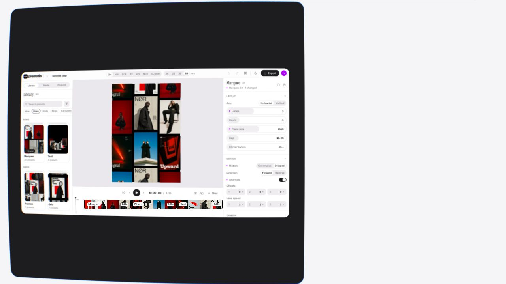
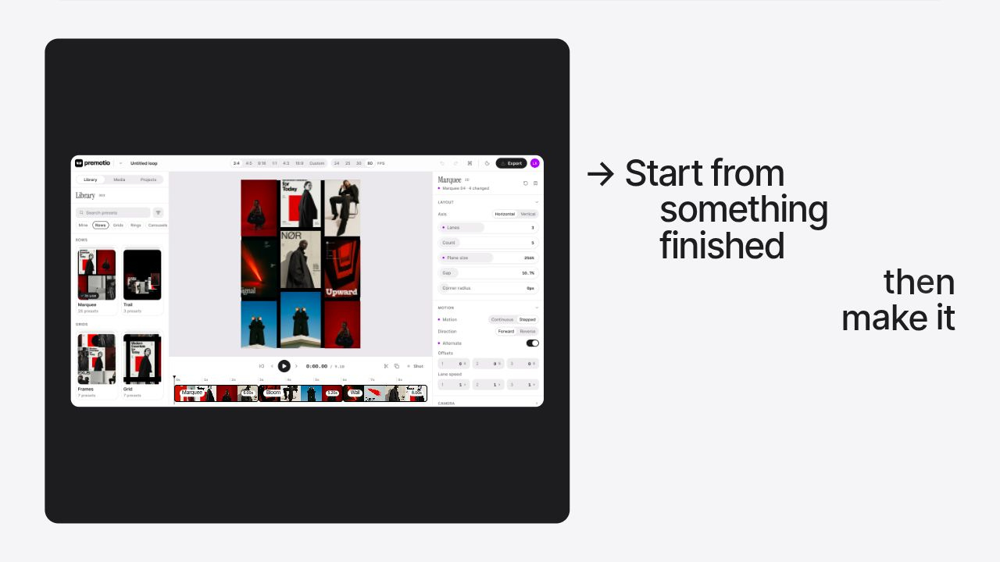
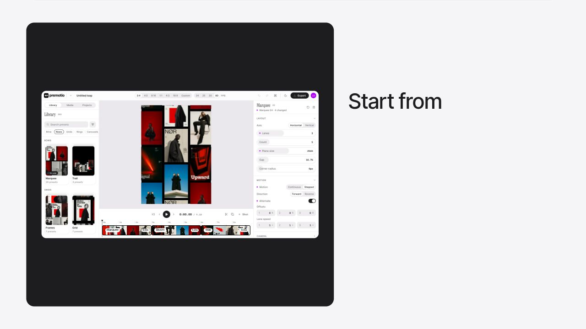

# Analisis galeri wall/grid Premotio untuk pembuka Phone

Tanggal inspeksi: 2 November 2026. Dokumen ini memperbarui rencana galeri pembuka pada [laporan sebelumnya](PREMOTIO_GALLERY_RUNTIME_REVERSE_ENGINEERING_2026-11-02.md). Statusnya adalah analisis dan usulan adaptasi, belum merupakan implementasi baru.

## Hasil identifikasi

Gambar yang dilampirkan pengguna paling cocok dengan **wall gambar di dalam preview editor pada section “Make it your own in the editor”** di [Premotio](https://premotio.com/#how-it-works). Pada inspeksi live, urutan poster, latar hitam, bentuk kartu, dan gerak selang-seling kolom cocok dengan lampiran. Tampilan itu kemudian membesar ketika situs bertransisi menuju section “Distort anything”.



Di situs ada juga kategori preset bernama **Grids**. Namanya mirip, tetapi generator kategori tersebut mempunyai cara bergerak dan penataan yang berbeda dari wall pada screenshot. Dalam dokumen ini, “wall” merujuk khusus pada galeri yang cocok dengan lampiran.

Klarifikasi terbaru mengubah pembuka Menuin menjadi **wall/grid → pilih gambar storefront → preview Phone**. Konsep poster bertumpuk Fields/Reveals tidak lagi dipakai pada pembuka. Setelah Phone, carousel datar menuju Tab dan orbit melengkung menuju Laptop tetap mengikuti arahan sebelumnya.

## Bukti dan batas analisis

- **Visual:** situs live diperiksa pada viewport desktop 1280 × 720. Dua screenshot berikut diambil pada posisi scroll yang berbeda dalam preview editor yang sama. Perubahan posisi menunjukkan arah kolom yang bergantian.
- **Sumber teknis:** JavaScript publik yang dimuat browser, terutama [bundle konfigurasi dan geometri](https://premotio.com/_nuxt/CGu4ElgJ.js) dan [bundle renderer serta komponen](https://premotio.com/_nuxt/Xc5JkAqg.js). Simbol ter-minifikasi yang diperiksa meliputi `ar.wall`, `Lr`, `zr`, `me`, dan `fe`.
- **Bukan akses ke source repository asli:** nama fungsi, angka, dan offset merujuk pada build publik saat inspeksi. Situs dapat berubah setelah tanggal ini.
- **Satu screenshot pengguna:** pola yang tampak dapat dicocokkan dengan fase wall live, tetapi screenshot statis saja tidak dapat membuktikan kecepatannya. Arah dan progres gerak disimpulkan dari pengamatan scroll serta kode runtime.





## Bentuk visual yang perlu dipertahankan

Pada lampiran, galeri memenuhi bidang preview portrait dengan dasar hitam. Gambar-gambarnya berbentuk persegi panjang vertikal, seluruhnya tegak dan sejajar. Celah horizontal dan vertikal tipis memperlihatkan dasar hitam.

Pengukuran kasar dari lampiran berukuran 301 × 549 piksel:

| Elemen | Perkiraan pada lampiran | Implikasi |
| --- | --- | --- |
| Kartu tengah yang utuh | Sekitar 133 × 189 px | Rasio lebar/tinggi sekitar 0,70 |
| Lebar kartu tengah terhadap preview | Sekitar 44% | Kartu tengah cukup dominan untuk dikenali |
| Celah antar kolom | Sekitar 10–11 px | Celah sekitar 7–8% dari lebar kartu |
| Kolom yang tampak | Satu utuh di tengah; satu terpotong di kiri dan kanan | Wall lebih lebar daripada aperture |
| Baris yang tampak | Sekitar tiga tinggi kartu, termasuk potongan tepi | Gambar keluar/masuk melalui tepi atas dan bawah |

Angka ini adalah perkiraan komposisi pada gambar, bukan aturan pixel absolut. Di browser live, ukuran preview dan jumlah kolom yang tampak berubah mengikuti layout editor dan ukuran viewport. Pada Menuin proporsinya perlu dikalibrasi terhadap preview Phone yang sesungguhnya.

Screenshot lampiran memperlihatkan gambar yang sama berulang pada kolom yang sama di posisi berbeda. Karena itu identitas **aset** dan identitas **instance kartu** harus dibedakan: satu aset dapat muncul beberapa kali, tetapi tiap instance memiliki posisi dan key sendiri.

## Susunan dan gerak wall pada kode Premotio

### Grid dasar

Konfigurasi wall pada build yang diperiksa menyatakan `columns: 5` dan `rows: 5`. Ini adalah grid logis lima kolom dan lima baris; clipping menentukan bagian mana yang terlihat pada preview. Tidak semua 25 posisi harus terlihat bersamaan.

Kartu wall menggunakan bentuk bersama dengan rasio `720/1019`, sekitar **0,707 lebar per tinggi**. Nilai internal ukuran dan jarak adalah:

```text
lebar kartu = (370.8 / 1080) × unitLayout
tinggi kartu = lebar kartu / (720 / 1019)
jarak = (27 / 1080) × unitLayout
pitch horizontal = lebar kartu + jarak
pitch vertikal = tinggi kartu + jarak
```

`unitLayout` bukan tinggi halaman dan bukan selalu tinggi preview. Ia dihitung dari ukuran stage dan frame. Rasio yang lebih mudah digunakan untuk membandingkan tampilannya adalah **jarak sekitar 7,28% dari lebar kartu**. Preview editor pada lampiran mempunyai aperture dan pemotongan sendiri.

### Arah gerak

Tiap kolom bergerak vertikal. Arah kolom bersebelahan berlawanan: kolom genap ke satu arah, kolom ganjil ke arah lain saat progress meningkat. Pada frame yang diamati, satu kolom bergerak naik dan tetangganya turun; saat scroll dibalik, progress dan arah geraknya juga kembali.

Penyederhanaan rumus yang mempertahankan hubungan penting:

```text
arah = kolom ganjil ? +1 : -1
pergeseran = 0.5 × t × smootherstep(clamp(t / 0.6, 0, 1))
x = pusatX + kolom × pitchHorizontal
y = pusatY + wrapTengah((baris + arah × pergeseran) × pitchVertikal,
                       5 × pitchVertikal)
```

Di sini `t` adalah progress internal setelah awal fase wall, bukan detik jam nyata. `wrapTengah` mengembalikan koordinat ke rentang yang berulang di sekitar pusat. Lima baris logis memungkinkan gambar yang melewati satu tepi kembali dari sisi lain tanpa perlu memindahkan seluruh halaman.

Kecepatan wall diatur oleh **progress cerita berbasis scroll**. Pemetaan dari scroll fisik ke progress itu melewati sistem story situs. Nilai `0.5` dan `0.6` di atas tidak dapat langsung diterjemahkan menjadi “0,5 detik” atau “0,6 detik” animasi CSS.

### Transisi masuk ke wall

Dalam alur asli Premotio, wall terbentuk dari susunan kartu di fase editor sebelumnya. Kode menginterpolasi pose kartu yang sudah ada menuju posisi grid, lalu menambahkan kartu untuk melengkapi grid. Rentang internal pembentukan wall berada pada `4.2–5` dengan kurva smootherstep. Periode awal gerak vertikal juga dinaikkan bertahap melalui parameter `gathers: 0.6`.

Untuk Menuin, pengguna sudah memutuskan **tidak menggunakan adegan poster bertumpuk**. Maka bagian yang relevan adalah kondisi wall dan geraknya; asal gerak wall bisa disesuaikan dengan adegan Menuin sebelumnya tanpa merekonstruksi tumpukan Premotio.

### Pengulangan aset

Wall Premotio memakai kumpulan gambar yang juga dipakai pada bagian lain landing. Beberapa slot telah mewarisi kartu dari adegan sebelumnya. Slot tambahan diisi dengan mempertimbangkan aset di sekitar dan distribusi jumlah gambar, sehingga tidak sekadar mengacak gambar di setiap frame.

Untuk Menuin, algoritme pengisian dapat lebih sederhana selama hasilnya stabil: susunan ditentukan sekali, aset yang sama boleh berulang, dan scroll balik mengembalikan instance ke posisi yang sama. Semua galeri tetap menggunakan **kolam gambar bersama** yang telah ditentukan sebelumnya.

## Kaitan wall dengan preview dan kamera

Pada Premotio, wall digambar di atas latar hitam dan dipotong sesuai persegi panjang stage di dalam editor. Elemen di luar preview editor—panel, kontrol, dan teks—adalah bagian dari presentasi story yang lebih besar.

Sebelum section Distort, keseluruhan area editor/preview ikut berubah skala dan posisi, sehingga wall terlihat semakin besar. Gerak itu berasal dari transisi panggung yang lebih luas. Gerak isi wall sendiri tetap berupa kolom yang bergeser dan berulang.

Untuk Menuin, batas yang relevan adalah **layar preview perangkat di kanan**. Latar, kolom, gambar yang dipilih, dan transisinya harus terpotong rapi oleh aperture tersebut; navigasi, teks, dan seluruh halaman tidak ikut diperbesar.

## Perbedaan dari kategori Grids

Preset **Grids** pada daftar kategori juga merupakan kumpulan poster datar, tetapi kode publiknya membangun pola berulang 7 × 7 dengan variasi rasio gambar dan jalur pusat pandang tersendiri. Kode ini juga menghitung perubahan jarak pandang dalam perjalanannya.

Wall pada screenshot pengguna berasal dari geometri lain: grid logis 5 × 5, bentuk kartu bersama, gerakan kolom berlawanan, dan wrapping vertikal. Mengambil preset kategori Grids hanya karena namanya sama akan menghasilkan perilaku yang tidak persis sesuai screenshot.

## Adaptasi wall → Phone yang diminta Menuin

Berikut rancangan transisi yang konsisten dengan arahan pengguna. **Langkah pemilihan storefront ini merupakan usulan Menuin**, karena dalam fase wall yang diperiksa di Premotio tidak ditemukan adegan memilih poster tertentu lalu menjadikannya tampilan Phone.

1. **Wall muncul di preview kanan.** Dasar hitam, kartu tegak, jarak rapi, dan tepi kolom terpotong. Kolam gambar berisi screenshot storefront, POS, dashboard, status pesanan, dan gambar Menuin lain yang sama dengan galeri berikutnya.
2. **Scroll menggerakkan wall.** Kolom bersebelahan bergerak berlawanan. Gambar storefront yang akan dipilih sudah ada sebagai instance nyata di wall.
3. **Storefront mendekati posisi fokus.** Progress ditata agar instance storefront yang sudah dipilih mencapai area tengah. Pemilihan bersifat hardcoded, bukan berdasarkan gambar acak yang kebetulan melintas.
4. **Storefront mengisi aperture.** Instance yang sama berpindah dari ukuran dan posisi grid ke ukuran layar Phone. Bentuk/kliping gambar berubah dengan halus. Instance lainnya dapat tetap bergerak singkat lalu menghilang di belakang gambar terpilih; tidak perlu melompat atau seluruh grid diperbesar bersamaan.
5. **Hold Phone.** Screenshot storefront memenuhi layar preview dan diam. Scroll berikutnya membuat gambar itu mundur menuju carousel datar untuk Tab.

Saat screenshot storefront mempunyai rasio berbeda dari kartu wall, crop dan framing perlu diinterpolasi atau dipilih secara sengaja. Pada akhir transisi, isi penting storefront harus terbaca dan layar terisi tanpa gambar gepeng atau muncul pinggiran kosong yang tidak diinginkan.

### Kontinuitas instance

Jika storefront muncul lebih dari sekali, pilih satu **instance** yang spesifik, misalnya berdasarkan key slot, bukan hanya indeks aset. Saat instance itu maju, renderer harus tetap mempertahankan key dan posisi awalnya. Duplikat storefront lainnya boleh tetap menjadi bagian wall, tetapi tidak boleh berubah menjadi gambar terpilih secara mendadak.

Aturan yang sama berlaku untuk scroll balik: gambar yang sudah memenuhi Phone kembali ke slot asalnya, lalu wall melanjutkan posisi sesuai progress. Pemilihan, wrapping, dan pasangan gambar harus deterministik agar pengguna tidak melihat gambar berpindah tempat ketika scroll berhenti atau berbalik.

### Usulan pembagian fase, bukan angka final

```text
masuk preview → wall bergerak → storefront mencapai fokus
→ storefront mengisi aperture → hold Phone
→ mundur → carousel datar → pilih POS → hold Tab
→ mundur → orbit melengkung → pilih dashboard → hold Laptop
```

Jarak scroll dan waktu hold sebaiknya dikalibrasi melalui pengujian visual. Tidak ada bukti dari Premotio yang menentukan persentase spesifik untuk alur pilihan gambar kustom Menuin ini.

## Prinsip agar hasil tetap rapi dan ringan

- Simpan satu kumpulan aset bersama dan metadata rasio/framing yang diperlukan setiap tampilan. Jangan membuat tiga koleksi gambar yang berbeda per galeri.
- Gunakan data posisi terukur dan key stabil. Grid 5 × 5 dapat digunakan sebagai acuan, tetapi hanya kartu yang dibutuhkan di sekitar aperture yang perlu digambar.
- Pisahkan **progress gerak kolom**, **pose kartu terpilih**, dan **ukuran aperture/bezel**. Semuanya boleh berasal dari timeline yang sama, namun tiap fase mempunyai rentang sendiri.
- Hindari spring pada kartu terpilih dan bezel sesuai masukan pengguna. Kurva monotonic memudahkan gambar berhenti dengan tenang ketika memenuhi layar.
- Interpolasi posisi dan ukuran dari nilai yang sudah diukur dalam koordinat preview; jangan menebak posisi relatif terhadap viewport halaman.
- Jaga clipping pada setiap frame, termasuk saat morph Phone ke Tab dan saat scroll dibalik.
- Sediakan perilaku reduced motion yang mempertahankan urutan dan akses informasi tanpa mengandalkan gerakan terus-menerus.

## Pengujian yang diperlukan pada implementasi berikutnya

1. Bandingkan frame wall pada beberapa posisi scroll dengan lampiran; pastikan kolom tengah dan kolom samping bergerak berlawanan serta gap konsisten.
2. Pastikan gambar storefront berasal dari slot yang terlihat dan tidak berganti texture ketika membesar.
3. Berhenti di setiap fase: wall, fokus, transisi, dan Phone penuh. Tidak boleh ada posisi akhir gambar setengah terpilih setelah perilaku snap yang memang akan dirancang.
4. Uji scroll naik, scroll cepat, resize, dan viewport sempit. Identitas target dan crop tidak boleh meloncat.
5. Konfirmasi pergantian Phone → Tab tetap menggunakan carousel datar, dan Tab → Laptop tetap menggunakan orbit melengkung, dengan kolam aset yang sama.
6. Periksa kualitas screenshot produk setelah memenuhi layar, serta frame rate pada perangkat yang lebih lambat.

## Jejak kode publik

- `CGu4ElgJ.js`, sekitar 23 ribu karakter: `ar.wall` dan rentang `walls`.
- `CGu4ElgJ.js`, sekitar 29–34 ribu karakter: pengisian grid `Lr`, pembentukan wall `zr`, percepatan `fe`, dan posisi kolom `me`.
- `Xc5JkAqg.js`, sekitar 618–621 ribu karakter: generator kategori Grids (`_g`) yang berbeda.
- `Xc5JkAqg.js`, sekitar 742–747 ribu karakter: penghubung global renderer, frame, dan rectangle stage.

Offset adalah indeks karakter build ter-minifikasi yang diperiksa, bukan nomor baris sumber asli. Laporan sebelumnya mencatat hash bundle dan temuan untuk carousel, orbit, render, serta teks.
