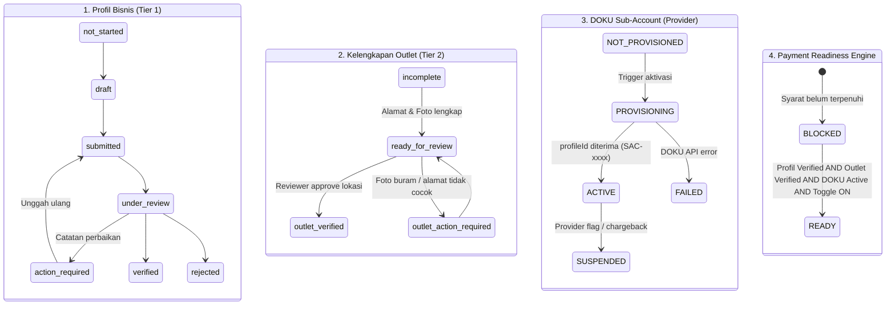
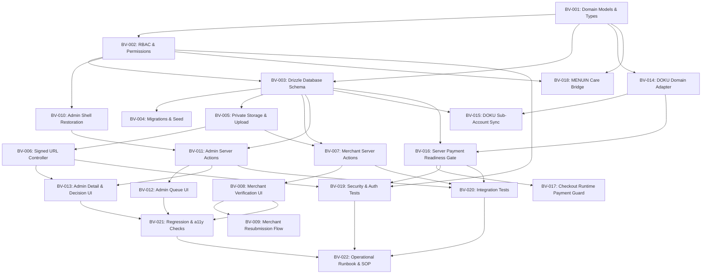

# MENUIN — BUSINESS VERIFICATION & ADMIN VERIFICATION
## Master Technical Implementation Plan & Architecture Specification

**Feature:** Integrated Merchant Business Verification, Admin Verification Console & DOKU Payment Onboarding  
**Repository:** `zidaneelfasya/menuin` (Branch: `dev/zidane`)  
**Date:** 2026-10-15  
**Planning Owner:** Technical Lead & Architecture Analyst  
**Planning Status:** **`PLANNING — AWAITING USER APPROVAL`**  
**Execution Boundary:** **ANALYSIS & PLANNING ONLY — NO APPLICATION CODE MODIFIED**  

---

## 1. Executive Summary

### 1.1 Context & Business Problem
MENUIN is an F&B SaaS platform operating in Indonesia, powering point-of-sale (POS), digital menus, multi-outlet management, and financial reporting. To enable online dynamic QRIS and digital payments via **DOKU Payment Gateway**, MENUIN must introduce a compliance-grade verification system. 

Before payment features can be enabled on merchant outlets:
1. The merchant's legal business profile and authorized representative must be verified internally.
2. Compliance administrators must have a dedicated, auditable review queue in the MENUIN Admin Panel.
3. Sub-account onboarding with DOKU must be tracked and synchronized.
4. Server-side payment readiness must be strictly enforced so unverified or fraudulent outlets cannot process live transactions.

### 1.2 Proposed Scope
- **Shared Verification Domain:** Normalized data model separating internal verification status, DOKU provider onboarding status, and payment readiness.
- **Merchant Business Verification:** Responsive self-service wizard at `/outlet/[outletKey]/verification` with progressive document uploads, draft saving, status tracking, and revision handling.
- **Admin Verification Console:** Dedicated operational console at `/system-admin/verification` featuring an overview dashboard, filterable review queue, detailed inspection view with PII masking, short-lived signed document viewing, and auditable decision modals.
- **Private Storage Infrastructure:** Migration to a dedicated private Supabase Storage bucket (`verification-documents`) with 60-second TTL signed URLs, eliminating public document exposure.
- **Server-Side Payment-Readiness Gate:** Triple-layer gating (UI toggle guard, server action assertion, runtime checkout assertion) preventing premature payment activation.
- **MENUIN Care Integration:** Contextual support links allowing merchants to open inquiries pre-linked to their submission, while strictly preventing Care agents from executing verification decisions.

### 1.3 Key Technical Risks & Mitigations
- **PII Leakage:** Mitigated by private storage buckets, short-lived signed URLs (60s TTL), server-side PII masking (NIK, Bank Accounts), and log exclusion.
- **Premature Payment Activation:** Mitigated by central server gate `assertPaymentReady(tenantId)` required by checkout routes and settings actions.
- **Multi-Outlet Duplication:** Mitigated by introducing `business_profiles` linked to owner accounts, allowing multiple outlets (`tenants`) to share verified business credentials.
- **DOKU Contract Gaps:** Mitigated by decoupling internal verification from DOKU status and providing manual operational sub-account linkage while automated APIs are certified.

---

## 2. Skill Discovery & Application Matrix

Per project requirements, installed skills in `.agents/skills/` were inspected and applied systematically during analysis.

| Skill | Availability | Instructions Read | Analysis Activity | Key Findings | Plan Impact | Limitations / Unexecuted Scope |
| :--- | :--- | :--- | :--- | :--- | :--- | :--- |
| **`using-superpowers`** | Verified present | Yes | Established disciplined workflow, task mapping in Antigravity, and non-negotiable analysis boundary. | Mapped Antigravity action semantics (`write_to_file` with `ArtifactMetadata` for task artifacts; read-only CLI commands). | Governs sequential execution order; strictly enforces no coding before explicit user approval. | None. |
| **`find-skills`** | Verified present | Yes | Evaluated whether any new skills or packages needed to be discovered or added. | All necessary skills exist locally in `.agents/skills/`. Skills CLI is for discovery/installation. | Prevented scope creep; locked skill dependencies to currently installed set. | Did not install or download external packages. |
| **`redesign-existing-projects`** | Verified present | Yes | Audited existing UI components, styling, layout patterns, and design tokens to avoid unnecessary redesigns. | MENUIN uses solid colors, Poppins/Inter, Radix primitives, Tailwind. Avoid generic AI patterns (Inter everywhere, heavy shadows, random AI gradients). | Mandates reuse of existing layout shells (`/system-admin`, `/outlet/[outletKey]`) in tasks `BV-008`, `BV-010`, `BV-012`. | Did not modify existing CSS or component files. |
| **`brandkit`** | Verified present | Yes | Audited brand guidelines, visual consistency, and palette discipline. | Focuses on logo and brand-deck image generation with disciplined palettes. | Aligned all verification surfaces with Menuin Royal Blue `#0e59f9` and slate neutrals; deferred image generation. | Image generation not executed during planning. |
| **`hallmark`** | Verified present | Yes | Applied quality gates: anti-slop rules, honest copy (no fabricated metrics), 8-state components, and mobile responsiveness. | Banned fabricated data; required all 8 component states (default, hover, focus, active, disabled, loading, error, success); enforced mobile collapse without horizontal scroll. | Embedded directly into acceptance criteria of tasks `BV-008`, `BV-012`, `BV-013`. | Did not emit code or run external web fetches. |
| **`impeccable`** | Verified present | Yes | Analyzed interaction modes (Operate mode for dashboards/forms/admin console) and command playbooks (shape, distill, harden, clarify). | Operate mode prioritizes scanability, consistency, native expectations, and task completion over decorative expression. Form simplification and error hardening. | Shaped merchant form into progressive disclosure; hardened error handling and private document access (`BV-005`, `BV-008`). | Scripts (`impeccable context`) not executed during planning. |
| **`ui-ux-pro-max`** | Verified present | Yes | Evaluated UX guidelines: forms & feedback, accessibility (contrast 4.5:1, keyboard nav, aria-labels), navigation patterns, and data tables. | Form labels above inputs; inline field-level errors; helper text; keyboard trap prevention in dialogs; accessible table pagination. | Direct input to specifications for verification form fields, checklist review states, and review queue filtering (`BV-008`, `BV-012`). | Python search script inspected locally; used built-in guidelines directly. |
| **`design-taste-frontend` / `design-taste-frontend-v1`** | Verified present | Yes | Evaluated frontend design directives against task requirements. | Explicitly states: "> Landing pages, portfolios, and redesigns. Not dashboards, not data tables, not multi-step product UI." | Scoped down to avoid applying landing-page layout rules (e.g. massive padding, kinetic hero headers) to internal verification forms and admin tables. | Not applied to dashboard/admin UI; deferred to `ui-ux-pro-max` and `MENUIN_UI_SOURCE_OF_TRUTH.md`. |
| **`minimalist-ui`** | Verified present | Yes | Evaluated clean editorial utilitarian aesthetics, warm monochrome, crisp 1px borders, and subtle pastels for status badges. | Aligns with high data-ink ratio; status badges borderless with soft pastel tints; zero unnecessary decoration. | Incorporated into document preview cards, audit timeline items, and status badge definitions (`BV-008`, `BV-013`). | Reconciled with MENUIN Royal Blue and existing Poppins/Inter typography stack. |
| **`high-end-visual-design`, `gpt-taste`, `stitch-design-taste`** | Verified present | Yes | Evaluated agency visual styles, GSAP choreographies, and semantic design tokens. | Massive macro-padding (`py-24+`) and aggressive animations conflict with dense operational review consoles and mobile POS performance. | Filtered out conflicting heavy animation and agency padding. Retained clean semantic token definitions and hardware-accelerated transitions. | Animation engines and heavy visual generators not used. |
| **`vercel-react-best-practices`** | Verified present | Yes | Evaluated Next.js App Router performance, Server/Client component boundaries, Server Actions security, and data fetching waterfalls. | Critical rules: `server-auth-actions` (authenticate every server action), `server-serialization` (do not pass full database rows with sensitive fields to client components), `server-parallel-fetching` (parallelize stats and table queries), `rendering-usetransition-loading` (useTransition for action forms). | Embedded directly into technical specifications and acceptance criteria of all backend actions and page components (`BV-007`, `BV-011`, `BV-016`). | None. |
| **`graphify`** | Verified present | Yes | Evaluated Graphify as a codebase analysis tool. | Requires `mkdir -p graphify-out`, python package installation (`pip install graphifyy`), and generation of multiple files. No existing `graphify-out/` exists. | Excluded execution to adhere strictly to non-negotiable read-only rules during planning. Read-only static inspection via ripgrep was used instead. | Not executed due to write/dependency restrictions. |
| **`humanizer`** | Verified present | Yes | Reviewed merchant-facing and admin-facing copy, status labels, and error messages. | Avoid robotic, staged, AI-sounding language (e.g. "Verifikasi Anda mengalami disrupsi pada pipeline autentikasi identitas kami"). Use clear, plain Indonesian ("Unggah ulang foto KTP yang jelas dan tidak buram"). | Defined the exact Indonesian copy guidelines for all 8 verification statuses, correction instructions, and email/notification messages (`BV-008`, `BV-013`). | None. |
| **`ponytail`** | Verified present | Yes | Applied "lazy senior dev" / YAGNI principles to data modeling and feature scope. | The best code is the code never written. Do not create duplicate tables when an existing table can be referenced. Add the minimal clean schema. Never cut validation at trust boundaries. | Kept the schema additive, focused, and directly linked to `accounts` and `tenants`. Prevented over-engineering of unnecessary KYC engines or separate microservices (`BV-003`, `BV-016`). | None. |
| **`imagegen-frontend-web`, `imagegen-frontend-mobile`, `image-to-code`, `vercel-react-native-skills`** | Verified present | Reserved | Evaluated whether image generation or mobile app work was required in this phase. | Feature is web application workflow for merchant settings and admin panel. | Deferred to implementation phase if/when specific visual mockups or mobile components are needed. | Not executed in planning. |

---

## 3. Read-Only Repository Audit Findings

### 3.1 Technology Stack & Architecture
- **Framework:** Next.js 15.3.1 (React 19) in monorepo setup (`apps/web` and `apps/mobile`, with shared packages: `packages/permissions`, `packages/types`, `packages/utils`, `packages/validation`).
- **Styling:** Tailwind CSS v3.4.1 + `tailwindcss-animate` + Radix UI primitives (`@radix-ui/react-slot`, `cmdk`, etc.) + `@tabler/icons-react` & `lucide-react`.
- **Database & ORM:** PostgreSQL (Supabase Database) with Drizzle ORM (`drizzle-orm` ^0.45.2, `drizzle-kit` ^0.31.10).
- **Authentication:** Supabase Auth (`@supabase/ssr` & `@supabase/supabase-js`), session cookies handled via `apps/web/src/lib/supabase/middleware.ts` and `apps/web/src/lib/actions/auth-context.ts`.
- **Storage:** Supabase Storage (`apps/web/src/lib/actions/storage.ts` using `createAdminClient()`).
- **Form Handling:** `react-hook-form` ^7.83.0 + `zod` ^3.25.76 + `@hookform/resolvers`.
- **Data Table:** `@tanstack/react-table` ^8.21.3 for data lists and tabular views.

### 3.2 Current-State Findings vs. Gaps

```
+--------------------------------------------------------------------------------------------------+
| MENUIN Current Architecture                                                                      |
+--------------------------------------------------------------------------------------------------+
| [Supabase Auth]                                                                                  |
|       |                                                                                          |
|       v                                                                                          |
| [accounts] (Global Identity: id, authUserId, email, name)                                        |
|       |                                                                                          |
|       +-----------------------------------+                                                      |
|       |                                   |                                                      |
|       v                                   v                                                      |
| [memberships]                     [business_profiles]  <--- PROPOSED NEW ENTITY                  |
| (role: OWNER/MGR/CASHIER/STAFF)         |                   (id, accountId, businessName,        |
|       |                                 |                    category, address, PII, status)     |
|       v                                 |                                                        |
| [tenants] (Outlet / Branch) <-----------+ (Nullable FK business_profile_id)                      |
| (name, outletKey, slug, doku fields,    |                                                        |
|  onlinePaymentEnabled)                  +---> [verification_submissions]                         |
|                                         |     (attemptNumber, status, snapshot, reviewedBy)      |
|                                         |                                                        |
|                                         +---> [verification_documents]                           |
|                                         |     (docType, storageKey, reviewStatus, reviewNote)    |
|                                         |                                                        |
|                                         +---> [provider_onboardings]                             |
|                                         |     (provider: DOKU, reference, providerStatus)        |
|                                         |                                                        |
|                                         +---> [verification_audit_logs]                          |
|                                               (actorId, action, previousStatus, newStatus)       |
+--------------------------------------------------------------------------------------------------+
```

1. **Entities & Ownership:**
   - `accounts`: Represents human user identity.
   - `tenants`: Represents individual outlets.
   - `memberships`: Associates an account with a tenant with a role (`OWNER`, `MANAGER`, `CASHIER`, `STAFF`).
   - **CONFIRMED GAP:** There is currently NO `business_profiles` table. Multi-outlet merchants have no shared business container.
2. **Admin Panel Status:**
   - In git history (`commit 563dc62`), a `/system-admin` dashboard existed with routes `/system-admin/tenants` and `/system-admin/users`.
   - When restructuring into monorepo (`apps/web`), the backend server actions were preserved in `apps/web/src/lib/actions/system-admin.ts` and route protection remained in `middleware.ts` (`pathname.startsWith('/system-admin')`), but the page views were not migrated.
   - **PROPOSED CHANGE:** Restore and consolidate the `/system-admin` layout shell and add the `/system-admin/verification` review queue and detail console.
3. **DOKU Payment Integration Status (Post-Re-Analysis):**
   - The team has successfully added and verified a native DOKU integration suite in `apps/web/src/lib/payments/doku/`:
     - `sub-account.ts`: Sub Account V2 registration (`POST /sub-account/v2.0/register`) using SNAP B2B tokens and symmetric HMAC-SHA512 signatures under the platform parent profile (`config.clientId`).
     - `snap/*`: Bank Indonesia SNAP standard implementation (RSA-SHA256 asymmetric B2B token exchange, dynamic QRIS generation via `generateQris`, and inbound notification verification).
     - `checkout.ts`: Hosted Checkout payment session creation with `additional_info.account.id = subAccountId` for split settlement.
     - `payment.service.ts`: End-to-end payment state machine, idempotent webhook processing (`payment_webhook_events`), and settlement reconciliation.
     - `apps/web/src/lib/actions/settings.ts`: `activateDokuSubAccount` with database concurrency lock (`SUB_ACCOUNT_PROVISIONING`).
   - **CONFIRMED GAPS IDENTIFIED IN RE-ANALYSIS:**
     - **Missing Verification Gate:** `activateDokuSubAccount()` in `settings.ts` currently runs without checking if the merchant has submitted or passed business verification.
     - **Unguarded Ordering Toggle:** `updateOrderingSettings` in `catalog.ts` allows toggling `onlinePaymentEnabled = true` without checking verification or active sub-account status.
     - **Single-Tenant Sub-Account Binding:** Sub-accounts are bound directly to `tenants.id`, without parent `business_profiles` inheritance for multi-outlet merchants.
     - **Settlement Bank Info:** Bank account details (buku tabungan, nomor rekening) are not captured or validated during onboarding.
4. **Storage Security Status:**
   - Current `uploadImageToSupabase` creates public buckets (`public: true`) returning permanent public URLs.
   - **CONFIRMED GAP:** Severe privacy violation if used for KTP/NPWP. Must implement private bucket `verification-documents` (`public: false`) with 60-second signed URLs.
5. **MENUIN Care Status:**
   - Referenced in `PRD-verify-bisnis.md` as customer support module.
   - **CONFIRMED GAP:** Ticketing system is not yet in the codebase. The verification plan will provide a lightweight contextual bridge interface without over-engineering a full helpdesk.

---

## 4. DOKU Integration Capability Classification (Updated Post-Audit)

All DOKU capabilities are strictly classified based on active code and documentation:

| Capability | Classification | Evidence in Codebase / Active Implementation |
| :--- | :--- | :--- |
| **Merchant Credentials Configuration** | **Confirmed in active implementation** | Environment secrets managed in `apps/web/src/lib/payments/doku/config.ts` (`DOKU_CLIENT_ID`, `DOKU_SECRET_KEY`). |
| **DOKU Dynamic QRIS Generation API (SNAP)** | **Confirmed in active implementation** | Fully implemented in `apps/web/src/lib/payments/doku/snap/qris.ts` (`POST /qr/qr-mpm-generate`) with RSA-SHA256 B2B tokens. |
| **DOKU Hosted Checkout Payment API** | **Confirmed in active implementation** | Fully implemented in `apps/web/src/lib/payments/doku/checkout.ts` (`POST /checkout/v1/payment`) with item sanitization and sub-account routing. |
| **DOKU Webhook Notification Handlers** | **Confirmed in active implementation** | Fully implemented in `/api/webhook/doku` and `/api/snap/v1.0/qr/qr-mpm-notify` with signature verification and DB deduplication. |
| **DOKU Sub-Account V2 Registration API** | **Confirmed in active implementation** | Implemented in `apps/web/src/lib/payments/doku/sub-account.ts` (`POST /sub-account/v2.0/register`). |
| **Sub-Account Concurrency Lock** | **Confirmed in active implementation** | Implemented in `apps/web/src/lib/actions/settings.ts` via `SUB_ACCOUNT_PROVISIONING` status lock. |
| **Server-Side Payment Readiness Gate** | **Identified Gap (To be implemented)** | Missing: Must connect business verification approval to sub-account activation and checkout availability (`BV-016`). |
| **Settlement Bank Account Capture** | **Identified Gap (To be implemented)** | Missing: Must capture and mask merchant bank accounts for sub-account payouts (`BV-004`). |

> [!IMPORTANT]
> The team's DOKU implementation is production-grade, mathematically sound, and compliant with Bank Indonesia SNAP standards. Our implementation plan focuses on building the **Business Verification & Compliance Gate** that governs and protects this payment infrastructure.

---

## 5. Target Architecture

### 5.1 Multi-Entity Hierarchy & Relational Architecture (1:N:M)

MENUIN models the relationship between users, corporate legal entities, and physical restaurant locations through a strict **1:N:M** hierarchy:

```
[Account (Human User)] (1)
       │
       │ owns 1 or more
       ▼
[Business Profile (Legal Entity / Tax Container)] (N)
       │ (KTP, NPWP, NIB, Akta, Bank Rekening)
       │
       │ operates 1 or more
       ▼
[Tenant (Physical Outlet / Storefront Branch)] (M)
         (Alamat Spesifik, Koordinat GPS, Foto Tampak Depan, DOKU Sub-Account)
```

1. **Account Level (`accounts`)**:
   - Represents the authenticated human owner. An account may own multiple corporate entities (e.g. Zidane owns a PT for a coffee chain, and a CV/Perorangan for a noodle shop).
2. **Business Profile Level (`business_profiles`)**:
   - Represents the legal entity and tax container (`INDIVIDUAL`, `PT`, `CV`, `YAYASAN`, `KOPERASI`).
   - Stores legal identity, director credentials, tax ID (NPWP), NIB, and primary payout bank account.
   - Legal documents are verified **once** at this tier and reused across all outlets linked to this business profile.
3. **Outlet Level (`tenants`)**:
   - Represents the physical trading branch/storefront.
   - Has a nullable foreign key `business_profile_id`.
   - Stores physical location details, GPS coordinates, storefront photo with signage, cashier area photo, and outlet-specific DOKU sub-account credentials.
   - Outlets inherit the verified legal status from their parent business profile, but must fulfill their own Tier 2 location evidence.

---

### 5.2 Two-Tier Verification Separation

To prevent merchant friction while preventing fictitious merchant fraud, verification is split into two distinct tiers:

```
+───────────────────────────────────────────────────────────────────────────────────────────────+
| TIER 1: BUSINESS IDENTITY & LEGAL ENTITY VERIFICATION (Tingkat Profil Bisnis)                  |
| Target: business_profiles                                                                     |
| Dokumen: KTP Pemilik/Direktur, NPWP, NIB, Akta & SK (PT/CV), Buku Rekening Bank Utama         |
| Kebijakan: Diverifikasi 1x per badan usaha. Dapat digunakan kembali oleh outlet cabang lain. |
| Status: business_profiles.verification_status                                                 |
+───────────────────────────────────────────────────────────────┬───────────────────────────────+
                                                                │
                                                                ▼ Diwarisi oleh cabang terhubung
+───────────────────────────────────────────────────────────────────────────────────────────────+
| TIER 2: OUTLET PHYSICAL LOCATION & EVIDENCE (Tingkat Outlet / Cabang)                         |
| Target: tenants                                                                               |
| Data & Bukti: Alamat Lengkap, Kota, Kode Pos, Pinpoint GPS, Foto Tampak Depan, Foto Kasir    |
| Kebijakan: Wajib dilengkapi per outlet. Tidak otomatis lolos hanya karena profil terverifikasi.|
| Status: tenants.outlet_compliance_status                                                      |
+───────────────────────────────────────────────────────────────────────────────────────────────+
```

---

### 5.3 Decoupled 4-State Verification Architecture

Four independent state engines govern the merchant lifecycle:



1. **State 1: Status Verifikasi Profil Bisnis (`business_profiles.verification_status`)**:
   `not_started` | `draft` | `submitted` | `under_review` | `action_required` | `verified` | `rejected` | `suspended`
2. **State 2: Status Kepatuhan Outlet (`tenants.outlet_compliance_status`)**:
   `incomplete` | `ready_for_review` | `verified` | `action_required`
3. **State 3: Status Onboarding DOKU Provider (`tenants.doku_sub_account_status`)**:
   `NOT_PROVISIONED` | `PROVISIONING` | `ACTIVE` | `PENDING_REVIEW` | `SUSPENDED` | `FAILED`
4. **State 4: Status Kesiapan Pembayaran (`payment_readiness`)**:
   Pure computed state via `evaluatePaymentReadiness(tenantId)`.

---

### 5.4 Architectural Impact Analysis on Registration & POS Operations

1. **Pengaruh Terhadap Pendaftaran Akun Baru (`/auth/register`)**:
   - **ZERO BREAKING CHANGES**: Registrasi akun awal (`signupAction` di `auth.ts`) tetap berjalan 100% normal tanpa perubahan langkah.
   - Kolom `tenants.business_profile_id` bersifat **NULLABLE**. Merchant baru tidak dipaksa mengisi data legal perusahaan saat pertama kali mendaftar.
   - Verifikasi bisnis menggunakan pendekatan **Progressive Disclosure**: merchant baru dapat langsung mencoba kasir POS dan baru diminta verifikasi bisnis saat ingin mengaktifkan metode pembayaran online gateway.
2. **Pengaruh Terhadap Sistem Bisnis & Operasional Kasir POS**:
   - **ZERO REGRESSION**: Seluruh fitur POS kasir (order checkout, split bill, cetak tiket dapur, struk kasir, laporan shift kasir, dan pembayaran CASH/MANUAL) tetap berfungsi normal tanpa hambatan bagi outlet yang belum terverifikasi.
   - Hanya metode pembayaran online (DOKU Checkout & QRIS Dinamis) yang dijaga secara ketat oleh engine readiness.

---

### 5.5 Dependensi & Matriks Konfirmasi DOKU (External Clarifications)

| Aspek DOKU | Status Bukti Teknis | Tindakan Arsitektural |
| :--- | :--- | :--- |
| **Endpoint Sub-Account V2** | **Terkonfirmasi** di kode (`POST /sub-account/v2.0/register`) | Mempertahankan implementasi `createSubAccount` milik tim. |
| **Kredensial & Signature SNAP/Non-SNAP** | **Terkonfirmasi** di kode & test (RSA-SHA256, HMAC-SHA512) | Digunakan sebagai engine kriptografi resmi. |
| **Data Alamat Fisik Outlet di Payload DOKU** | **Memerlukan Konfirmasi DOKU** | Selama spesifikasi payload alamat DOKU belum ada, data alamat dan foto outlet disimpan dan diverifikasi internal di platform MENUIN untuk kebutuhan audit BI. |
| **SLA Persetujuan Sub-Account di Produksi** | **Memerlukan Konfirmasi DOKU** | Sediakan status `PENDING_REVIEW` dan fallback manual override di Admin Console jika DOKU memerlukan review manual. |
| **Penggunaan Kembali Legalitas Lintas Outlet** | **Memerlukan Konfirmasi DOKU** | Platform mendukung registrasi sub-account terpisah per outlet di bawah legal entity yang sama. |
| **Webhook Suspensi Sub-Account** | **Memerlukan Konfirmasi DOKU** | Menyiapkan handler notifikasi jika DOKU menyediakan event webhook suspensi akun. |

---

### 5.6 Status Definitions & Humanized Indonesian Copy

| Status Code | Internal Meaning | Merchant-Facing Label | Merchant-Facing Guidance (Indonesian) |
| :--- | :--- | :--- | :--- |
| `not_started` | Belum memulai | **Belum Diverifikasi** | *Mulai verifikasi bisnis Anda untuk mengaktifkan pembayaran QRIS online di outlet.* |
| `draft` | Formulir belum lengkap | **Draf Disimpan** | *Data pengajuan tersimpan. Lengkapi dokumen yang diperlukan sebelum mengirim.* |
| `submitted` | Masuk antrean review | **Menunggu Pemeriksaan** | *Pengajuan Anda telah diterima dan sedang menunggu giliran pemeriksaan tim kepatuhan MENUIN.* |
| `under_review` | Sedang diperiksa reviewer | **Sedang Ditinjau** | *Tim verifikasi sedang memeriksa keabsahan data dan dokumen usaha Anda.* |
| `action_required`| Perlu perbaikan data/dokumen| **Perlu Perbaikan** | *Ada dokumen atau data yang perlu diperbaiki. Silakan periksa catatan reviewer di bawah dan unggah ulang.* |
| `verified` | Internal MENUIN disetujui | **Terverifikasi (Internal)** | *Verifikasi internal MENUIN telah disetujui. Sedang memproses kesiapan integrasi pembayaran DOKU.* |
| `rejected` | Ditolak permanen | **Pengajuan Ditolak** | *Pengajuan belum memenuhi persyaratan kepatuhan F&B MENUIN. Alasan penolakan terlampir.* |
| `suspended` | Akses dibekukan sementara | **Akses Ditangguhkan** | *Akses verifikasi atau pembayaran ditangguhkan sementara untuk keperluan pemeriksaan keamanan.* |

---

## 6. Security & Privacy Architecture

1. **Tenant & Data Isolation:**
   - Every verification record points to `business_profile_id` which binds to `account_id` (Owner).
   - In server actions, `getAuthenticatedAccount()` enforces that a user cannot query or submit for a business profile they do not own.
2. **Confidential Document Protection:**
   - Documents are stored in private bucket `verification-documents` (`public: false`).
   - Access is permitted strictly via signed URLs with a **60-second Time-To-Live (TTL)**.
   - Direct bucket URLs return HTTP 403 Forbidden.
   - PII (NIK, Nomor Rekening) is masked on frontend displays (`3578********0001`, `BCA *******890`).
3. **Role-Based Access Control (RBAC):**
   - Review actions (`APPROVE_INTERNAL`, `REQUEST_CHANGES`, `REJECT`, `ESCALATE`) require `assertPermission(user, 'verification:review')`.
   - Support / MENUIN Care agents have read-only access to high-level public statuses and public notes (`verification:view_summary`). Care agents cannot view unmasked PII or execute decisions.
4. **Comprehensive Audit Trail:**
   - Every status transition, document view, and decision creates an immutable entry in `verification_audit_logs` storing `actor_id`, `actor_role`, `action`, `previous_status`, `new_status`, `reason`, `ip_address`, and timestamp.
5. **Triple-Layer Payment Readiness Gate:**
   - *Layer 1 (UI):* Settings toggle disabled with clear prerequisite checklist.
   - *Layer 2 (Settings Action):* `updatePaymentIntegration` rejects setting `onlinePaymentEnabled = true` unless `assertPaymentReady(tenantId)` passes.
   - *Layer 3 (Runtime Checkout):* Checkout endpoints (`/api/checkout`, `/api/mobile/v1/pos`) assert `assertPaymentReady(tenantId)` before generating any QRIS charge.

---

## 7. Ordered Implementation Task Register

The complete, stable task list is defined in `docs/verify-bisnis/task-register.md` with tasks `BV-001` through `BV-022`.

### Dependency Graph



### Phase-by-Phase Breakdown

1. **Phase 1: Architecture & Shared Foundations**
   - `BV-001`: Verification Domain Models, Types & State Machine (M, P0)
   - `BV-002`: RBAC & Permission Model for Verification Admin (M, P0)
2. **Phase 2: Data Model & Migrations**
   - `BV-003`: Database Schema Definition in Drizzle ORM (L, P0)
   - `BV-004`: Database Migration & Idempotent Seed Scripts (M, P0)
3. **Phase 3: Secure Document Storage Infrastructure**
   - `BV-005`: Private Document Storage Infrastructure & Upload Action (M, P0)
   - `BV-006`: Time-Limited Signed URL Document Access Controller (M, P0)
4. **Phase 4: Merchant Business Verification Experience**
   - `BV-007`: Merchant Business Verification Server Actions (L, P1)
   - `BV-008`: Merchant Business Verification Flow UI (L, P1)
   - `BV-009`: Merchant Resubmission & Correction Workflow (M, P1)
5. **Phase 5: Admin Panel & Verification Management**
   - `BV-010`: Admin Panel Shell & Navigation Restoration (M, P1)
   - `BV-011`: Admin Verification Queue Server Actions (M, P1)
   - `BV-012`: Admin Verification Overview & Review Queue UI (L, P1)
   - `BV-013`: Admin Verification Detail & Decision Console (XL, P1)
6. **Phase 6: DOKU Onboarding & Integration Layer**
   - `BV-014`: DOKU Sub Account V2 Lifecycle & Provider Contract Integration (M, P1)
   - `BV-015`: Guarded Sub-Account Activation & Concurrency Lock Enhancement (L, P1)
7. **Phase 7: Server-Side Payment-Readiness Enforcement**
   - `BV-016`: Unified Server-Side Payment Readiness Engine & Catalog Gate (M, P0)
   - `BV-017`: Runtime Checkout & POS QRIS Payment Execution Guard (M, P0)
8. **Phase 8: MENUIN Care Integration**
   - `BV-018`: MENUIN Care Contextual Verification Bridge (S, P2)
9. **Phase 9: Comprehensive Security, Testing & Regression Prevention**
   - `BV-019`: Security & Authorization Automated Test Suite (L, P0)
   - `BV-020`: State Machine & Verification Flow Integration Tests (L, P1)
   - `BV-021`: End-to-End Regression & Accessibility (a11y) Verification (M, P1)
10. **Phase 10: Documentation & Operational Runbook**
    - `BV-022`: Verification Operational Runbook & Reviewer SOP (S, P2)

---

## 8. Agent Assignment & Execution Roles

During the subsequent implementation phase (once approved by the user), tasks will be coordinated across specialized roles:

| Role Identifier | Assigned Responsibilities | Tasks Owned |
| :--- | :--- | :--- |
| **Technical Lead / Planning Owner** | Domain types, state machine, architectural alignment, runbook, overall delivery. | `BV-001`, `BV-022` |
| **Architecture & Database Reviewer** | Drizzle schemas, non-destructive migrations, indexes, seed data. | `BV-003`, `BV-004` |
| **Security Reviewer** | RBAC permissions, private storage bucket, signed URL TTL, security tests. | `BV-002`, `BV-005`, `BV-006`, `BV-016`, `BV-019` |
| **UI/UX & Frontend Engineer** | Merchant wizard UI, admin review queue, detail console, 8-state components, mobile collapse. | `BV-008`, `BV-009`, `BV-010`, `BV-012`, `BV-013` |
| **Backend & Integration Engineer** | Server actions, DOKU adapter, payment readiness assertion, checkout guards, Care bridge. | `BV-007`, `BV-011`, `BV-014`, `BV-015`, `BV-017`, `BV-018` |
| **QA & Compliance Reviewer** | Integration test suite, state lifecycle verification, a11y testing, zero-regression audit. | `BV-020`, `BV-021` |

---

## 9. Plan Quality Gate Verification

Before finalizing this artifact, the plan was formally audited against all 18 quality criteria:

- [x] **1. Repository audit complete:** Monorepo architecture, Drizzle schema, existing `system-admin.ts`, middleware, and storage analyzed directly from source.
- [x] **2. Relevant skills read and applied:** `using-superpowers`, `find-skills`, `redesign-existing-projects`, `brandkit`, `hallmark`, `impeccable`, `ui-ux-pro-max`, `design-taste-frontend`, `minimalist-ui`, `high-end-visual-design`, `vercel-react-best-practices`, `graphify`, `humanizer`, `ponytail` systematically evaluated.
- [x] **3. Skill matrix accurate:** Explicit contributions, findings, and limitations recorded.
- [x] **4. Both Merchant & Admin interfaces included:** `/outlet/[outletKey]/verification` and `/system-admin/verification` fully specified.
- [x] **5. Coherent unified workflow:** Both sides share one underlying state machine and data model.
- [x] **6. Distinct state models:** Internal status, DOKU provider status, payment readiness, and Care ticket status separated.
- [x] **7. Existing entities reused:** `accounts`, `tenants`, and `memberships` preserved without duplication.
- [x] **8. No schema bloat:** Clean `business_profiles` container solves multi-outlet ownership without redundant tables.
- [x] **9. Security & auth prioritized:** Security tasks (`BV-002`, `BV-005`, `BV-006`) scheduled before dependent UI work.
- [x] **10. DOKU unknowns made explicit:** Automated sub-account API gaps documented; manual fallback provided.
- [x] **11. Measurable acceptance criteria:** Every task has concrete, verifiable criteria.
- [x] **12. Dependency graph coherent:** Predecessors strictly ordered without circular dependencies.
- [x] **13. Implementable order:** Data model -> Security -> Backend actions -> UI -> Integrations -> Tests.
- [x] **14. No file ownership conflicts:** Responsibilities mapped to prevent parallel edit collisions.
- [x] **15. Continuous testing included:** Security tests (`BV-019`), integration tests (`BV-020`), regression checks (`BV-021`).
- [x] **16. No unrelated redesigns:** Scoped strictly to verification without rewriting existing POS or marketing pages.
- [x] **17. Status clearly marked:** Marked as `PLANNING — AWAITING USER APPROVAL`.
- [x] **18. Zero application code modified:** Working tree remains clean; no production code touched.

---

## 10. Open Decisions & User Confirmation Items

Before the user approves the start of Phase 1 implementation, the following decisions should be reviewed:

1. **DOKU Sub-Account Creation Process:**
   - *Option A (Recommended):* Implement operational manual entry of DOKU sub-account IDs in the Admin Panel (`BV-015`), and integrate automated API registration once formal DOKU aggregator sandbox credentials and API contracts are certified.
   - *Option B:* Block payment feature completion entirely until DOKU Account Manager provides direct aggregator API endpoints.
2. **Multi-Outlet Business Profile Binding:**
   - Confirm recommendation that an F&B Owner verifies their legal business profile once (`business_profiles`), and subsequent outlets created under the same account can be attached to the verified profile without re-uploading KTP/NPWP.
3. **Approval to Proceed:**
   - Formal user instruction is required to transition from `PLANNING — AWAITING USER APPROVAL` to active implementation of Phase 1 (`BV-001` through `BV-004`).
