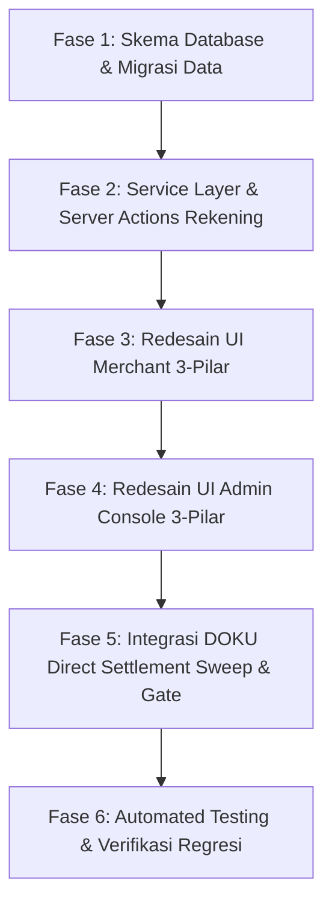

# IMPLEMENTATION PLAN: MENUIN 3-PILLAR BUSINESS VERIFICATION ARCHITECTURE (V2)

**Status:** COMPLETED & VERIFIED (All 6 Phases Fully Implemented & 180 Tests Passed)  
**Author:** Technical Lead & Architecture Analyst  
**Version:** 2.1  
**Date:** 2026-10-15  

---

## 1. EXECUTIVE SUMMARY & ARSITEKTUR 3-PILAR

Sistem verifikasi bisnis MENUIN dirancang untuk memisahkan domain verifikasi menjadi 3 entitas independen yang saling melengkapi (decoupled):
1. **Pilar 1: Profil Bisnis (Legal & Identity):** Badan usaha (PT/CV/Perorangan), dokumen KTP, NPWP, NIB, Akta Pendirian. **Diverifikasi sekali, dapat digunakan kembali (reusable) untuk semua outlet dan rekening.**
2. **Pilar 2: Rekening Settlement (Bank Account & Payout):** Rekening penampungan dana hasil transaksi QRIS. Memiliki status verifikasi mandiri, mendukung penanda rekening default (utama), serta mendukung rekening khusus cabang. **Diverifikasi dengan standar industri perbankan & payment gateway.**
3. **Pilar 3: Kepatuhan Fisik Outlet (Physical Premises):** Data gerai fisik (alamat, titik koordinat, Google Maps, foto tampak depan gerai, foto area kasir/dalam). **Diisi setiap kali membuat gerai/outlet baru.**

---

## 2. STANDAR INDUSTRI VERIFIKASI REKENING BANK PADA FINTECH & PAYMENT GATEWAY

### 2.1 Apakah Platform Perlu Bekerja Sama Langsung dengan Setiap Bank?
**Jawabannya: TIDAK.**
* **Tantangan jika langsung ke Bank:** Bekerja sama langsung secara bilateral dengan bank (BCA, Mandiri, BRI, BNI, dll.) membutuhkan:
  - Lisensi PJP (Penyelenggara Jasa Pembayaran) Kategori 2/3 dari Bank Indonesia.
  - Perjanjian Kerja Sama (PKS) terpisah dengan masing-masing bank (memakan waktu 6–12 bulan per bank).
  - Minimum deposit dan biaya integrasi API direct-connect yang sangat besar.
* **Standar Industri yang Digunakan Fintech & SaaS B2B:**
  Platform seperti MENUIN memanfaatkan **Bank Account Inquiry API (Name Validation API)** yang disediakan oleh Payment Gateway partner (seperti DOKU) atau Bank Aggregator berizin BI (seperti Oy! Indonesia, Flip for Business, Xendit, Brick).

### 2.2 Tiga Metode Verifikasi Rekening Standar Industri (Multi-Tier Verification)

```
┌─────────────────────────────────────────────────────────────────────────────┐
│                   METODE VERIFIKASI REKENING STANDAR INDUSTRI               │
└──────────────────────────────────────┬──────────────────────────────────────┘
                                       │
        ┌──────────────────────────────┼──────────────────────────────┐
        ▼                              ▼                              ▼
┌──────────────────────┐    ┌──────────────────────┐   ┌──────────────────────┐
│  METODE 1: REAL-TIME │    │ METODE 2: ALGORITMA  │   │  METODE 3: DOKUMEN   │
│  INQUIRY API (AUTO)  │    │ NAME-MATCHING SCORE  │   │    KYB MANUAL (SOP)  │
├──────────────────────┤    ├──────────────────────┤   ├──────────────────────┤
│ Provider (DOKU/Bank) │    │ Mencocokkan nama     │   │ Reviewer mencocokkan │
│ mengembalikan nama   │    │ pemilik rekening vs  │   │ foto Buku Tabungan / │
│ resmi pemilik dari   │    │ nama di KTP/NIB/Akta │   │ M-Banking dengan KTP │
│ database Core Bank.  │    │ dg skor fuzzy match. │   │ & data badan usaha.  │
└──────────────────────┘    └──────────────────────┘   └──────────────────────┘
```

1. **Metode 1: Real-Time Bank Account Inquiry API (Otomatis & Terintegrasi)**
   - Saat merchant menginput Nama Bank dan Nomor Rekening, sistem mengirim request ke Inquiry API (misalnya DOKU Account Inquiry / Bank Validation API).
   - Core Banking mengembalikan respons JSON berupa nama resmi nasabah (misal: `"account_holder_name": "JORDAN ELFASYA"` atau `"PT KOPI JOTOS NUSANTARA"`).
   - Memastikan nomor rekening tersebut **aktif**, **tidak diblokir**, dan **bukan rekening fiktif**.

2. **Metode 2: Algoritma Pencocokan Nama Otomatis (Name-Matching Score)**
   - Sistem membandingkan `account_holder_name` dari bank dengan data legalitas Profil Bisnis:
     - **Untuk Perorangan (INDIVIDUAL):** Dibandingkan dengan `responsible_person_name` (nama di KTP).
     - **Untuk Badan Usaha (PT / CV):** Dibandingkan dengan `business_name` (nama di NIB/NPWP) atau nama Direktur Utama di Akta.
   - Digunakan algoritma pencocokan teks fleksibel (Jaro-Winkler similarity / Levenshtein distance):
     - **Skor >= 85% (Match Sempurna):** Rekening otomatis berstatus `verified`.
     - **Skor 60% – 84% (Perbedaan Ejaan/Singkatan, misal "MHD" vs "MUHAMMAD"):** Masuk ke antrean review manual admin.
     - **Skor < 60% (Nama Berbeda):** Rekening ditolak atau mewajibkan upload Surat Kuasa / Hubungan Keluarga (Kartu Keluarga).

3. **Metode 3: Dokumen Kepemilikan Rekening & SOP Compliance (Dokumen Bukti)**
   - Merchant mengunggah foto halaman pertama **Buku Tabungan** atau **Tangkapan Layar Informasi Rekening M-Banking / Rekening Koran**.
   - Dokumen ini berfungsi sebagai bukti otentik apabila:
     - API bank sedang *down* / *maintenance*.
     - Rekening menggunakan nama rekening bersama (*joint account*) atau rekening keluarga yang sah.
     - Diperlukan untuk audit kepatuhan DOKU dan regulator.

---

## 3. ALUR DANA SETTLEMENT: DOKU DIRECT SETTLEMENT SWEEP

Sesuai preferensi Anda, MENUIN menerapkan model **Direct Settlement Sweep**:
```
┌─────────────────────────────────────────────────────────────────────────────┐
│                     ALUR DOKU DIRECT SETTLEMENT SWEEP                       │
└─────────────────────────────────────────────────────────────────────────────┘
                                       │
                                       ▼
  [ 1. Pelanggan Membayar via QRIS Dinamis MENUIN ]
                                       │
                                       ▼
  [ 2. Transaksi Sukses & Diterima di Sub-Account DOKU ]
                                       │
                                       ▼
  [ 3. DOKU Auto-Sweep Otomatis Setiap Hari Kerja (H+1 / H+2) ]
                                       │
                                       ▼
  [ 4. Dana Bersih Masuk Langsung ke Rekening Settlement Terverifikasi ]
       • Menggunakan Rekening Default Profil Bisnis
       • Atau Rekening Khusus Cabang yang Dipilih
```

* **Keuntungan Model Ini:**
  - Merchant tidak perlu repot menarik saldo (payout) secara manual setiap hari.
  - Dana penjualan langsung masuk ke rekening bank operasional mereka.
  - MENUIN tidak memegang dana (*non-custodial*), sehingga aman dan terbebas dari risiko regulasi penyimpanan dana.

---

## 4. PERUBAHAN SKEMA DATABASE & ARSITEKTUR DATA

### 4.1 Tabel Baru: `settlement_accounts`
```typescript
export const settlementAccounts = pgTable('settlement_accounts', {
  id: uuid('id').primaryKey().defaultRandom(),
  businessProfileId: uuid('business_profile_id')
    .references(() => businessProfiles.id, { onDelete: 'cascade' })
    .notNull(),
  bankName: text('bank_name').notNull(), // 'BCA', 'MANDIRI', 'BRI', 'BNI', 'CIMB', 'PERMATA', 'DANAMON', 'BSI', dll
  bankAccountNumber: text('bank_account_number').notNull(), // Nomor rekening asli (akses terbatas)
  bankAccountNumberMasked: text('bank_account_number_masked').notNull(), // contoh: '•••••• 4821'
  bankAccountHolder: text('bank_account_holder').notNull(), // Nama pemilik rekening
  proofDocumentKey: text('proof_document_key'), // Storage key foto buku tabungan / screenshot m-banking
  verificationMethod: text('verification_method').default('MANUAL_REVIEW').notNull(), // 'API_INQUIRY' | 'MANUAL_REVIEW' | 'HYBRID'
  verificationStatus: text('verification_status').default('pending').notNull(), // 'pending' | 'verified' | 'action_required' | 'rejected'
  nameMatchScore: integer('name_match_score'), // 0 - 100%
  verificationNotes: text('verification_notes'),
  isDefault: boolean('is_default').default(false).notNull(), // Flag rekening utama profil bisnis
  dokuBeneficiaryId: text('doku_beneficiary_id'), // ID jika didaftarkan di DOKU
  createdAt: timestamp('created_at', { withTimezone: true }).defaultNow().notNull(),
  updatedAt: timestamp('updated_at', { withTimezone: true }).defaultNow().notNull(),
}, (table) => [
  index('settlement_accounts_profile_idx').on(table.businessProfileId),
  index('settlement_accounts_status_idx').on(table.verificationStatus),
]);
```

### 4.2 Pembaruan Tabel `business_profiles`
- Kolom legacy `bank_name`, `bank_account_number`, dan `bank_account_holder` dijadikan opsional / deprecated.
- Data rekening yang sudah ada otomatis dimigrasikan ke tabel `settlement_accounts` sebagai rekening utama (`is_default = true`).
- `verification_status` pada `business_profiles` murni merefleksikan status verifikasi **Identitas & Legalitas Badan Usaha** (`not_started`, `draft`, `submitted`, `under_review`, `action_required`, `verified`, `rejected`, `suspended`).

### 4.3 Pembaruan Tabel `tenants` (Outlet)
- Menambahkan relasi ke rekening settlement:
  ```typescript
  settlementAccountId: uuid('settlement_account_id')
    .references(() => settlementAccounts.id, { onDelete: 'set null' }),
  ```
  *(Jika `null`, sistem otomatis mewarisi rekening default dari `businessProfileId`).*
- Menambahkan kolom foto area dalam/kasir:
  ```typescript
  indoorPhotoUrl: text('indoor_photo_url'),
  ```
- Mempertahankan `mapsUrl: text('maps_url')` dengan fitur auto-parser koordinat.

### 4.4 Pembaruan Tabel `verification_submissions`
- Mendukung 3 scope verifikasi terpisah:
  `submission_scope`: `'BUSINESS_PROFILE'` | `'SETTLEMENT_ACCOUNT'` | `'OUTLET'`

---

## 5. KEAMANAN DATA & RBAC (SENSITIVE DATA PROTECTION)

| Peran Pengguna | Melihat Nomor Rekening | Mengubah Rekening | Melihat Dokumen Legal |
| :--- | :---: | :---: | :---: |
| **Kasir (CASHIER)** | ❌ Dilarang (Hanya masked: `BCA •••••• 4821`) | ❌ Dilarang | ❌ Dilarang |
| **Staf (STAFF)** | ❌ Dilarang (Hanya masked) | ❌ Dilarang | ❌ Dilarang |
| **Manajer (MANAGER)** | ✅ Diizinkan | ❌ Terbatas | ⚠️ Read-only |
| **Pemilik (OWNER)** | ✅ Lengkap | ✅ Tambah / Ganti | ✅ Penuh |
| **Admin Verifikasi (VERIFICATION_ADMIN)** | ✅ Lengkap untuk Audit | ⚠️ Hanya Approve/Reject | ✅ Penuh untuk KYC |

---

## 6. WORKFLOW & USER EXPERIENCE (UI/UX)

### 6.1 Tampilan Merchant ([apps/web/src/app/outlet/[outletKey]/verification](file:///home/zidaneelfasya/D/Github/menuin/apps/web/src/app/outlet/[outletKey]/verification))
Halaman verifikasi dibagi menjadi 3 tab yang sangat rapi:

1. **Tab 1: Profil Legal Bisnis (Tier 1)**
   - Kartu Profil Bisnis terpilih (PT/CV/Perorangan) beserta status verifikasinya.
   - Pilihan: *"Gunakan Profil yang Sudah Terverifikasi"* (1 klik) atau *"Buat Profil Bisnis Baru"*.
   - Dokumen: KTP, NIK, NPWP, NIB. Cukup diunggah dan diverifikasi 1 kali.

2. **Tab 2: Rekening Settlement (Tier 2)**
   - Daftar rekening bank milik Profil Bisnis yang dipilih.
   - Pilihan untuk outlet:
     - 🔘 **Gunakan Rekening Utama Profil Bisnis (Default - Rekomendasi):** Menampilkan rekening default bertanda bintang emas.
     - 🔘 **Gunakan Rekening Khusus untuk Cabang Ini:** Pilih rekening cabang lain atau klik *"Tambah Rekening Baru"*.
   - Form Tambah Rekening:
     - Dropdown Bank Utama Indonesia (BCA, Mandiri, BRI, BNI, CIMB, Permata, Danamon, BSI, Bank Lainnya).
     - Nomor Rekening & Nama Pemilik Rekening.
     - Upload Bukti Buku Tabungan / Screenshot M-Banking.
     - Tombol verifikasi instan / manual.

3. **Tab 3: Kepatuhan Fisik Outlet (Tier 3 - Wajib Setiap Outlet Baru)**
   - Khusus untuk outlet saat ini:
     - **Alamat & Kota:** Alamat fisik gerai.
     - **Google Maps & Titik Lokasi:** Input link Google Maps (otomatis mengurai koordinat Lintang & Bujur) atau tombol *"Gunakan Lokasi Saat Ini"*.
     - **Foto Tampak Depan:** Fasad toko / plang nama gerai.
     - **Foto Tampak Dalam / Area Kasir:** Foto meja kasir dan area operasional gerai.
   - Tombol *"Kirim Kepatuhan Outlet untuk Ditinjau"*.

### 6.2 Tampilan Admin Console ([apps/web/src/app/system-admin/verification](file:///home/zidaneelfasya/D/Github/menuin/apps/web/src/app/system-admin/verification))
- Antrean verifikasi dibagi menjadi 3 sub-antrean:
  1. **Review Dokumen Legalitas Profil Bisnis**
  2. **Review Rekening Bank Settlement** (Pencocokan nama pemilik vs identitas badan usaha)
  3. **Review Fisik Outlet** (Pencocokan alamat, foto tampak depan, dan foto kasir)
- Admin dapat menyetujui salah satu pilar secara modular tanpa menggantungkan pilar lain yang sudah valid.

---

## 7. TAHAPAN EKSEKUSI (IMPLEMENTATION PHASES)



| Fase | Rincian Pekerjaan | File Terkait | Status |
| :--- | :--- | :--- | :---: |
| **Fase 1** | Buat tabel `settlement_accounts`, tambahkan kolom `indoor_photo_url` & `settlement_account_id` pada `tenants`, migrasikan data rekening lama secara aman tanpa downtime. | `apps/web/src/lib/db/schema.ts`<br>`apps/web/drizzle/verification.sql` | ✅ Selesai |
| **Fase 2** | Buat CRUD `settlement_accounts`, algoritma string matching nama pemilik, server action tambah rekening, update overview action, data masking RBAC. | `apps/web/src/lib/actions/settlement-accounts.ts`<br>`apps/web/src/lib/actions/merchant-verification.ts` | ✅ Selesai |
| **Fase 3** | Redesain halaman verifikasi merchant menjadi 3 tab mandiri (Profil Bisnis, Rekening Settlement, Kepatuhan Fisik Outlet) dengan fitur auto-parse Google Maps. | `apps/web/src/app/outlet/[outletKey]/verification/verification-client.tsx` | ✅ Selesai |
| **Fase 4** | Perbarui Admin Verification Console untuk memisahkan review Legalitas, Rekening Bank, dan Fisik Outlet secara modular. | `apps/web/src/app/system-admin/verification/[id]/admin-verification-detail-client.tsx`<br>`apps/web/src/lib/actions/admin-verification.ts` | ✅ Selesai |
| **Fase 5** | Perbarui `evaluatePaymentReadiness()` untuk mengevaluasi status ketiga pilar + adaptasi payload DOKU Direct Settlement Sweep. | `apps/web/src/lib/payments/doku/doku-adapter.ts`<br>`apps/web/src/lib/verification/state-machine.ts` | ✅ Selesai |
| **Fase 6** | Buat unit test & integration test untuk pilar rekening dan kepatuhan outlet, jalankan seluruh test suite Vitest (180 tests lulus). | `apps/web/src/lib/verification/*.test.ts` | ✅ Selesai |
| **Fase 7** | Redesain Visual Identity Menuin & Rebranding Copywriting: Sub-sidebar layout ala Laporan Menuin, circular royal blue pillar icons dengan icon putih, green filled checkmarks, wizard modal 3-kolom dengan reactive guidelines, serta rebranding terminologi "Bisnis Terverifikasi" yang user-friendly (menghapus jargon teknis "QRIS Dinamis Aktif"). | `apps/web/src/components/verification/*`<br>`apps/web/src/app/outlet/[outletKey]/verification/*`<br>`apps/web/src/lib/verification/ui-status.ts` | ✅ Selesai |

---

## 8. Standar Visual & Copywriting Verifikasi Menuin (Source of Truth)

1. **Komponen Ikon Pilar (Pillar Card Icon)**:
   - Menggunakan bentuk lingkaran penuh (`rounded-full`) dengan latar warna Menuin Royal Blue (`bg-[#0e59f9]`).
   - Ikon di dalam berwarna putih bersih (`text-white`, `w-4 h-4`), dengan ukuran kontainer `w-8 h-8`.
   - Indikator status terverifikasi menggunakan ikon centang hijau terisi (`CircleCheck` dengan `fill-emerald-500 text-white`).

2. **Standar Terminologi & Copywriting (User-Friendly Rebranding)**:
   - Dilarang menggunakan jargon teknis payment gateway yang membingungkan merchant (seperti "QRIS Dinamis Aktif", "Aktivasi QRIS Otomatis", "Aktivasi Bisnis").
   - Gunakan terminologi verifikasi bisnis yang ramah dan mudah dipahami:
     - Kartu Status Utama: **"Bisnis Terverifikasi"** (Status: Terverifikasi, badge hijau lembut).
     - Timeline Progres: **"Progres Verifikasi Bisnis"** (bukan "Progres Aktivasi Pembayaran").
     - Tahapan Akhir (Milestone 3): **"Bisnis Terverifikasi Penuh"** (bukan "Aktivasi QRIS Dinamis Otomatis").
     - Sub-sidebar: **"Legalitas & kepatuhan gerai"**.
     - Deskripsi Header: *"Kelola data legalitas bisnis, perwakilan, rekening penampungan dana, dan kepatuhan lokasi gerai untuk verifikasi operasional outlet."*

3. **Kebijakan Nol Emoticon & Ikon Fungsional**:
   - Seluruh teks, judul, tombol, badge, dan catatan panduan TIDAK menggunakan emoticon/emoji.
   - Ikon Lucide digunakan secara fungsional (avatar kartu pilar, navigasi sub-sidebar, dan indikator status).

4. **Prinsip Kesederhanaan & Tanpa Efek Hover Berlebihan (No Distracting Hover)**:
   - Kartu pilar verifikasi tidak menggunakan animasi scale, pembesaran ikon, bayangan melayang (`hover:shadow`), atau perubahan warna border saat kursor diarahkan.
   - Desain mempertahankan kesan tenang, profesional, dan solid tanpa visual noise ("too much").

5. **Label Status pada Kartu Hero Biru (Clean Text Only)**:
   - Label status di sudut kanan atas kartu hero biru utama tidak menggunakan kontainer badge/pill dengan latar belakang gelap/lingkaran.
   - Menggunakan teks murni berwarna putih (`text-white text-xs font-semibold tracking-wide`) agar tampilan elegan, minimalis, dan menyatu dengan kanvas kartu biru.

6. **Standar Desain Formulir Wizard Onboarding (Open Canvas & Anti-Slop)**:
   - **Open Canvas (Tanpa Floating Card Box)**: Formulir tidak lagi dibatasi oleh kartu melayang kecil (`rounded-2xl border min-h-[420px]`) yang menyebabkan komponen meluap (*overflow bug*). Kanvas tengah berupa bidang putih penuh (`bg-white`) yang lapang dengan tombol aksi terpasang pada *docked sticky footer* (`h-16 border-t bg-white`).
   - **Komponen Unggah File Horizontal Kompak (Xendit Style)**: Menggantikan kotak dropzone vertikal tinggi (140px) dengan kartu horizontal ramping (`h-14` atau auto-fit dengan ikon di kiri, panduan format di tengah, dan tombol *outline* `Pilih File` di kanan).
   - **Bentuk Input Bersih Standar Enterprise**: Menghilangkan sudut terlalu melengkung (`rounded-xl` / `rounded-2xl`), beralih ke standar bersih `rounded-lg` dengan border `border-slate-300`.
   - **Mode Pratinjau Langkah Mendatang (`isPreviewOnly`)**: Pengguna dapat mengklik langkah berikutnya (Langkah 2 sampai 5) kapan saja dari stepper vertikal kiri untuk melihat dokumen dan informasi apa saja yang dipersyaratkan. Jika langkah sebelumnya belum selesai, langkah ditampilkan dalam mode pratinjau (*read-only*) dengan banner informasi kuning dan tombol aksi cepat `Buka Langkah X untuk Melengkapi`.
   - **Stepper Garis Vertikal & Progress Bar Konsisten**:
     - Badge progres `X dari 5 selesai` murni dihitung dari langkah yang telah diselesaikan (`completedSteps.length / 5 * 100`). Jika pengguna melihat/preview langkah ke-2 sementara langkah ke-1 belum selesai, nomor langkah aktif menjadi biru namun badge tetap `0 dari 5 selesai`.
     - Langkah yang selesai menggunakan lingkaran biru Menuin (`bg-[#0e59f9] text-white`) dengan ikon centang (`✓` / `Check`), bukan nomor. Garis penghubung ke langkah berikutnya berwarna biru Menuin.
     - Langkah yang aktif menggunakan lingkaran biru Menuin bernomor (`bg-[#0e59f9] text-white`) bersih tanpa efek lingkaran/halo biru muda di sekitarnya dan tanpa latar belakang kotak biru muda.
     - Langkah belum selesai & non-aktif menggunakan lingkaran outline abu-abu dengan nomor langkah.
     - **Panjang Garis Progresif & Ketebalan Ramping (1px)**: Garis penghubung vertikal antar-tahapan menggunakan ketebalan ramping 1px (`w-px`) agar selaras dengan estetika halus kartu verifikasi utama. Panjang garis bertingkat secara dinamis: Langkah 1 (`h-7` / 28px) -> Langkah 2 (`h-11` / 44px) -> Langkah 3 (`h-16` / 64px) -> Langkah 4 (`h-22` / 88px).
     - Menghapus ikon mata dan badge `"Lihat"` agar visual tetap minimalis dan bersih.


